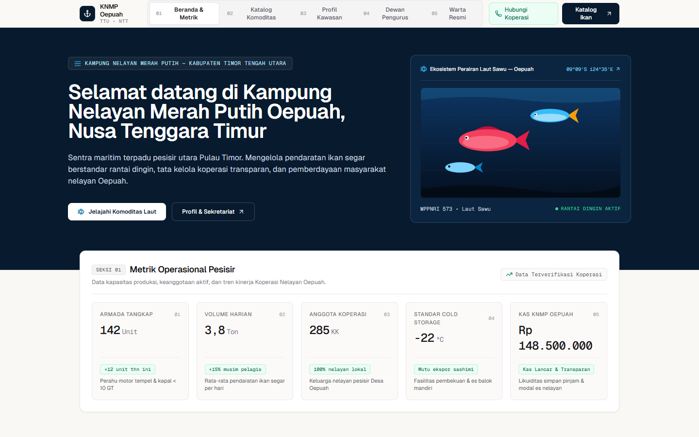
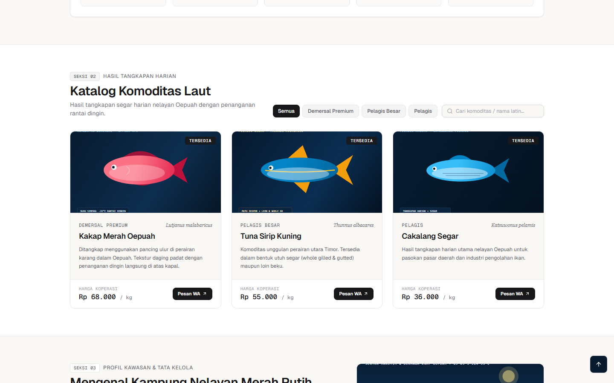
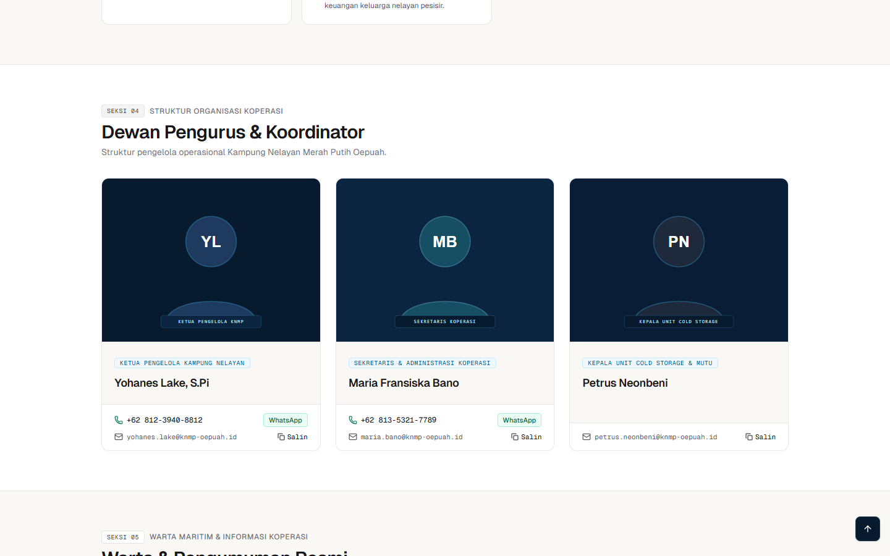
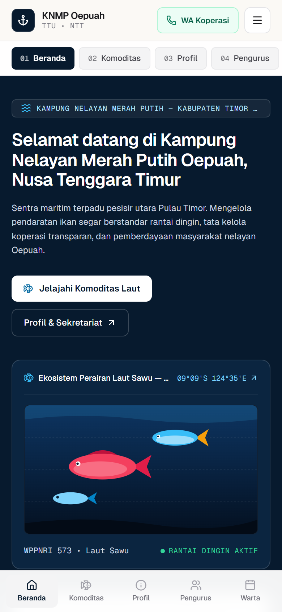
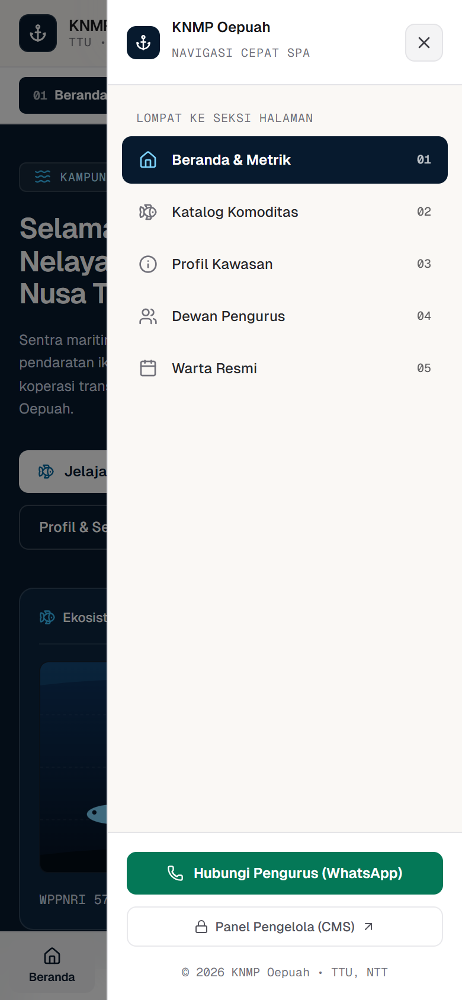
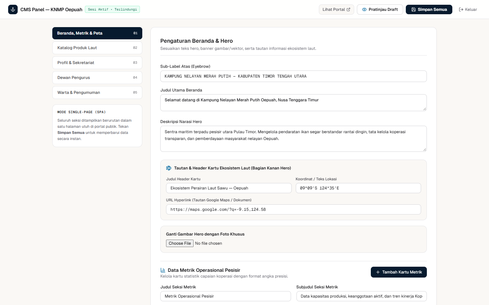

# Portal Maritim & CMS Kampung Nelayan Merah Putih (KNMP) Oepuah

Portal resmi dan sistem manajemen konten (CMS) untuk **Koperasi Kampung Nelayan Merah Putih (KNMP) Oepuah**, Kecamatan Biboki Moenleu, Kabupaten Timor Tengah Utara, Nusa Tenggara Timur.

Aplikasi ini dirancang sebagai **Single-Page Application (SPA)** dengan navigasi gulir halus (*smooth scroll*), tata letak adaptif khusus ponsel (*mobile-first*), serta lapisan keamanan sisi server untuk melindungi panel pengelola koperasi. Dibangun di atas Next.js 14 App Router mode *standalone*, seluruh kontainer produksi hanya membutuhkan sekitar 60 MB RAM pada VPS kecil.

---

## Galeri Visual & Demo Fitur

### 1. Beranda Utama & Metrik Operasional Pesisir (Desktop SPA)
Menampilkan identitas kawasan perairan Laut Sawu (WPPNRI 573), tautan koordinat peta interaktif (`09°09'S 124°35'E`), serta lima kartu metrik operasional koperasi dengan tipografi angka sejajar (`tabular-nums`). Bilah navigasi atas (*sticky top bar*) dilengkapi *scroll-spy* otomatis yang menandai seksi aktif saat pengunjung menggulir halaman ke bawah.



### 2. Katalog Komoditas Laut & Pemesanan Langsung
Pengunjung dapat menyaring hasil tangkapan harian berdasarkan kategori (`Demersal Premium`, `Pelagis Besar`, `Pelagis`) atau mencari nama spesies secara instan. Setiap kartu produk memuat informasi rantai dingin, harga koperasi per kilogram, dan tombol pemesanan langsung ke WhatsApp pengurus.



### 3. Struktur Dewan Pengurus & Warta Resmi
Memuat daftar koordinator koperasi beserta kontak telepon, tautan WhatsApp klik-langsung, dan penyalinan alamat email satu klik. Seksi Warta Resmi di bagian bawah halaman menyajikan maklumat operasional pabrik es balok dan prakiraan gelombang BMKG Maritim.



### 4. Ergonomi Mobile: Bilah Cepat Atas & Dock Navigasi Bawah
Tampilan ponsel dirancang agar nyaman dioperasikan dengan satu tangan. Selain tombol pintas WhatsApp di bagian atas, tersedia bilah pil geser horizontal dan *sticky bottom navigation dock* berisi lima ikon seksi utama (`Beranda`, `Komoditas`, `Profil`, `Pengurus`, `Warta`).

| Tampilan Mobile & Dock Bawah | Laci Navigasi Samping (Slide-Out Drawer) |
| :---: | :---: |
|  |  |

### 5. Panel Pengelola (CMS) Berbasis Sesi Terenkripsi
Pengurus koperasi dapat memperbarui seluruh teks beranda, menambah atau menghapus kartu metrik, memformat harga komoditas secara otomatis, mengunggah foto yang dikompresi di sisi klien, serta meninjau tampilan lewat fitur *Draft Live Preview* sebelum menyimpan ke server.



---

## Arsitektur Keamanan & UI/UX

### Lapisan Keamanan Sisi Server (`src/lib/security.ts` & `src/middleware.ts`)
1. **Otorisasi Server-Side Tanpa Kebocoran Bundel Klien:** Kata sandi admin tidak pernah disimpan di kode JavaScript browser. Verifikasi dilakukan sepenuhnya di server (`POST /api/auth`) menggunakan perbandingan waktu konstan (`crypto.timingSafeEqual`) terhadap nilai SHA-256.
2. **Token Sesi Bertanda Tangan HMAC-SHA256 (`HttpOnly` Cookie):** Setelah login berhasil, server menerbitkan cookie `knmp_admin_session` dengan atribut `HttpOnly`, `SameSite=Strict`, dan masa berlaku 12 jam.
3. **Pembatas Laju Percobaan (*Rate Limiting*):** Mencegah serangan *brute-force* pada endpoint `/api/auth` (maksimal 8 percobaan gagal per 10 menit per alamat IP) dan membatasi frekuensi penulisan pada `/api/cms`.
4. **Sanitasi Input & Validasi Protokol URL:** Seluruh payload CMS dibersihkan dari karakter kontrol ASCII, karakter *zero-width* tersembunyi, serta injeksi tag `<script>`. URL gambar dan tautan divalidasi ketat agar hanya menerima protokol `https:`, `http:`, `mailto:`, `tel:`, path relatif `/`, atau `data:image/*` base64 yang aman.
5. **Penulisan File Atomik (*Atomic File Write*):** Perubahan data disimpan terlebih dahulu ke `data/cms.json.tmp` lalu diganti namanya secara atomik ke `data/cms.json` untuk mencegah kerusakan file saat terjadi akses bersamaan.
6. **Header Keamanan HTTP:** Middleware menyematkan `Content-Security-Policy`, `X-Content-Type-Options: nosniff`, `X-Frame-Options: SAMEORIGIN`, `Referrer-Policy: strict-origin-when-cross-origin`, dan `Permissions-Policy` pada setiap respons.

### Desain Single-Page Application (SPA) & Responsivitas
- **Navigasi Gulir Satu Halaman:** Seluruh lima seksi utama dirender berurutan dalam satu halaman utuh. Klik pada menu atas, pil mobile, laci samping, maupun *bottom dock* akan menggulir layar secara mulus ke seksi tujuan.
- **Tipografi Presisi (`ui-design`):** Menggunakan kombinasi permukaan *Warm Editorial* (`#FAF8F5`) dan *High-Craft Swiss Grid* dengan garis batas struktural `1px`, kontras maritim gelap (`#071A2E`), serta font monospace `tabular-nums` pada seluruh nominal harga, metrik, tanggal, dan koordinat laut.
- **Ilustrasi Vektor Mandiri:** Dilengkapi aset SVG maritim lokal di `public/images/` sehingga seluruh visual komoditas dan pengurus tetap tampil tajam meskipun server berjalan di jaringan lokal tanpa internet.

---

## Peta Arsitektur & Ringkasan Paket Repomix

Repositori ini dikemas menggunakan [Repomix](https://github.com/yamadashy/repomix) (`repomix.config.json`) untuk memudahkan audit kode dan dokumentasi arsitektur.

```text
knmp-oepuah/
├── data/
│   └── cms.json                  # Penyimpanan JSON persisten untuk seluruh konten CMS
├── docs/
│   └── screenshots/              # Tangkapan layar terverifikasi Playwright (Desktop, Mobile, Admin)
├── public/
│   └── images/                   # Ilustrasi SVG komoditas laut, kawasan pesisir, dan pengurus
├── src/
│   ├── app/
│   │   ├── admin/
│   │   │   └── page.tsx          # Panel pengelola CMS dengan Live Preview & kompresi gambar
│   │   ├── api/
│   │   │   ├── auth/
│   │   │   │   └── route.ts      # Endpoint otorisasi HMAC-SHA256 & rate limiter
│   │   │   └── cms/
│   │   │       └── route.ts      # Endpoint baca/tulis CMS tervalidasi
│   │   ├── fonts/                # Font lokal Geist Sans & Geist Mono
│   │   ├── globals.css           # Konfigurasi smooth-scroll & variabel desain
│   │   ├── layout.tsx            # Root layout & metadata SEO bahasa Indonesia
│   │   └── page.tsx              # Portal publik SPA dengan scroll-spy & dock navigasi mobile
│   ├── lib/
│   │   ├── db.ts                 # Pembacaan data & penulisan file atomik cms.json
│   │   └── security.ts           # Utilitas kriptografi, rate limit, dan sanitasi payload
│   ├── types/
│   │   └── cms.ts                # Definisi tipe TypeScript untuk struktur data CMS
│   └── middleware.ts             # Routing subdomain admin & injeksi HTTP security headers
├── Dockerfile                    # Multi-stage Alpine build untuk Next.js standalone
├── docker-compose.yml            # Orkestrasi kontainer dengan volume persisten ./data:/app/data
├── next.config.mjs               # Konfigurasi standalone output & keamanan header
├── package.json                  # Dependensi & skrip npm (termasuk skrip repomix)
└── repomix.config.json           # Konfigurasi bundel konteks kode Repomix
```

| Metrik Paket Repomix | Nilai |
| :--- | :--- |
| **Berkas Konfigurasi** | `repomix.config.json` |
| **Berkas Keluaran** | `repomix-output.md` |
| **Total Berkas Tercakup** | `29` berkas sumber, aset SVG, dan konfigurasi |
| **Total Token & Karakter** | `48.462` token (`202.507` karakter) |
| **Pemeriksaan Keamanan** | Lulus (`enableSecurityCheck: true`, 0 berkas mencurigakan) |
| **Perintah Pembaruan Bundel** | `npm run repomix` atau `npx --yes repomix` |

---

## Panduan Menjalankan Proyek

### 1. Lingkungan Pengembangan Lokal (Node.js)

```bash
# Pasang dependensi
npm install

# Jalankan server pengembangan di http://localhost:3000
npm run dev
```

- **Portal Publik SPA:** `http://localhost:3000`
- **Panel Pengelola (Admin):** `http://localhost:3000/admin` atau `http://admin.localhost:3000`
- **Kata Sandi Default Admin:** `MerahPutih2026` (Dapat diubah melalui variabel lingkungan `ADMIN_PASSWORD` dan `ADMIN_SESSION_SECRET`).

### 2. Deployment Produksi Menggunakan Docker Compose

File `Dockerfile` dan `docker-compose.yml` telah dikonfigurasi menggunakan *multi-stage build* (`node:20-alpine`) dan memetakan port host `3002` ke port kontainer `3000`.

```bash
# Bangun ulang image dan jalankan kontainer di latar belakang
docker compose up -d --build

# Periksa status dan log kontainer
docker compose ps
docker compose logs -f
```

- **Akses Portal Publik:** `http://localhost:3002`
- **Akses Panel Admin:** `http://localhost:3002/admin` atau `http://admin.localhost:3002`
- **Persistensi Data:** Seluruh perubahan konten yang disimpan melalui panel admin langsung ditulis ke folder `./data/cms.json` di mesin host melalui *volume mount* `./data:/app/data`, sehingga data tetap aman meskipun kontainer dibuat ulang.

### 3. Pengaturan Subdomain di VPS / Cloudflare
Middleware di `src/middleware.ts` secara otomatis mendeteksi akses melalui subdomain berawalan `admin.` atau `admin-` (contoh: `admin-oepuah.domainanda.id` atau `admin.knmp-oepuah.id`) dan mengarahkannya secara transparan ke panel pengelola tanpa perlu mengetik `/admin` di akhir URL.
