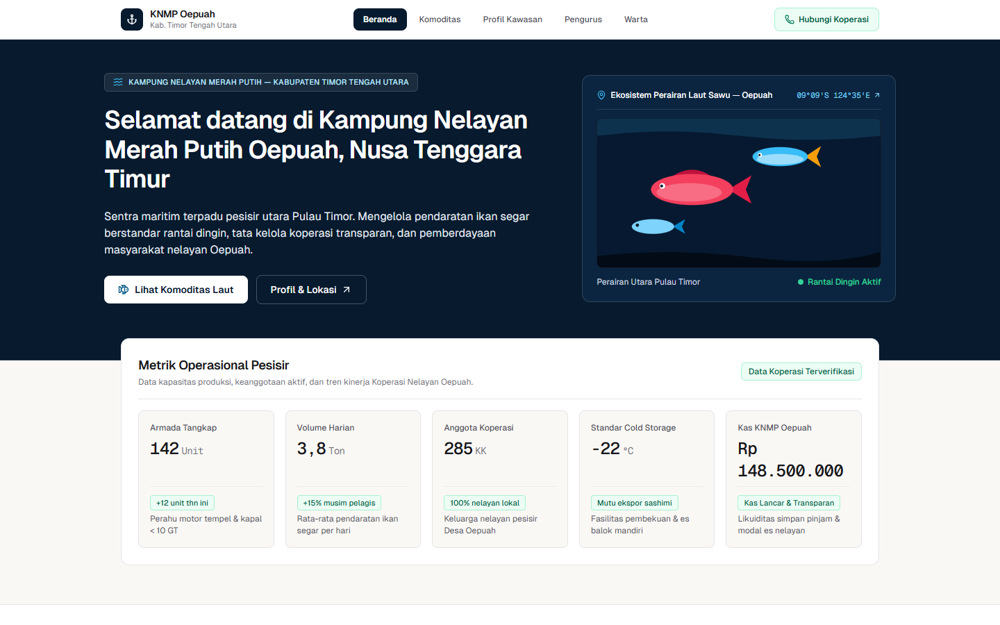
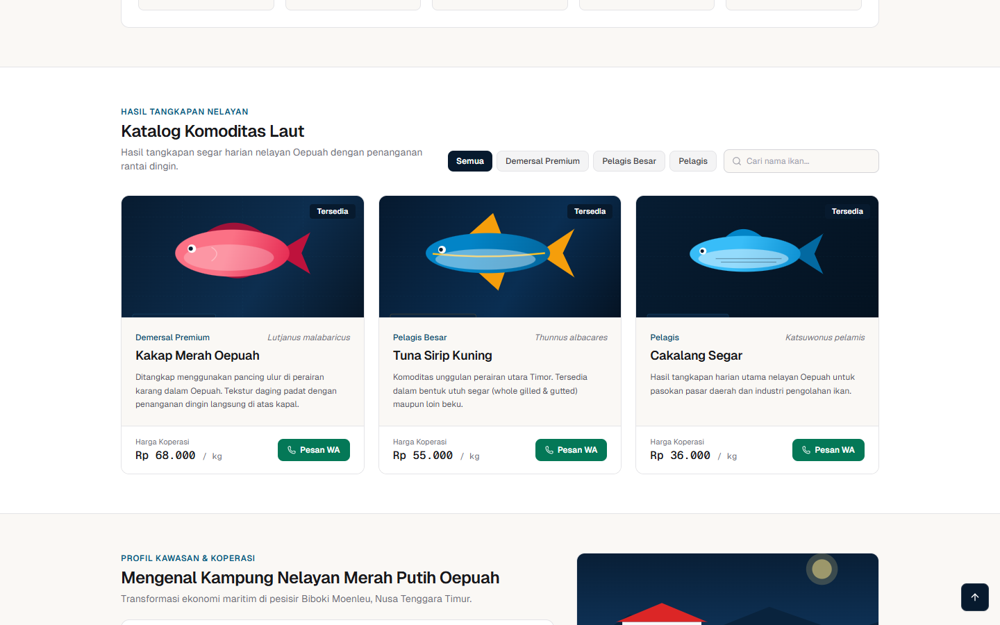
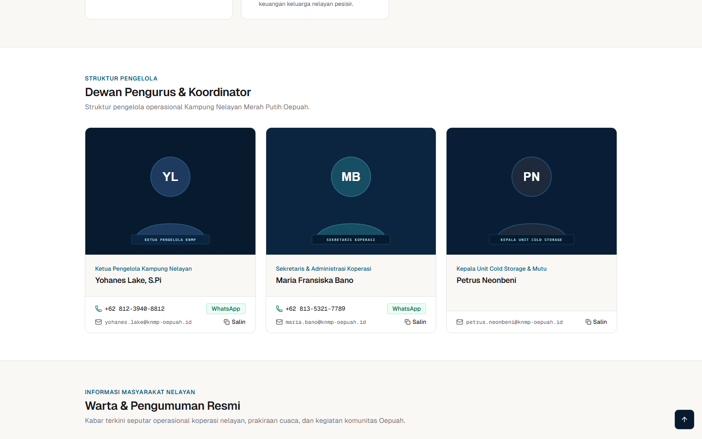
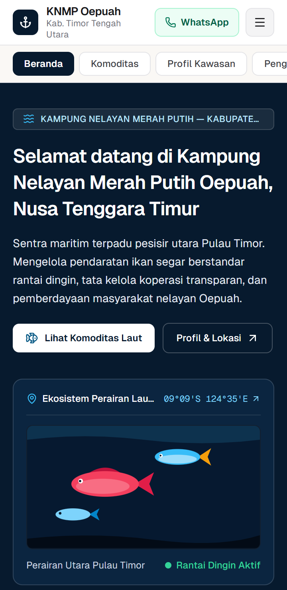
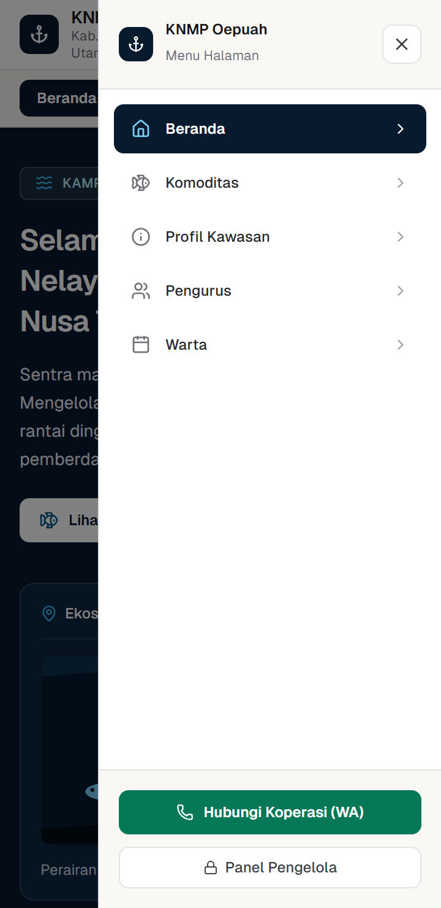
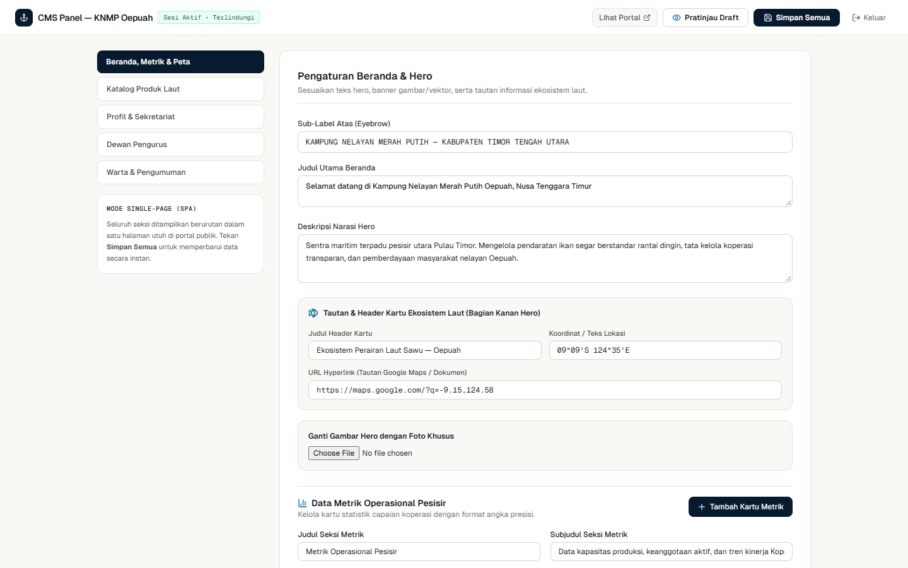

This file is a merged representation of a subset of the codebase, containing specifically included files and files not matching ignore patterns, combined into a single document by Repomix.

# File Summary

## Purpose
This file contains a packed representation of a subset of the repository's contents that is considered the most important context.
It is designed to be easily consumable by AI systems for analysis, code review,
or other automated processes.

## File Format
The content is organized as follows:
1. This summary section
2. Repository information
3. Directory structure
4. Repository files (if enabled)
5. Multiple file entries, each consisting of:
  a. A header with the file path (## File: path/to/file)
  b. The full contents of the file in a code block

## Usage Guidelines
- This file should be treated as read-only. Any changes should be made to the
  original repository files, not this packed version.
- When processing this file, use the file path to distinguish
  between different files in the repository.
- Be aware that this file may contain sensitive information. Handle it with
  the same level of security as you would the original repository.

## Notes
- Some files may have been excluded based on .gitignore rules and Repomix's configuration
- Binary files are not included in this packed representation. Please refer to the Repository Structure section for a complete list of file paths, including binary files
- Only files matching these patterns are included: src/**/*, public/**/*, scripts/**/*, .github/**/*, .gitlab-ci.yml, .eslintrc.json, Dockerfile, docker-compose.yml, next.config.mjs, package.json, tailwind.config.ts, tsconfig.json, README.md
- Files matching these patterns are excluded: node_modules/**, .next/**, dist/**, data/*.tmp, *.db, *.db-journal, .env*, secrets/**, repomix-output.*, docs/screenshots/**
- Files matching patterns in .gitignore are excluded
- Files matching default ignore patterns are excluded
- Files are sorted by Git change count (files with more changes are at the bottom)

# Directory Structure
````
.github/
  workflows/
    deploy.yml
public/
  images/
    cakalang-segar.svg
    kakap-merah.svg
    pengurus-1.svg
    pengurus-2.svg
    pengurus-3.svg
    pesisir-oepuah.svg
    tuna-sirip-kuning.svg
    warta-cold-storage.svg
    warta-gelombang.svg
  .gitkeep
scripts/
  auto-deploy.ps1
  auto-deploy.sh
src/
  app/
    admin/
      page.tsx
    api/
      auth/
        route.ts
      cms/
        route.ts
    fonts/
      GeistMonoVF.woff
      GeistVF.woff
    globals.css
    layout.tsx
    not-found.tsx
    page.tsx
  components/
    MetricSparkline.tsx
  lib/
    db.ts
    security.ts
  types/
    cms.ts
  middleware.ts
.eslintrc.json
.gitlab-ci.yml
docker-compose.yml
Dockerfile
next.config.mjs
package.json
README.md
tailwind.config.ts
tsconfig.json
````

# Files

## File: .github/workflows/deploy.yml
````yaml
name: CI/CD Deploy KNMP Oepuah

on:
  push:
    branches:
      - main
      - master
  workflow_dispatch:

concurrency:
  group: production-deploy-${{ github.ref }}
  cancel-in-progress: false

jobs:
  # 1. Tahap Validasi Lint & Build Next.js
  verify-build:
    name: Verify Lint & Production Build
    runs-on: ubuntu-latest
    steps:
      - name: Checkout Repository
        uses: actions/checkout@v4

      - name: Setup Node.js 20
        uses: actions/setup-node@v4
        with:
          node-version: '20'
          cache: 'npm'

      - name: Install Dependencies
        run: npm ci

      - name: Run ESLint & TypeScript Check
        run: npm run lint

      - name: Build Next.js Standalone
        run: npm run build

  # 2. Tahap Auto-Pull & Rebuild Docker di Server via SSH
  deploy-ssh:
    name: Auto-Pull & Deploy to Server (SSH)
    needs: verify-build
    runs-on: ubuntu-latest
    # Hanya berjalan jika Secret SSH_HOST sudah diisi di GitHub Settings -> Secrets -> Actions
    if: ${{ vars.ENABLE_SSH_DEPLOY != 'false' }}
    steps:
      - name: Deploy to Server via SSH
        env:
          SSH_HOST: ${{ secrets.SSH_HOST }}
          SSH_USER: ${{ secrets.SSH_USER }}
          SSH_PRIVATE_KEY: ${{ secrets.SSH_PRIVATE_KEY }}
          SSH_PORT: ${{ secrets.SSH_PORT || '22' }}
          DEPLOY_PATH: ${{ secrets.DEPLOY_PATH || '~/knmp-oepuah' }}
          BRANCH_NAME: ${{ github.ref_name }}
        run: |
          if [ -z "$SSH_HOST" ] || [ -z "$SSH_USER" ] || [ -z "$SSH_PRIVATE_KEY" ]; then
            echo "Info: Secrets SSH_HOST / SSH_USER / SSH_PRIVATE_KEY belum diatur di GitHub Repository."
            echo "Silakan tambahkan di Settings -> Secrets and variables -> Actions untuk mengaktifkan auto-deploy SSH."
            exit 0
          fi

          mkdir -p ~/.ssh
          echo "$SSH_PRIVATE_KEY" > ~/.ssh/id_deploy
          chmod 600 ~/.ssh/id_deploy
          ssh-keyscan -p "$SSH_PORT" -H "$SSH_HOST" >> ~/.ssh/known_hosts 2>/dev/null

          ssh -i ~/.ssh/id_deploy -p "$SSH_PORT" -o StrictHostKeyChecking=no "$SSH_USER@$SSH_HOST" << EOF
            set -e
            echo "==> Masuk ke direktori project: $DEPLOY_PATH"
            cd $DEPLOY_PATH

            echo "==> Mencadangkan data CMS (data/cms.json) agar perubahan admin tetap aman..."
            if [ -f data/cms.json ]; then
              cp data/cms.json /tmp/knmp_cms_backup.json
            fi

            echo "==> Menarik pembaruan terbaru dari branch $BRANCH_NAME..."
            git fetch --all
            git reset --hard origin/$BRANCH_NAME

            if [ -f /tmp/knmp_cms_backup.json ]; then
              mkdir -p data
              cp /tmp/knmp_cms_backup.json data/cms.json
              rm -f /tmp/knmp_cms_backup.json
            fi

            echo "==> Membangun ulang & menjalankan container Docker..."
            docker compose up -d --build --remove-orphans
            docker image prune -f

            echo "==> Deployment selesai!"
            docker compose ps
          EOF
````

## File: public/images/cakalang-segar.svg
````xml
<svg xmlns="http://www.w3.org/2000/svg" viewBox="0 0 700 460" fill="none">
  <defs>
    <linearGradient id="bg3" x1="0" y1="0" x2="700" y2="460" gradientUnits="userSpaceOnUse">
      <stop offset="0%" stop-color="#071D33"/>
      <stop offset="100%" stop-color="#041220"/>
    </linearGradient>
    <linearGradient id="skipjack" x1="140" y1="140" x2="500" y2="260" gradientUnits="userSpaceOnUse">
      <stop offset="0%" stop-color="#38BDF8"/>
      <stop offset="60%" stop-color="#0284C7"/>
      <stop offset="100%" stop-color="#0F172A"/>
    </linearGradient>
  </defs>
  <rect width="700" height="460" fill="url(#bg3)"/>
  <g stroke="#38BDF8" stroke-opacity="0.08" stroke-dasharray="4 6">
    <line x1="0" y1="115" x2="700" y2="115"/>
    <line x1="0" y1="230" x2="700" y2="230"/>
    <line x1="0" y1="345" x2="700" y2="345"/>
  </g>
  <text x="32" y="42" fill="#7DD3FC" font-family="monospace" font-size="13" letter-spacing="2">PELAGIS HARIAN • KATSUWONUS PELAMIS</text>
  <g transform="translate(135, 140)">
    <path d="M315 82 L405 24 L380 82 L405 140 Z" fill="#0369A1"/>
    <path d="M125 32 Q175 -12 230 34 Z" fill="#0284C7"/>
    <ellipse cx="180" cy="82" rx="160" ry="52" fill="url(#skipjack)"/>
    <ellipse cx="175" cy="96" rx="130" ry="28" fill="#F0F9FF" fill-opacity="0.5"/>
    <path d="M95 96 L285 96" stroke="#071A2E" stroke-opacity="0.35" stroke-width="2.5"/>
    <path d="M110 106 L270 106" stroke="#071A2E" stroke-opacity="0.35" stroke-width="2.5"/>
    <circle cx="58" cy="74" r="10" fill="#FFFFFF"/>
    <circle cx="56" cy="74" r="5" fill="#071A2E"/>
  </g>
  <rect x="32" y="396" width="235" height="32" rx="6" fill="#0B2540" stroke="#38BDF8" stroke-opacity="0.25"/>
  <text x="46" y="417" fill="#E0F2FE" font-family="monospace" font-size="12">TANGKAPAN HARIAN • SEGAR</text>
</svg>
````

## File: public/images/kakap-merah.svg
````xml
<svg xmlns="http://www.w3.org/2000/svg" viewBox="0 0 700 460" fill="none">
  <defs>
    <linearGradient id="bg1" x1="0" y1="0" x2="700" y2="460" gradientUnits="userSpaceOnUse">
      <stop offset="0%" stop-color="#071A2E"/>
      <stop offset="60%" stop-color="#0D2E4F"/>
      <stop offset="100%" stop-color="#061423"/>
    </linearGradient>
    <linearGradient id="snapper" x1="150" y1="150" x2="520" y2="280" gradientUnits="userSpaceOnUse">
      <stop offset="0%" stop-color="#FB7185"/>
      <stop offset="55%" stop-color="#E11D48"/>
      <stop offset="100%" stop-color="#9F1239"/>
    </linearGradient>
  </defs>
  <rect width="700" height="460" fill="url(#bg1)"/>
  <g stroke="#38BDF8" stroke-opacity="0.08" stroke-dasharray="4 6">
    <line x1="0" y1="115" x2="700" y2="115"/>
    <line x1="0" y1="230" x2="700" y2="230"/>
    <line x1="0" y1="345" x2="700" y2="345"/>
    <line x1="175" y1="0" x2="175" y2="460"/>
    <line x1="350" y1="0" x2="350" y2="460"/>
    <line x1="525" y1="0" x2="525" y2="460"/>
  </g>
  <text x="32" y="42" fill="#7DD3FC" font-family="monospace" font-size="13" letter-spacing="2">KOMODITAS DEMERSAL • WPPNRI 573</text>
  <g transform="translate(135, 125)">
    <path d="M310 95 L410 35 L385 95 L410 155 Z" fill="#BE123C"/>
    <path d="M105 38 Q190 -24 275 38 Z" fill="#9F1239"/>
    <path d="M140 150 Q205 188 265 145 Z" fill="#9F1239"/>
    <ellipse cx="185" cy="95" rx="165" ry="68" fill="url(#snapper)"/>
    <ellipse cx="175" cy="108" rx="130" ry="38" fill="#FFE4E6" fill-opacity="0.32"/>
    <path d="M125 78 Q155 95 125 118" stroke="#FFE4E6" stroke-opacity="0.45" stroke-width="3" fill="none"/>
    <circle cx="68" cy="82" r="12" fill="#FFFFFF"/>
    <circle cx="65" cy="82" r="6" fill="#071A2E"/>
  </g>
  <rect x="32" y="396" width="240" height="32" rx="6" fill="#0B2540" stroke="#38BDF8" stroke-opacity="0.25"/>
  <text x="46" y="417" fill="#E0F2FE" font-family="monospace" font-size="12">SUHU SIMPAN: -22°C RANTAI DINGIN</text>
</svg>
````

## File: public/images/pengurus-1.svg
````xml
<svg xmlns="http://www.w3.org/2000/svg" viewBox="0 0 500 375" fill="none">
  <rect width="500" height="375" fill="#071A2E"/>
  <circle cx="250" cy="145" r="58" fill="#1E3A5F" stroke="#38BDF8" stroke-opacity="0.35" stroke-width="2"/>
  <path d="M145 335 C145 265 355 265 355 335" fill="#1E3A5F" stroke="#38BDF8" stroke-opacity="0.35" stroke-width="2"/>
  <text x="250" y="158" text-anchor="middle" fill="#FFFFFF" font-family="sans-serif" font-weight="700" font-size="36">YL</text>
  <rect x="135" y="315" width="230" height="28" rx="6" fill="#0B2540" stroke="#38BDF8" stroke-opacity="0.25"/>
  <text x="250" y="333" text-anchor="middle" fill="#BAE6FD" font-family="monospace" font-size="11" letter-spacing="1.5">KETUA PENGELOLA KNMP</text>
</svg>
````

## File: public/images/pengurus-2.svg
````xml
<svg xmlns="http://www.w3.org/2000/svg" viewBox="0 0 500 375" fill="none">
  <rect width="500" height="375" fill="#0B2540"/>
  <circle cx="250" cy="145" r="58" fill="#164E63" stroke="#7DD3FC" stroke-opacity="0.35" stroke-width="2"/>
  <path d="M145 335 C145 265 355 265 355 335" fill="#164E63" stroke="#7DD3FC" stroke-opacity="0.35" stroke-width="2"/>
  <text x="250" y="158" text-anchor="middle" fill="#FFFFFF" font-family="sans-serif" font-weight="700" font-size="36">MB</text>
  <rect x="135" y="315" width="230" height="28" rx="6" fill="#071A2E" stroke="#7DD3FC" stroke-opacity="0.25"/>
  <text x="250" y="333" text-anchor="middle" fill="#BAE6FD" font-family="monospace" font-size="11" letter-spacing="1.5">SEKRETARIS KOPERASI</text>
</svg>
````

## File: public/images/pengurus-3.svg
````xml
<svg xmlns="http://www.w3.org/2000/svg" viewBox="0 0 500 375" fill="none">
  <rect width="500" height="375" fill="#091E36"/>
  <circle cx="250" cy="145" r="58" fill="#1E293B" stroke="#38BDF8" stroke-opacity="0.35" stroke-width="2"/>
  <path d="M145 335 C145 265 355 265 355 335" fill="#1E293B" stroke="#38BDF8" stroke-opacity="0.35" stroke-width="2"/>
  <text x="250" y="158" text-anchor="middle" fill="#FFFFFF" font-family="sans-serif" font-weight="700" font-size="36">PN</text>
  <rect x="125" y="315" width="250" height="28" rx="6" fill="#071A2E" stroke="#38BDF8" stroke-opacity="0.25"/>
  <text x="250" y="333" text-anchor="middle" fill="#BAE6FD" font-family="monospace" font-size="11" letter-spacing="1.5">KEPALA UNIT COLD STORAGE</text>
</svg>
````

## File: public/images/pesisir-oepuah.svg
````xml
<svg xmlns="http://www.w3.org/2000/svg" viewBox="0 0 800 520" fill="none">
  <defs>
    <linearGradient id="sky" x1="0" y1="0" x2="0" y2="300" gradientUnits="userSpaceOnUse">
      <stop offset="0%" stop-color="#071A2E"/>
      <stop offset="100%" stop-color="#0F355C"/>
    </linearGradient>
    <linearGradient id="sea" x1="0" y1="300" x2="0" y2="520" gradientUnits="userSpaceOnUse">
      <stop offset="0%" stop-color="#0284C7"/>
      <stop offset="100%" stop-color="#061629"/>
    </linearGradient>
  </defs>
  <rect width="800" height="310" fill="url(#sky)"/>
  <rect y="310" width="800" height="210" fill="url(#sea)"/>
  <circle cx="650" cy="95" r="42" fill="#FDE68A" fill-opacity="0.2"/>
  <circle cx="650" cy="95" r="26" fill="#FDE68A" fill-opacity="0.5"/>
  <!-- Bukit Pesisir Timor -->
  <path d="M0 310 L140 215 L310 275 L510 195 L710 265 L800 235 L800 310 Z" fill="#09233D"/>
  <!-- Bangunan Sentra Koperasi & Cold Storage -->
  <rect x="120" y="235" width="210" height="75" fill="#F8FAFC"/>
  <polygon points="105,235 225,185 345,235" fill="#DC2626"/>
  <rect x="145" y="255" width="38" height="32" fill="#0F355C"/>
  <rect x="205" y="255" width="42" height="55" fill="#071A2E"/>
  <rect x="268" y="255" width="38" height="32" fill="#0F355C"/>
  <!-- Dermaga & Kapal Nelayan -->
  <rect x="330" y="296" width="240" height="14" fill="#CBD5E1"/>
  <g transform="translate(470, 265)">
    <path d="M0 35 L145 35 L125 60 L20 60 Z" fill="#F8FAFC"/>
    <path d="M8 35 L137 35 L132 43 L13 43 Z" fill="#E11D48"/>
    <rect x="45" y="10" width="46" height="25" rx="3" fill="#E2E8F0"/>
    <line x1="68" y1="-15" x2="68" y2="10" stroke="#F8FAFC" stroke-width="3"/>
  </g>
  <text x="36" y="46" fill="#E0F2FE" font-family="monospace" font-size="14" letter-spacing="2">SENTRA MARITIM &amp; DERMAGA KNMP OEPUAH • 09°09'S 124°35'E</text>
</svg>
````

## File: public/images/tuna-sirip-kuning.svg
````xml
<svg xmlns="http://www.w3.org/2000/svg" viewBox="0 0 700 460" fill="none">
  <defs>
    <linearGradient id="bg2" x1="0" y1="0" x2="700" y2="460" gradientUnits="userSpaceOnUse">
      <stop offset="0%" stop-color="#06182C"/>
      <stop offset="60%" stop-color="#0A2E52"/>
      <stop offset="100%" stop-color="#04101E"/>
    </linearGradient>
    <linearGradient id="tuna" x1="120" y1="130" x2="540" y2="270" gradientUnits="userSpaceOnUse">
      <stop offset="0%" stop-color="#0284C7"/>
      <stop offset="50%" stop-color="#0369A1"/>
      <stop offset="100%" stop-color="#1E3A8A"/>
    </linearGradient>
  </defs>
  <rect width="700" height="460" fill="url(#bg2)"/>
  <g stroke="#38BDF8" stroke-opacity="0.08" stroke-dasharray="4 6">
    <line x1="0" y1="115" x2="700" y2="115"/>
    <line x1="0" y1="230" x2="700" y2="230"/>
    <line x1="0" y1="345" x2="700" y2="345"/>
  </g>
  <text x="32" y="42" fill="#FDE68A" font-family="monospace" font-size="13" letter-spacing="2">PELAGIS BESAR • THUNNUS ALBACARES</text>
  <g transform="translate(120, 130)">
    <path d="M340 90 L445 20 L412 90 L445 160 Z" fill="#F59E0B"/>
    <path d="M140 36 L210 -26 L235 38 Z" fill="#F59E0B"/>
    <path d="M165 144 L225 198 L245 142 Z" fill="#F59E0B"/>
    <ellipse cx="195" cy="90" rx="180" ry="58" fill="url(#tuna)"/>
    <path d="M35 92 Q195 108 360 90" stroke="#FBBF24" stroke-width="5" fill="none"/>
    <ellipse cx="188" cy="108" rx="145" ry="30" fill="#E0F2FE" fill-opacity="0.45"/>
    <circle cx="62" cy="80" r="11" fill="#FFFFFF"/>
    <circle cx="59" cy="80" r="5.5" fill="#071A2E"/>
  </g>
  <rect x="32" y="396" width="248" height="32" rx="6" fill="#0B2540" stroke="#F59E0B" stroke-opacity="0.35"/>
  <text x="46" y="417" fill="#FEF3C7" font-family="monospace" font-size="12">MUTU EKSPOR • LOIN &amp; WHOLE GG</text>
</svg>
````

## File: public/images/warta-cold-storage.svg
````xml
<svg xmlns="http://www.w3.org/2000/svg" viewBox="0 0 800 440" fill="none">
  <rect width="800" height="440" fill="#071A2E"/>
  <g stroke="#38BDF8" stroke-opacity="0.1" stroke-dasharray="4 6">
    <line x1="0" y1="110" x2="800" y2="110"/>
    <line x1="0" y1="220" x2="800" y2="220"/>
    <line x1="0" y1="330" x2="800" y2="330"/>
  </g>
  <rect x="160" y="110" width="480" height="220" rx="14" fill="#0D2847" stroke="#38BDF8" stroke-opacity="0.35" stroke-width="2"/>
  <text x="400" y="185" text-anchor="middle" fill="#38BDF8" font-family="monospace" font-weight="700" font-size="44">-22.0 °C</text>
  <text x="400" y="230" text-anchor="middle" fill="#FFFFFF" font-family="sans-serif" font-weight="600" font-size="20">INSTALASI RANTAI DINGIN &amp; PABRIK ES BALOK</text>
  <text x="400" y="265" text-anchor="middle" fill="#94A3B8" font-family="monospace" font-size="13">DISTRIBUSI PAGI 04:30 WITA • SORE 16:00 WITA</text>
</svg>
````

## File: public/images/warta-gelombang.svg
````xml
<svg xmlns="http://www.w3.org/2000/svg" viewBox="0 0 800 440" fill="none">
  <rect width="800" height="440" fill="#061526"/>
  <path d="M0 260 Q100 220 200 260 T400 260 T600 260 T800 260 L800 440 L0 440 Z" fill="#0C2E52"/>
  <path d="M0 310 Q100 275 200 310 T400 310 T600 310 T800 310 L800 440 L0 440 Z" fill="#0284C7" fill-opacity="0.35"/>
  <text x="400" y="135" text-anchor="middle" fill="#38BDF8" font-family="monospace" font-size="14" letter-spacing="2">BMKG MARITIM TENAU KUPANG • PERAIRAN UTARA TIMOR</text>
  <text x="400" y="185" text-anchor="middle" fill="#FFFFFF" font-family="sans-serif" font-weight="700" font-size="34">GELOMBANG 0,5 – 1,25 METER</text>
  <text x="400" y="222" text-anchor="middle" fill="#34D399" font-family="monospace" font-size="15">STATUS: KONDUSIF UNTUK ARMADA &lt; 10 GT (ANGIN 10–15 KNOT)</text>
</svg>
````

## File: public/.gitkeep
````
# Public assets directory
````

## File: scripts/auto-deploy.ps1
````powershell
# Skrip Auto-Pull & Rebuild Docker untuk Server Windows (PowerShell)
# Cocok untuk server dengan IP lokal/privat yang menjalankan Docker Desktop di Windows.
# Jalankan di terminal: .\scripts\auto-deploy.ps1

param(
  [string]$Branch = "main",
  [int]$IntervalSeconds = 30
)

Write-Host "==> Memantau repositori Git (branch: $Branch) setiap $IntervalSeconds detik..." -ForegroundColor Cyan

while ($true) {
  git fetch origin $Branch --quiet
  $localHash = (git rev-parse HEAD).Trim()
  $remoteHash = (git rev-parse "origin/$Branch").Trim()

  if ($localHash -ne $remoteHash) {
    $timestamp = Get-Date -Format "yyyy-MM-dd HH:mm:ss"
    Write-Host "[$timestamp] Push baru terdeteksi ($localHash -> $remoteHash). Menarik kode & rebuild Docker..." -ForegroundColor Green

    if (Test-Path "data\cms.json") {
      Copy-Item "data\cms.json" "$env:TEMP\knmp_cms_backup.json" -Force
    }

    git reset --hard "origin/$Branch"

    if (Test-Path "$env:TEMP\knmp_cms_backup.json") {
      New-Item -ItemType Directory -Force -Path "data" | Out-Null
      Copy-Item "$env:TEMP\knmp_cms_backup.json" "data\cms.json" -Force
    }

    docker compose up -d --build --remove-orphans
    docker image prune -f
    Write-Host "[$timestamp] Container berhasil diperbarui!" -ForegroundColor Green
  }

  Start-Sleep -Seconds $IntervalSeconds
}
````

## File: scripts/auto-deploy.sh
````bash
#!/usr/bin/env bash
# Skrip Auto-Pull & Rebuild Docker untuk Server Linux / VPS (termasuk IP Privat / Lokal)
# Cara pakai otomatis (cron tiap 1 menit):
# * * * * * cd /path/to/knmp-oepuah && ./scripts/auto-deploy.sh >> /var/log/knmp-deploy.log 2>&1

set -e

BRANCH="${1:-main}"

git fetch origin "$BRANCH" --quiet
LOCAL_HASH=$(git rev-parse HEAD)
REMOTE_HASH=$(git rev-parse "origin/$BRANCH")

if [ "$LOCAL_HASH" != "$REMOTE_HASH" ]; then
  echo "[$(date -Iseconds)] Pembaruan terdeteksi ($LOCAL_HASH -> $REMOTE_HASH). Memulai auto-deploy..."

  if [ -f data/cms.json ]; then
    cp data/cms.json /tmp/knmp_cms_backup.json
  fi

  git reset --hard "origin/$BRANCH"

  if [ -f /tmp/knmp_cms_backup.json ]; then
    mkdir -p data
    cp /tmp/knmp_cms_backup.json data/cms.json
    rm -f /tmp/knmp_cms_backup.json
  fi

  docker compose up -d --build --remove-orphans
  docker image prune -f
  echo "[$(date -Iseconds)] Auto-deploy selesai!"
fi
````

## File: src/app/api/auth/route.ts
````typescript
import { NextRequest, NextResponse } from 'next/server';
import {
  checkRateLimit,
  createAdminSessionToken,
  resetRateLimit,
  verifyAdminPassword,
  verifyAdminSessionToken,
} from '@/lib/security';

export const dynamic = 'force-dynamic';

const COOKIE_NAME = 'knmp_admin_session';

function getClientIp(req: NextRequest): string {
  const forwarded = req.headers.get('x-forwarded-for');
  if (forwarded) {
    return forwarded.split(',')[0].trim();
  }
  return req.headers.get('x-real-ip') || '127.0.0.1';
}

export async function GET(req: NextRequest) {
  const sessionCookie = req.cookies.get(COOKIE_NAME)?.value;
  const authenticated = verifyAdminSessionToken(sessionCookie);
  return NextResponse.json(
    { authenticated },
    {
      status: 200,
      headers: { 'Cache-Control': 'no-store, max-age=0' },
    }
  );
}

export async function POST(req: NextRequest) {
  const ip = getClientIp(req);
  const rateLimitKey = `auth:${ip}`;
  const rate = checkRateLimit(rateLimitKey, 8, 10 * 60 * 1000);

  if (!rate.allowed) {
    return NextResponse.json(
      {
        error: `Terlalu banyak percobaan login. Silakan tunggu ${rate.retryAfterSeconds} detik.`,
      },
      {
        status: 429,
        headers: { 'Retry-After': String(rate.retryAfterSeconds) },
      }
    );
  }

  try {
    const body = (await req.json()) as { password?: string };
    const password = typeof body?.password === 'string' ? body.password : '';

    if (!verifyAdminPassword(password)) {
      return NextResponse.json(
        {
          error: 'Kata sandi otorisasi tidak valid.',
          remainingAttempts: rate.remaining,
        },
        { status: 401 }
      );
    }

    resetRateLimit(rateLimitKey);
    const token = createAdminSessionToken();

    const response = NextResponse.json({
      authenticated: true,
      message: 'Otorisasi berhasil.',
    });

    response.cookies.set({
      name: COOKIE_NAME,
      value: token,
      httpOnly: true,
      sameSite: 'strict',
      secure: process.env.NODE_ENV === 'production' && req.nextUrl.protocol === 'https:',
      path: '/',
      maxAge: 60 * 60 * 12, // 12 jam
    });

    return response;
  } catch {
    return NextResponse.json({ error: 'Format permintaan tidak valid.' }, { status: 400 });
  }
}

export async function DELETE() {
  const response = NextResponse.json({ authenticated: false, message: 'Sesi diakhiri.' });
  response.cookies.delete(COOKIE_NAME);
  return response;
}
````

## File: src/app/not-found.tsx
````typescript
import Link from 'next/link';

export default function NotFound() {
  return (
    <div className="min-h-screen bg-[#F5F5F7] flex items-center justify-center px-4 font-sans text-[#1D1D1F]">
      <div className="max-w-md w-full bg-white rounded-2xl p-8 border border-black/[0.08] shadow-sm text-center">
        <span className="text-4xl font-bold text-[#0071E3] block mb-2">404</span>
        <h1 className="text-xl font-semibold mb-2">Halaman Tidak Ditemukan</h1>
        <p className="text-xs text-[#86868B] mb-6">
          Halaman yang Anda tuju tidak tersedia atau telah dipindahkan.
        </p>
        <Link
          href="/"
          className="inline-flex items-center justify-center px-5 py-2.5 rounded-full text-xs font-medium text-white bg-[#0071E3] hover:bg-[#0077ED] transition-colors"
        >
          Kembali ke Beranda
        </Link>
      </div>
    </div>
  );
}
````

## File: src/components/MetricSparkline.tsx
````typescript
'use client';

import React from 'react';

// Helper generator titik angka grafik tren secara 100% otomatis dari Nilai Utama
export function getAutoChartPoints(
  valueStr: string,
  pattern: 'up' | 'stable' | 'wave' = 'up',
  manualPoints?: number[]
): number[] {
  if (manualPoints && manualPoints.length >= 2) return manualPoints;
  const cleanStr = (valueStr || '').replace(',', '.');
  const match = cleanStr.match(/-?\d+(\.\d+)?/);
  const baseNum = match ? parseFloat(match[0]) : 100;
  const absNum = Math.abs(baseNum) || 100;
  const isNegative = baseNum < 0;

  if (pattern === 'stable') {
    const factors = [0.98, 1.01, 0.99, 1.02, 0.99, 1.01, 1.0];
    return factors.map((f) => (isNegative ? -Math.abs(absNum * f) : Number((absNum * f).toFixed(1))));
  }
  if (pattern === 'wave') {
    const factors = [0.78, 1.12, 0.85, 1.18, 0.92, 1.08, 1.0];
    return factors.map((f) => (isNegative ? -Math.abs(absNum * f) : Number((absNum * f).toFixed(1))));
  }
  // 'up'
  const factors = [0.68, 0.75, 0.82, 0.88, 0.91, 0.96, 1.0];
  return factors.map((f) => (isNegative ? -Math.abs(absNum * f) : Number((absNum * f).toFixed(1))));
}

// Helper component untuk merender Sparkline SVG dinamis otomatis
export function MetricSparkline({
  value,
  pattern = 'up',
  points,
  color = '#0071E3',
  id,
}: {
  value: string;
  pattern?: 'up' | 'stable' | 'wave';
  points?: number[];
  color?: string;
  id: string;
}) {
  const data = getAutoChartPoints(value, pattern, points);
  const width = 160;
  const height = 40;
  const min = Math.min(...data);
  const max = Math.max(...data);
  const range = max - min || 1;

  const coords = data.map((val, idx) => {
    const x = (idx / (data.length - 1)) * width;
    const y = height - ((val - min) / range) * (height - 10) - 5;
    return `${x.toFixed(1)},${y.toFixed(1)}`;
  });

  const pathD = `M ${coords.join(' L ')}`;
  const gradId = `sparkGrad-${id}`;

  return (
    <div className="w-full h-10 mt-3 overflow-hidden">
      <svg viewBox={`0 0 ${width} ${height}`} className="w-full h-full overflow-visible">
        <defs>
          <linearGradient id={gradId} x1="0" y1="0" x2="0" y2="1">
            <stop offset="0%" stopColor={color} stopOpacity="0.25" />
            <stop offset="100%" stopColor={color} stopOpacity="0.0" />
          </linearGradient>
        </defs>
        {/* Area fill */}
        <path d={`M ${coords.join(' L ')} L ${width},${height} L 0,${height} Z`} fill={`url(#${gradId})`} />
        {/* Line stroke */}
        <path d={pathD} fill="none" stroke={color} strokeWidth="2" strokeLinecap="round" strokeLinejoin="round" />
        {/* Dot on the latest point */}
        {coords.length > 0 && (
          <circle
            cx={coords[coords.length - 1].split(',')[0]}
            cy={coords[coords.length - 1].split(',')[1]}
            r="3"
            fill={color}
          />
        )}
      </svg>
    </div>
  );
}
````

## File: src/lib/security.ts
````typescript
import crypto from 'crypto';
import { CmsData, StatItem, PengurusItem, ProductItem, AnnouncementItem } from '@/types/cms';

const DEFAULT_ADMIN_PASS = 'MerahPutih2026';
const SESSION_TTL_MS = 1000 * 60 * 60 * 12; // 12 jam

function getAdminPassword(): string {
  return process.env.ADMIN_PASSWORD || DEFAULT_ADMIN_PASS;
}

function getSessionSecret(): string {
  return (
    process.env.ADMIN_SESSION_SECRET ||
    crypto.createHash('sha256').update(`knmp-oepuah-secret:${getAdminPassword()}`).digest('hex')
  );
}

/**
 * Perbandingan string secara constant-time untuk mencegah timing side-channel attack.
 */
export function verifyAdminPassword(candidate: string): boolean {
  if (!candidate || typeof candidate !== 'string') return false;
  const expectedHash = crypto.createHash('sha256').update(getAdminPassword()).digest();
  const candidateHash = crypto.createHash('sha256').update(candidate).digest();
  return crypto.timingSafeEqual(expectedHash, candidateHash);
}

/**
 * Membuat token sesi admin bertanda tangan HMAC-SHA256.
 */
export function createAdminSessionToken(): string {
  const payload = {
    role: 'knmp_admin',
    iat: Date.now(),
    exp: Date.now() + SESSION_TTL_MS,
    nonce: crypto.randomBytes(8).toString('hex'),
  };
  const payloadB64 = Buffer.from(JSON.stringify(payload)).toString('base64url');
  const signature = crypto
    .createHmac('sha256', getSessionSecret())
    .update(payloadB64)
    .digest('base64url');
  return `${payloadB64}.${signature}`;
}

/**
 * Memverifikasi token sesi admin HMAC-SHA256 secara constant-time.
 */
export function verifyAdminSessionToken(token?: string | null): boolean {
  if (!token || typeof token !== 'string' || !token.includes('.')) return false;
  const [payloadB64, signature] = token.split('.');
  if (!payloadB64 || !signature) return false;

  const expectedSig = crypto
    .createHmac('sha256', getSessionSecret())
    .update(payloadB64)
    .digest('base64url');

  const sigHash = crypto.createHash('sha256').update(signature).digest();
  const expectedHash = crypto.createHash('sha256').update(expectedSig).digest();

  if (!crypto.timingSafeEqual(sigHash, expectedHash)) {
    return false;
  }

  try {
    const decoded = JSON.parse(Buffer.from(payloadB64, 'base64url').toString('utf-8')) as {
      role?: string;
      exp?: number;
    };
    if (decoded.role !== 'knmp_admin') return false;
    if (typeof decoded.exp !== 'number' || Date.now() > decoded.exp) return false;
    return true;
  } catch {
    return false;
  }
}

/**
 * In-memory Rate Limiter untuk melindungi endpoint login & mutasi CMS dari brute-force.
 */
interface RateBucket {
  count: number;
  resetAt: number;
}

const rateBuckets = new Map<string, RateBucket>();

export function checkRateLimit(
  key: string,
  maxAttempts = 10,
  windowMs = 10 * 60 * 1000
): { allowed: boolean; remaining: number; retryAfterSeconds: number } {
  const now = Date.now();
  const existing = rateBuckets.get(key);

  if (!existing || now > existing.resetAt) {
    rateBuckets.set(key, { count: 1, resetAt: now + windowMs });
    return { allowed: true, remaining: maxAttempts - 1, retryAfterSeconds: 0 };
  }

  if (existing.count >= maxAttempts) {
    const retryAfterSeconds = Math.max(1, Math.ceil((existing.resetAt - now) / 1000));
    return { allowed: false, remaining: 0, retryAfterSeconds };
  }

  existing.count += 1;
  return {
    allowed: true,
    remaining: Math.max(0, maxAttempts - existing.count),
    retryAfterSeconds: 0,
  };
}

export function resetRateLimit(key: string): void {
  rateBuckets.delete(key);
}

/**
 * Sanitasi teks untuk menghapus karakter kontrol berbahaya, invisible zero-width chars,
 * dan injeksi tag script/event handler.
 */
export function sanitizeText(input: unknown, maxLength = 4000): string {
  if (typeof input !== 'string') return '';
  return input
    // Hapus karakter kontrol ASCII (kecuali newline \n dan tab \t)
    .replace(/[\u0000-\u0008\u000B\u000C\u000E-\u001F\u007F]/g, '')
    // Hapus karakter zero-width / bidi override tersembunyi
    .replace(/[\u200B-\u200F\u202A-\u202E\u2060-\u206F\uFEFF]/g, '')
    // Hapus injeksi tag script
    .replace(/<\s*\/?\s*script\b[^>]*>/gi, '')
    .trim()
    .slice(0, maxLength);
}

/**
 * Sanitasi URL gambar atau tautan agar hanya mengizinkan protokol aman
 * (https:, http:, mailto:, tel:, path relatif /, atau data:image/* base64 non-SVG).
 */
export function sanitizeUrl(input: unknown, maxLength = 1500000): string {
  if (typeof input !== 'string') return '';
  const trimmed = input.trim().slice(0, maxLength);
  if (!trimmed) return '';

  if (/^data:image\/(jpeg|jpg|png|webp|gif);base64,[a-zA-Z0-9+/=\s]+$/i.test(trimmed)) {
    return trimmed;
  }

  if (trimmed.startsWith('/')) {
    return trimmed.replace(/[\u0000-\u001F<>"]/g, '');
  }

  try {
    const parsed = new URL(trimmed);
    const allowedProtocols = ['http:', 'https:', 'mailto:', 'tel:'];
    if (!allowedProtocols.includes(parsed.protocol)) {
      return '';
    }
    return trimmed;
  } catch {
    return '';
  }
}

/**
 * Validasi dan sanitasi menyeluruh pada objek CmsData sebelum disimpan ke disk.
 */
export function sanitizeCmsPayload(raw: unknown, fallback: CmsData): CmsData {
  if (!raw || typeof raw !== 'object') {
    throw new Error('Payload CMS tidak valid.');
  }

  const data = raw as Partial<CmsData>;

  const rawStats = Array.isArray(data.beranda?.stats) ? data.beranda!.stats.slice(0, 24) : fallback.beranda.stats;
  const stats: StatItem[] = rawStats.map((item, idx) => ({
    id: sanitizeText(item?.id || `stat-${idx + 1}`, 64) || `stat-${idx + 1}`,
    label: sanitizeText(item?.label, 120) || 'Metrik Operasional',
    value: sanitizeText(item?.value, 80) || '0',
    unit: sanitizeText(item?.unit ?? '', 32),
    detail: sanitizeText(item?.detail, 240),
    trendLabel: sanitizeText(item?.trendLabel ?? '', 80),
    trendType:
      item?.trendType === 'up' || item?.trendType === 'down' || item?.trendType === 'neutral'
        ? item.trendType
        : 'neutral',
  }));

  const rawPengurus = Array.isArray(data.pengurusSection?.items)
    ? data.pengurusSection!.items.slice(0, 40)
    : fallback.pengurusSection.items;
  const pengurusItems: PengurusItem[] = rawPengurus.map((p, idx) => ({
    id: sanitizeText(p?.id || `p-${idx + 1}`, 64) || `p-${idx + 1}`,
    name: sanitizeText(p?.name, 140) || 'Pengurus KNMP',
    role: sanitizeText(p?.role, 140) || 'Koordinator',
    email: sanitizeText(p?.email ?? '', 160),
    phone: sanitizeText(p?.phone ?? '', 60),
    photoUrl:
      sanitizeUrl(p?.photoUrl) ||
      '/images/pengurus-1.svg',
  }));

  const rawMissions = Array.isArray(data.mengenalKami?.missions)
    ? data.mengenalKami!.missions.slice(0, 20)
    : fallback.mengenalKami.missions;
  const missions = rawMissions
    .map((m) => sanitizeText(m, 400))
    .filter((m) => m.length > 0);

  const rawProducts = Array.isArray(data.produkSection?.items)
    ? data.produkSection!.items.slice(0, 60)
    : fallback.produkSection.items;
  const productItems: ProductItem[] = rawProducts.map((prd, idx) => ({
    id: sanitizeText(prd?.id || `prd-${idx + 1}`, 64) || `prd-${idx + 1}`,
    name: sanitizeText(prd?.name, 140) || 'Komoditas Laut',
    latinName: sanitizeText(prd?.latinName, 140),
    category: sanitizeText(prd?.category, 80) || 'Pelagis',
    pricePerKg: sanitizeText(prd?.pricePerKg, 60) || 'Rp 0',
    availability:
      prd?.availability === 'Tersedia' ||
      prd?.availability === 'Terbatas' ||
      prd?.availability === 'Musiman'
        ? prd.availability
        : 'Tersedia',
    description: sanitizeText(prd?.description, 600),
    imageUrl:
      sanitizeUrl(prd?.imageUrl) ||
      '/images/kakap-merah.svg',
  }));

  const rawAnnouncements = Array.isArray(data.pengumumanSection?.items)
    ? data.pengumumanSection!.items.slice(0, 50)
    : fallback.pengumumanSection.items;
  const announcementItems: AnnouncementItem[] = rawAnnouncements.map((ann, idx) => ({
    id: sanitizeText(ann?.id || `ann-${idx + 1}`, 64) || `ann-${idx + 1}`,
    title: sanitizeText(ann?.title, 220) || 'Pengumuman Koperasi',
    date: sanitizeText(ann?.date, 80) || '2026',
    category: sanitizeText(ann?.category, 80) || 'Operasional',
    summary: sanitizeText(ann?.summary, 600),
    content: sanitizeText(ann?.content ?? '', 12000),
    imageUrl: sanitizeUrl(ann?.imageUrl ?? ''),
  }));

  return {
    beranda: {
      eyebrow: sanitizeText(data.beranda?.eyebrow ?? fallback.beranda.eyebrow, 160),
      title: sanitizeText(data.beranda?.title ?? fallback.beranda.title, 300),
      description: sanitizeText(data.beranda?.description ?? fallback.beranda.description, 1000),
      heroImageUrl: sanitizeUrl(data.beranda?.heroImageUrl ?? ''),
      heroCardTitle: sanitizeText(
        data.beranda?.heroCardTitle ?? fallback.beranda.heroCardTitle,
        160
      ),
      heroCardCoords: sanitizeText(
        data.beranda?.heroCardCoords ?? fallback.beranda.heroCardCoords,
        80
      ),
      heroCardLink:
        sanitizeUrl(data.beranda?.heroCardLink ?? fallback.beranda.heroCardLink) ||
        'https://maps.google.com/?q=-9.15,124.58',
      statsTitle: sanitizeText(data.beranda?.statsTitle ?? fallback.beranda.statsTitle, 160),
      statsSubtitle: sanitizeText(
        data.beranda?.statsSubtitle ?? fallback.beranda.statsSubtitle,
        300
      ),
      stats: stats.length > 0 ? stats : fallback.beranda.stats,
    },
    pengurusSection: {
      title: sanitizeText(
        data.pengurusSection?.title ?? fallback.pengurusSection.title,
        160
      ),
      subtitle: sanitizeText(
        data.pengurusSection?.subtitle ?? fallback.pengurusSection.subtitle,
        300
      ),
      items: pengurusItems,
    },
    mengenalKami: {
      title: sanitizeText(data.mengenalKami?.title ?? fallback.mengenalKami.title, 180),
      subtitle: sanitizeText(
        data.mengenalKami?.subtitle ?? fallback.mengenalKami.subtitle,
        300
      ),
      narrative: sanitizeText(
        data.mengenalKami?.narrative ?? fallback.mengenalKami.narrative,
        6000
      ),
      vision: sanitizeText(data.mengenalKami?.vision ?? fallback.mengenalKami.vision, 1000),
      missions: missions.length > 0 ? missions : fallback.mengenalKami.missions,
      imageUrl:
        sanitizeUrl(data.mengenalKami?.imageUrl) || fallback.mengenalKami.imageUrl,
      address: sanitizeText(
        data.mengenalKami?.address ?? fallback.mengenalKami.address,
        350
      ),
      phone: sanitizeText(data.mengenalKami?.phone ?? fallback.mengenalKami.phone, 60),
      email: sanitizeText(data.mengenalKami?.email ?? fallback.mengenalKami.email, 160),
    },
    produkSection: {
      title: sanitizeText(data.produkSection?.title ?? fallback.produkSection.title, 160),
      subtitle: sanitizeText(
        data.produkSection?.subtitle ?? fallback.produkSection.subtitle,
        300
      ),
      items: productItems,
    },
    pengumumanSection: {
      title: sanitizeText(
        data.pengumumanSection?.title ?? fallback.pengumumanSection.title,
        160
      ),
      subtitle: sanitizeText(
        data.pengumumanSection?.subtitle ?? fallback.pengumumanSection.subtitle,
        300
      ),
      items: announcementItems,
    },
  };
}
````

## File: src/types/cms.ts
````typescript
export interface StatItem {
  id: string;
  value: string; // Nilai angka / jumlah (misal: "142", "3,8", "Rp 148.500.000")
  unit?: string; // Satuan fleksibel (misal: "Unit", "Ton", "KK", "°C", atau kosong jika sudah ada Rp di nilai)
  label: string;
  detail: string;
  trendLabel?: string; // misal: "+12 unit thn ini", "+15% musim pelagis", "Sehat & Transparan"
  trendType?: 'up' | 'down' | 'neutral';
  trendPattern?: 'up' | 'stable' | 'wave';
  chartData?: number[];
}

export interface PengurusItem {
  id: string;
  name: string;
  role: string;
  email?: string; // opsional: bisa diisi atau dikosongkan sebebas admin
  phone?: string; // opsional: nomor telepon / WhatsApp pengurus
  photoUrl: string;
}

export interface ProductItem {
  id: string;
  name: string;
  latinName: string;
  category: string;
  pricePerKg: string;
  availability: 'Tersedia' | 'Terbatas' | 'Musiman';
  description: string;
  imageUrl: string;
}

export interface AnnouncementItem {
  id: string;
  title: string;
  date: string;
  category: string;
  summary: string;
  content?: string; // isi detail pengumuman / artikel blog lengkap
  imageUrl?: string; // gambar banner pengumuman / artikel seperti blog
  attachmentUrl?: string;
}

export interface CmsData {
  beranda: {
    eyebrow: string;
    title: string;
    description: string;
    heroImageUrl: string;
    // Header visual ekosistem laut yang bisa di-hyperlink dan diedit admin
    heroCardTitle?: string;
    heroCardCoords?: string;
    heroCardLink?: string;
    statsTitle: string;
    statsSubtitle: string;
    stats: StatItem[];
  };
  pengurusSection: {
    title: string;
    subtitle: string;
    items: PengurusItem[];
  };
  mengenalKami: {
    title: string;
    subtitle: string;
    narrative: string;
    vision: string;
    missions: string[];
    imageUrl: string;
    address: string;
    phone: string;
    email: string;
  };
  produkSection: {
    title: string;
    subtitle: string;
    items: ProductItem[];
  };
  pengumumanSection: {
    title: string;
    subtitle: string;
    items: AnnouncementItem[];
  };
}
````

## File: .gitlab-ci.yml
````yaml
stages:
  - verify
  - deploy

variables:
  DOCKER_DRIVER: overlay2

verify_build:
  stage: verify
  image: node:20-alpine
  script:
    - npm ci
    - npm run lint
    - npm run build
  only:
    - main
    - master

deploy_server:
  stage: deploy
  image: alpine:3.20
  needs:
    - verify_build
  before_script:
    - apk add --no-cache openssh-client
  script:
    - |
      if [ -z "$SSH_HOST" ] || [ -z "$SSH_USER" ] || [ -z "$SSH_PRIVATE_KEY" ]; then
        echo "Secrets SSH_HOST / SSH_USER / SSH_PRIVATE_KEY belum diatur di GitLab CI/CD Variables."
        exit 0
      fi
      mkdir -p ~/.ssh
      echo "$SSH_PRIVATE_KEY" > ~/.ssh/id_deploy
      chmod 600 ~/.ssh/id_deploy
      PORT="${SSH_PORT:-22}"
      TARGET_DIR="${DEPLOY_PATH:-~/knmp-oepuah}"
      ssh -i ~/.ssh/id_deploy -p "$PORT" -o StrictHostKeyChecking=no "$SSH_USER@$SSH_HOST" "
        set -e
        cd $TARGET_DIR
        [ -f data/cms.json ] && cp data/cms.json /tmp/knmp_cms_backup.json
        git fetch --all
        git reset --hard origin/$CI_COMMIT_REF_NAME
        [ -f /tmp/knmp_cms_backup.json ] && mkdir -p data && cp /tmp/knmp_cms_backup.json data/cms.json
        docker compose up -d --build --remove-orphans
        docker image prune -f
      "
  only:
    - main
    - master
````

## File: tsconfig.json
````json
{
  "compilerOptions": {
    "lib": ["dom", "dom.iterable", "esnext"],
    "allowJs": true,
    "skipLibCheck": true,
    "strict": true,
    "noEmit": true,
    "esModuleInterop": true,
    "module": "esnext",
    "moduleResolution": "bundler",
    "resolveJsonModule": true,
    "isolatedModules": true,
    "jsx": "preserve",
    "incremental": true,
    "plugins": [
      {
        "name": "next"
      }
    ],
    "paths": {
      "@/*": ["./src/*"]
    }
  },
  "include": ["next-env.d.ts", "**/*.ts", "**/*.tsx", ".next/types/**/*.ts"],
  "exclude": ["node_modules"]
}
````

## File: src/app/api/cms/route.ts
````typescript
import { NextRequest, NextResponse } from 'next/server';
import { getCmsData, INITIAL_CMS_DATA, saveCmsData } from '@/lib/db';
import {
  checkRateLimit,
  sanitizeCmsPayload,
  verifyAdminPassword,
  verifyAdminSessionToken,
} from '@/lib/security';

export const dynamic = 'force-dynamic';

const COOKIE_NAME = 'knmp_admin_session';

function getClientIp(req: NextRequest): string {
  const forwarded = req.headers.get('x-forwarded-for');
  if (forwarded) {
    return forwarded.split(',')[0].trim();
  }
  return req.headers.get('x-real-ip') || '127.0.0.1';
}

export async function GET() {
  const data = getCmsData();
  return NextResponse.json(data, {
    headers: {
      'Cache-Control': 'no-store, max-age=0',
    },
  });
}

export async function PUT(req: NextRequest) {
  const ip = getClientIp(req);
  const rate = checkRateLimit(`cms-write:${ip}`, 30, 5 * 60 * 1000);
  if (!rate.allowed) {
    return NextResponse.json(
      { error: `Batas penyimpanan terlampaui. Coba lagi dalam ${rate.retryAfterSeconds} detik.` },
      { status: 429 }
    );
  }

  const sessionToken = req.cookies.get(COOKIE_NAME)?.value;
  const headerKey = req.headers.get('x-admin-key');

  const isSessionValid = verifyAdminSessionToken(sessionToken);
  const isHeaderValid = headerKey ? verifyAdminPassword(headerKey) : false;

  if (!isSessionValid && !isHeaderValid) {
    return NextResponse.json(
      { error: 'Sesi otorisasi tidak valid atau telah berakhir. Silakan masuk kembali.' },
      { status: 401 }
    );
  }

  try {
    const rawBody = await req.text();
    if (rawBody.length > 8 * 1024 * 1024) {
      return NextResponse.json(
        { error: 'Ukuran data melebihi batas maksimum (8 MB).' },
        { status: 413 }
      );
    }

    const parsed = JSON.parse(rawBody) as unknown;
    const sanitized = sanitizeCmsPayload(parsed, INITIAL_CMS_DATA);
    saveCmsData(sanitized);

    return NextResponse.json({
      ok: true,
      updatedAt: new Date().toISOString(),
    });
  } catch (err) {
    const message = err instanceof Error ? err.message : 'Payload tidak valid.';
    return NextResponse.json({ error: message }, { status: 400 });
  }
}
````

## File: src/app/layout.tsx
````typescript
import type { Metadata } from 'next';
import localFont from 'next/font/local';
import './globals.css';

const geistSans = localFont({
  src: './fonts/GeistVF.woff',
  variable: '--font-geist-sans',
  weight: '100 900',
});
const geistMono = localFont({
  src: './fonts/GeistMonoVF.woff',
  variable: '--font-geist-mono',
  weight: '100 900',
});

export const metadata: Metadata = {
  title: 'Kampung Nelayan Merah Putih Oepuah - Portal Resmi Koperasi Nelayan',
  description:
    'Portal Resmi Komoditas & Koperasi Kampung Nelayan Merah Putih Oepuah, Kab. Timor Tengah Utara, Nusa Tenggara Timur.',
};

export default function RootLayout({
  children,
}: Readonly<{
  children: React.ReactNode;
}>) {
  return (
    <html lang="id">
      <body className={`${geistSans.variable} ${geistMono.variable} antialiased`}>
        {children}
      </body>
    </html>
  );
}
````

## File: src/lib/db.ts
````typescript
import fs from 'fs';
import path from 'path';
import { CmsData } from '@/types/cms';

const DATA_DIR = path.join(process.cwd(), 'data');
const DATA_FILE = path.join(DATA_DIR, 'cms.json');

export const INITIAL_CMS_DATA: CmsData = {
  beranda: {
    eyebrow: 'KAMPUNG NELAYAN MERAH PUTIH — KABUPATEN TIMOR TENGAH UTARA',
    title: 'Selamat datang di Kampung Nelayan Merah Putih Oepuah, Nusa Tenggara Timur',
    description:
      'Sentra maritim terpadu pesisir utara Pulau Timor. Mengelola pendaratan ikan segar berstandar rantai dingin, tata kelola koperasi transparan, dan pemberdayaan masyarakat nelayan Oepuah.',
    heroImageUrl: '',
    heroCardTitle: 'Ekosistem Perairan Laut Sawu — Oepuah',
    heroCardCoords: "09°09'S 124°35'E",
    heroCardLink: 'https://maps.google.com/?q=-9.15,124.58',
    statsTitle: 'Metrik Operasional Pesisir',
    statsSubtitle: 'Data kapasitas produksi, keanggotaan aktif, dan tren kinerja Koperasi Nelayan Oepuah.',
    stats: [
      {
        id: '1',
        label: 'Armada Tangkap',
        value: '142',
        unit: 'Unit',
        detail: 'Perahu motor tempel & kapal < 10 GT',
        trendLabel: '+12 unit thn ini',
        trendType: 'up',
      },
      {
        id: '2',
        label: 'Volume Harian',
        value: '3,8',
        unit: 'Ton',
        detail: 'Rata-rata pendaratan ikan segar per hari',
        trendLabel: '+15% musim pelagis',
        trendType: 'up',
      },
      {
        id: '3',
        label: 'Anggota Koperasi',
        value: '285',
        unit: 'KK',
        detail: 'Keluarga nelayan pesisir Desa Oepuah',
        trendLabel: '100% nelayan lokal',
        trendType: 'neutral',
      },
      {
        id: '4',
        label: 'Standar Cold Storage',
        value: '-22',
        unit: '°C',
        detail: 'Fasilitas pembekuan & es balok mandiri',
        trendLabel: 'Mutu ekspor sashimi',
        trendType: 'neutral',
      },
      {
        id: '5',
        label: 'Kas KNMP Oepuah',
        value: 'Rp 148.500.000',
        unit: '',
        detail: 'Likuiditas simpan pinjam & modal es nelayan',
        trendLabel: 'Kas Lancar & Transparan',
        trendType: 'up',
      },
    ],
  },
  pengurusSection: {
    title: 'Dewan Pengurus & Koordinator',
    subtitle: 'Struktur pengelola operasional Kampung Nelayan Merah Putih Oepuah.',
    items: [
      {
        id: 'p1',
        name: 'Yohanes Lake, S.Pi',
        role: 'Ketua Pengelola Kampung Nelayan',
        email: 'yohanes.lake@knmp-oepuah.id',
        phone: '+62 812-3940-8812',
        photoUrl: '/images/pengurus-1.svg',
      },
      {
        id: 'p2',
        name: 'Maria Fransiska Bano',
        role: 'Sekretaris & Administrasi Koperasi',
        email: 'maria.bano@knmp-oepuah.id',
        phone: '+62 813-5321-7789',
        photoUrl: '/images/pengurus-2.svg',
      },
      {
        id: 'p3',
        name: 'Petrus Neonbeni',
        role: 'Kepala Unit Cold Storage & Mutu',
        email: 'petrus.neonbeni@knmp-oepuah.id',
        phone: '',
        photoUrl: '/images/pengurus-3.svg',
      },
    ],
  },
  mengenalKami: {
    title: 'Mengenal Kampung Nelayan Merah Putih Oepuah',
    subtitle: 'Transformasi ekonomi maritim di pesisir Biboki Moenleu, Nusa Tenggara Timur.',
    narrative:
      'Kampung Nelayan Merah Putih (KNMP) Oepuah merupakan inisiatif strategis penataan kawasan pesisir di Kabupaten Timor Tengah Utara. Berada di bibir perairan Laut Sawu yang kaya akan komoditas pelagis dan demersal, Oepuah mengintegrasikan dermaga pendaratan, instalasi pengolahan rantai dingin, serta koperasi pemasaran satu pintu.\n\nMelalui pengelolaan berbasis komunitas, seluruh hasil tangkapan nelayan lokal ditangani dengan standar sanitasi tinggi sehingga memiliki nilai jual kompetitif di pasar regional maupun ekspor.',
    vision:
      'Mewujudkan ekosistem kampung maritim modern yang mandiri secara ekonomi, berdaulat pangan, dan lestari secara ekologis di Nusa Tenggara Timur.',
    missions: [
      'Menjamin ketersediaan es balok dan fasilitas penyimpanan beku (Cold Storage) bagi seluruh nelayan anggota.',
      'Memangkas rantai distribusi melalui sistem lelang dan penjualan langsung Koperasi Merah Putih.',
      'Menerapkan alat tangkap ramah lingkungan guna menjaga keberlanjutan stok ikan karang dan pelagis Oepuah.',
      'Meningkatkan kapasitas manajemen keuangan keluarga nelayan pesisir.',
    ],
    imageUrl: '/images/pesisir-oepuah.svg',
    address: 'Pesisir Desa Oepuah, Kec. Biboki Moenleu, Kab. Timor Tengah Utara, NTT 85681',
    phone: '+62 812-3940-8812',
    email: 'sekretariat@knmp-oepuah.id',
  },
  produkSection: {
    title: 'Katalog Komoditas Laut',
    subtitle: 'Hasil tangkapan segar harian nelayan Oepuah dengan penanganan rantai dingin.',
    items: [
      {
        id: 'prd1',
        name: 'Kakap Merah Oepuah',
        latinName: 'Lutjanus malabaricus',
        category: 'Demersal Premium',
        pricePerKg: 'Rp 68.000',
        availability: 'Tersedia',
        description:
          'Ditangkap menggunakan pancing ulur di perairan karang dalam Oepuah. Tekstur daging padat dengan penanganan dingin langsung di atas kapal.',
        imageUrl: '/images/kakap-merah.svg',
      },
      {
        id: 'prd2',
        name: 'Tuna Sirip Kuning',
        latinName: 'Thunnus albacares',
        category: 'Pelagis Besar',
        pricePerKg: 'Rp 55.000',
        availability: 'Tersedia',
        description:
          'Komoditas unggulan perairan utara Timor. Tersedia dalam bentuk utuh segar (whole gilled & gutted) maupun loin beku.',
        imageUrl: '/images/tuna-sirip-kuning.svg',
      },
      {
        id: 'prd3',
        name: 'Cakalang Segar',
        latinName: 'Katsuwonus pelamis',
        category: 'Pelagis',
        pricePerKg: 'Rp 36.000',
        availability: 'Tersedia',
        description:
          'Hasil tangkapan harian utama nelayan Oepuah untuk pasokan pasar daerah dan industri pengolahan ikan.',
        imageUrl: '/images/cakalang-segar.svg',
      },
    ],
  },
  pengumumanSection: {
    title: 'Warta & Pengumuman Resmi',
    subtitle: 'Kabar terkini seputar operasional koperasi nelayan, prakiraan cuaca, dan kegiatan komunitas Oepuah.',
    items: [
      {
        id: 'ann1',
        title: 'Jadwal Operasional Cold Storage & Distribusi Es Balok Subsidi',
        date: '16 Oktober 2026',
        category: 'Operasional',
        summary:
          'Pelayanan pengambilan es balok untuk armada tangkap pagi dibuka setiap hari pukul 04.30 WITA di Unit Produksi Es Koperasi KNMP Oepuah.',
        imageUrl: '/images/warta-cold-storage.svg',
        content:
          'Untuk memastikan rantai dingin (cold chain) hasil tangkapan nelayan Oepuah tetap optimal, Koperasi Nelayan Merah Putih mengumumkan jadwal operasional cold storage dan unit pabrik es balok harian:\n\n1. Pembagian Es Pagi: 04.30 - 06.00 WITA untuk perahu pancing ulur dan jaring lingkar.\n2. Pembagian Es Sore: 16.00 - 17.30 WITA untuk armada malam.\n3. Biaya es balok subsidi anggota sebesar Rp 12.000 per balok 25 kg.\n\nDihimbau kepada seluruh nahkoda untuk membawa palka insulasi saat pengambilan es guna meminimalkan penyusutan.',
      },
      {
        id: 'ann2',
        title: 'Informasi Prakiraan Gelombang Perairan Utara Timor Tengah Utara',
        date: '14 Oktober 2026',
        category: 'Keselamatan Laut',
        summary:
          'Berdasarkan rilis Stasiun Meteorologi Maritim Tenau Kupang, tinggi gelombang perairan Oepuah berkisar 0,5 hingga 1,25 meter dengan angin timuran 10–15 knot.',
        imageUrl: '/images/warta-gelombang.svg',
        content:
          'BMKG Maritim mengeluarkan peringatan dini cuaca perairan Laut Sawu dan Selat Ombai:\n\n- Kecepatan angin timuran: 10 s/d 18 knot.\n- Tinggi gelombang rata-rata: 0,75 - 1,25 meter (kategori tenang hingga sedang).\n- Jarak pandang laut: > 8 kilometer.\n\nKondisi relatif kondusif untuk melaut bagi perahu motor tempel dan armada tangkap < 10 GT. Tetap lengkapi perahu dengan alat keselamatan (life jacket) dan lampu navigasi.',
      },
    ],
  },
};

export function getCmsData(): CmsData {
  try {
    if (!fs.existsSync(DATA_DIR)) {
      fs.mkdirSync(DATA_DIR, { recursive: true });
    }
    if (!fs.existsSync(DATA_FILE)) {
      fs.writeFileSync(DATA_FILE, JSON.stringify(INITIAL_CMS_DATA, null, 2), 'utf-8');
      return INITIAL_CMS_DATA;
    }
    const raw = fs.readFileSync(DATA_FILE, 'utf-8');
    if (!raw.trim()) {
      fs.writeFileSync(DATA_FILE, JSON.stringify(INITIAL_CMS_DATA, null, 2), 'utf-8');
      return INITIAL_CMS_DATA;
    }
    const parsed = JSON.parse(raw) as Partial<CmsData>;
    return {
      ...INITIAL_CMS_DATA,
      ...parsed,
      beranda: {
        ...INITIAL_CMS_DATA.beranda,
        ...(parsed.beranda || {}),
        stats: parsed.beranda?.stats || INITIAL_CMS_DATA.beranda.stats,
      },
      pengurusSection: {
        ...INITIAL_CMS_DATA.pengurusSection,
        ...(parsed.pengurusSection || {}),
        items: parsed.pengurusSection?.items || INITIAL_CMS_DATA.pengurusSection.items,
      },
      mengenalKami: {
        ...INITIAL_CMS_DATA.mengenalKami,
        ...(parsed.mengenalKami || {}),
        missions: parsed.mengenalKami?.missions || INITIAL_CMS_DATA.mengenalKami.missions,
      },
      produkSection: {
        ...INITIAL_CMS_DATA.produkSection,
        ...(parsed.produkSection || {}),
        items: parsed.produkSection?.items || INITIAL_CMS_DATA.produkSection.items,
      },
      pengumumanSection: {
        ...INITIAL_CMS_DATA.pengumumanSection,
        ...(parsed.pengumumanSection || {}),
        items: parsed.pengumumanSection?.items || INITIAL_CMS_DATA.pengumumanSection.items,
      },
    };
  } catch {
    return INITIAL_CMS_DATA;
  }
}

export function saveCmsData(data: CmsData): void {
  if (!fs.existsSync(DATA_DIR)) {
    fs.mkdirSync(DATA_DIR, { recursive: true });
  }
  const tmpFile = `${DATA_FILE}.tmp`;
  fs.writeFileSync(tmpFile, JSON.stringify(data, null, 2), 'utf-8');
  fs.renameSync(tmpFile, DATA_FILE);
}
````

## File: .eslintrc.json
````json
{
  "extends": ["next/core-web-vitals", "next/typescript"],
  "rules": {
    "@next/next/no-img-element": "off"
  }
}
````

## File: Dockerfile
````dockerfile
# 1. Tahap Instalasi Dependensi (Deps)
FROM node:20-alpine AS deps
RUN apk add --no-cache libc6-compat
WORKDIR /app
COPY package*.json ./
RUN npm ci

# 2. Tahap Build Aplikasi
FROM node:20-alpine AS builder
WORKDIR /app
COPY --from=deps /app/node_modules ./node_modules
COPY . .

ENV NEXT_TELEMETRY_DISABLED=1
RUN npm run build

# 3. Tahap Runner (Ringan, Hemat RAM ~50-80MB)
FROM node:20-alpine AS runner
WORKDIR /app

ENV NODE_ENV=production
ENV NEXT_TELEMETRY_DISABLED=1
ENV PORT=3000
ENV HOSTNAME="0.0.0.0"

RUN addgroup --system --gid 1001 nodejs
RUN adduser --system --uid 1001 nextjs

# Siapkan folder data CMS agar perubahan konten tersimpan permanen
RUN mkdir -p /app/data && chown -R nextjs:nodejs /app/data

COPY --from=builder --chown=nextjs:nodejs /app/public ./public
COPY --from=builder --chown=nextjs:nodejs /app/.next/standalone ./
COPY --from=builder --chown=nextjs:nodejs /app/.next/static ./.next/static

USER nextjs

EXPOSE 3000

VOLUME ["/app/data"]

CMD ["node", "server.js"]
````

## File: tailwind.config.ts
````typescript
import type { Config } from 'tailwindcss';

const config: Config = {
  content: [
    './src/pages/**/*.{js,ts,jsx,tsx,mdx}',
    './src/components/**/*.{js,ts,jsx,tsx,mdx}',
    './src/app/**/*.{js,ts,jsx,tsx,mdx}',
  ],
  theme: {
    extend: {
      colors: {
        background: 'var(--background)',
        foreground: 'var(--foreground)',
      },
      fontFamily: {
        sans: ['var(--font-geist-sans)', 'system-ui', '-apple-system', 'sans-serif'],
        mono: ['var(--font-geist-mono)', 'ui-monospace', 'SFMono-Regular', 'monospace'],
      },
    },
  },
  plugins: [],
};
export default config;
````

## File: src/app/globals.css
````css
@tailwind base;
@tailwind components;
@tailwind utilities;

:root {
  --background: #FAF8F5;
  --foreground: #18181B;
}

html {
  scroll-behavior: smooth;
  -webkit-tap-highlight-color: transparent;
}

body {
  color: var(--foreground);
  background: var(--background);
  font-family: var(--font-geist-sans), system-ui, -apple-system, sans-serif;
  font-feature-settings: "cv02", "cv03", "cv04", "cv11";
}

@layer utilities {
  .text-balance {
    text-wrap: balance;
  }
}

@keyframes tabFadeSlide {
  0% {
    opacity: 0;
    transform: translateY(6px);
  }
  100% {
    opacity: 1;
    transform: translateY(0);
  }
}

.animate-tab-switch {
  animation: tabFadeSlide 0.25s cubic-bezier(0.16, 1, 0.3, 1) forwards;
}

/* Utilitas scrollbar tersembunyi untuk navigasi mobile yang rapi */
.no-scrollbar::-webkit-scrollbar {
  display: none;
}
.no-scrollbar {
  -ms-overflow-style: none;
  scrollbar-width: none;
}
````

## File: src/app/page.tsx
````typescript
'use client';

import React, { useCallback, useEffect, useMemo, useState } from 'react';
import { AnnouncementItem, CmsData } from '@/types/cms';
import {
  Anchor,
  ArrowUp,
  ArrowUpRight,
  Calendar,
  Check,
  ChevronRight,
  Copy,
  Fish,
  Home,
  Info,
  Layers,
  Lock,
  Mail,
  MapPin,
  Menu,
  Phone,
  Search,
  ShieldCheck,
  Users,
  Waves,
  X,
} from 'lucide-react';

type SectionKey = 'beranda' | 'produk' | 'mengenal' | 'pengurus' | 'pengumuman';

const NAV_SECTIONS: {
  key: SectionKey;
  label: string;
  icon: React.ComponentType<{ className?: string }>;
}[] = [
  { key: 'beranda', label: 'Beranda', icon: Home },
  { key: 'produk', label: 'Komoditas', icon: Fish },
  { key: 'mengenal', label: 'Profil Kawasan', icon: Info },
  { key: 'pengurus', label: 'Pengurus', icon: Users },
  { key: 'pengumuman', label: 'Warta', icon: Calendar },
];

export default function PublicPortalPage() {
  const [data, setData] = useState<CmsData | null>(null);
  const [activeSection, setActiveSection] = useState<SectionKey>('beranda');
  const [searchQuery, setSearchQuery] = useState('');
  const [selectedCategory, setSelectedCategory] = useState<string>('Semua');
  const [copiedEmail, setCopiedEmail] = useState<string | null>(null);
  const [selectedAnnouncement, setSelectedAnnouncement] = useState<AnnouncementItem | null>(null);
  const [isMobileSidebarOpen, setIsMobileSidebarOpen] = useState(false);
  const [showBackToTop, setShowBackToTop] = useState(false);

  useEffect(() => {
    fetch('/api/cms', { cache: 'no-store' })
      .then((res) => res.json())
      .then((resData: CmsData) => setData(resData))
      .catch(() => {});
  }, []);

  // Scroll-Spy ringan tanpa membebani CPU HP spesifikasi rendah
  useEffect(() => {
    if (!data) return;

    let ticking = false;
    const handleScroll = () => {
      if (ticking) return;
      ticking = true;
      window.requestAnimationFrame(() => {
        const scrollY = window.scrollY;
        setShowBackToTop(scrollY > 560);

        const viewportOffset = 150;
        let current: SectionKey = 'beranda';

        for (const section of NAV_SECTIONS) {
          const el = document.getElementById(section.key);
          if (el) {
            const rect = el.getBoundingClientRect();
            if (rect.top <= viewportOffset) {
              current = section.key;
            }
          }
        }
        setActiveSection(current);
        ticking = false;
      });
    };

    window.addEventListener('scroll', handleScroll, { passive: true });
    handleScroll();
    return () => window.removeEventListener('scroll', handleScroll);
  }, [data]);

  const scrollToSection = useCallback((key: SectionKey) => {
    setActiveSection(key);
    setIsMobileSidebarOpen(false);
    const el = document.getElementById(key);
    if (el) {
      const headerOffset = 96;
      const elementPosition = el.getBoundingClientRect().top + window.scrollY;
      const offsetPosition = Math.max(0, elementPosition - headerOffset);
      window.scrollTo({
        top: offsetPosition,
        behavior: 'smooth',
      });
    }
  }, []);

  const handleCopyEmail = (email: string) => {
    if (navigator.clipboard) {
      navigator.clipboard.writeText(email);
      setCopiedEmail(email);
      setTimeout(() => setCopiedEmail(null), 2000);
    }
  };

  const productCategories = useMemo(() => {
    if (!data) return ['Semua'];
    const unique = Array.from(
      new Set(data.produkSection.items.map((item) => item.category).filter(Boolean))
    );
    return ['Semua', ...unique];
  }, [data]);

  const filteredProducts = useMemo(() => {
    if (!data) return [];
    return data.produkSection.items.filter((item) => {
      const matchesQuery =
        item.name.toLowerCase().includes(searchQuery.toLowerCase()) ||
        item.category.toLowerCase().includes(searchQuery.toLowerCase()) ||
        item.latinName.toLowerCase().includes(searchQuery.toLowerCase());
      const matchesCategory =
        selectedCategory === 'Semua' || item.category === selectedCategory;
      return matchesQuery && matchesCategory;
    });
  }, [data, searchQuery, selectedCategory]);

  if (!data) {
    return (
      <div className="min-h-screen bg-[#FAF8F5] flex flex-col items-center justify-center gap-2.5 px-4 text-center">
        <div className="w-8 h-8 rounded-lg bg-[#071A2E] text-white flex items-center justify-center">
          <Anchor className="w-4 h-4" />
        </div>
        <p className="text-xs font-medium text-zinc-600">
          Memuat Portal Kampung Nelayan Merah Putih Oepuah...
        </p>
      </div>
    );
  }

  const cleanWaNumber = data.mengenalKami.phone.replace(/[^0-9]/g, '');

  return (
    <div className="min-h-screen w-full overflow-x-hidden bg-[#FAF8F5] text-zinc-900 flex flex-col antialiased selection:bg-[#071A2E] selection:text-white">
      {/* ================= STICKY TOP BAR (RINGAN, TANPA EFEK BLUR BERAT UNTUK HP 1 JUTAAN) ================= */}
      <header className="sticky top-0 z-40 bg-white border-b border-zinc-200">
        <div className="max-w-[1140px] mx-auto h-14 px-4 sm:px-6 flex items-center justify-between gap-3">
          {/* Identitas Koperasi */}
          <button
            type="button"
            onClick={() => scrollToSection('beranda')}
            className="flex items-center gap-2.5 text-left focus:outline-none focus-visible:ring-2 focus-visible:ring-zinc-900 rounded-lg"
          >
            <span className="w-8 h-8 rounded-lg bg-[#071A2E] text-white flex items-center justify-center shrink-0">
              <Anchor className="w-4 h-4 stroke-[2.2]" />
            </span>
            <div className="flex flex-col">
              <span className="text-sm font-semibold tracking-tight text-zinc-900 leading-tight">
                KNMP Oepuah
              </span>
              <span className="text-[11px] text-zinc-500 leading-tight">
                Kab. Timor Tengah Utara
              </span>
            </div>
          </button>

          {/* Navigasi Desktop (Satu Baris Rapi Tanpa Nomor) */}
          <nav aria-label="Navigasi Utama" className="hidden md:flex items-center gap-1">
            {NAV_SECTIONS.map((item) => {
              const isActive = activeSection === item.key;
              return (
                <button
                  key={item.key}
                  type="button"
                  onClick={() => scrollToSection(item.key)}
                  className={`px-3.5 py-2 rounded-lg text-xs transition-colors duration-150 whitespace-nowrap focus-visible:outline-none focus-visible:ring-2 focus-visible:ring-zinc-900 ${
                    isActive
                      ? 'bg-[#071A2E] text-white font-semibold'
                      : 'text-zinc-600 hover:text-zinc-900 hover:bg-zinc-100 font-medium'
                  }`}
                >
                  {item.label}
                </button>
              );
            })}
          </nav>

          {/* Tombol Aksi Desktop */}
          <div className="hidden md:flex items-center gap-2">
            <a
              href={`https://wa.me/${cleanWaNumber}`}
              target="_blank"
              rel="noopener noreferrer"
              className="inline-flex items-center gap-1.5 px-3.5 py-2 rounded-lg text-xs font-semibold text-emerald-800 bg-emerald-50 hover:bg-emerald-100 border border-emerald-200 transition-colors duration-150"
            >
              <Phone className="w-3.5 h-3.5 text-emerald-700" />
              <span>Hubungi Koperasi</span>
            </a>
          </div>

          {/* Tombol Aksi Mobile (HP) */}
          <div className="flex md:hidden items-center gap-2">
            <a
              href={`https://wa.me/${cleanWaNumber}`}
              target="_blank"
              rel="noopener noreferrer"
              className="h-9 px-3 rounded-lg text-xs font-semibold text-emerald-800 bg-emerald-50 border border-emerald-200 inline-flex items-center gap-1.5"
            >
              <Phone className="w-3.5 h-3.5 text-emerald-700" />
              <span>WhatsApp</span>
            </a>

            <button
              type="button"
              onClick={() => setIsMobileSidebarOpen(true)}
              className="w-9 h-9 rounded-lg bg-zinc-100 border border-zinc-200 text-zinc-900 flex items-center justify-center hover:bg-zinc-200"
              aria-label="Buka Menu Navigasi"
            >
              <Menu className="w-4 h-4" />
            </button>
          </div>
        </div>

        {/* Baris Menu Geser Mobile (Sederhana, Jelas, Tanpa Nomor) */}
        <div className="flex md:hidden overflow-x-auto no-scrollbar px-4 py-2 gap-1.5 border-t border-zinc-200 bg-[#FAF8F5]">
          {NAV_SECTIONS.map((item) => {
            const isActive = activeSection === item.key;
            return (
              <button
                key={item.key}
                type="button"
                onClick={() => scrollToSection(item.key)}
                className={`px-3.5 py-1.5 rounded-lg text-xs whitespace-nowrap transition-colors duration-150 shrink-0 ${
                  isActive
                    ? 'bg-[#071A2E] text-white font-semibold'
                    : 'bg-white text-zinc-700 border border-zinc-200 font-medium'
                }`}
              >
                {item.label}
              </button>
            );
          })}
        </div>
      </header>

      {/* ================= MENU SAMPING MOBILE (SLIDE-OUT DRAWER) ================= */}
      {isMobileSidebarOpen && (
        <div
          className="fixed inset-0 z-50 bg-black/50 md:hidden"
          onClick={() => setIsMobileSidebarOpen(false)}
        />
      )}

      <aside
        aria-label="Menu Samping Mobile"
        className={`fixed top-0 bottom-0 right-0 z-50 w-[280px] max-w-[85vw] bg-white border-l border-zinc-200 flex flex-col justify-between transition-transform duration-200 ease-out md:hidden ${
          isMobileSidebarOpen ? 'translate-x-0' : 'translate-x-full'
        }`}
      >
        <div>
          <div className="p-4 border-b border-zinc-200 flex items-center justify-between bg-[#FAF8F5]">
            <div className="flex items-center gap-2.5">
              <span className="w-7 h-7 rounded-lg bg-[#071A2E] text-white flex items-center justify-center shrink-0">
                <Anchor className="w-3.5 h-3.5" />
              </span>
              <div>
                <h3 className="text-xs font-semibold text-zinc-900">KNMP Oepuah</h3>
                <span className="text-[11px] text-zinc-500">Menu Halaman</span>
              </div>
            </div>
            <button
              type="button"
              onClick={() => setIsMobileSidebarOpen(false)}
              className="w-8 h-8 rounded-lg bg-white border border-zinc-200 text-zinc-700 flex items-center justify-center"
              aria-label="Tutup Menu"
            >
              <X className="w-4 h-4" />
            </button>
          </div>

          <div className="p-3 space-y-1">
            {NAV_SECTIONS.map((item) => {
              const isActive = activeSection === item.key;
              return (
                <button
                  key={item.key}
                  type="button"
                  onClick={() => scrollToSection(item.key)}
                  className={`w-full flex items-center justify-between px-3.5 py-3 rounded-lg text-xs font-medium transition-colors ${
                    isActive
                      ? 'bg-[#071A2E] text-white font-semibold'
                      : 'text-zinc-800 hover:bg-zinc-100'
                  }`}
                >
                  <div className="flex items-center gap-3">
                    <item.icon className={`w-4 h-4 ${isActive ? 'text-sky-300' : 'text-zinc-500'}`} />
                    <span>{item.label}</span>
                  </div>
                  <ChevronRight className={`w-3.5 h-3.5 ${isActive ? 'text-white' : 'text-zinc-400'}`} />
                </button>
              );
            })}
          </div>
        </div>

        <div className="p-4 border-t border-zinc-200 bg-[#FAF8F5] space-y-2.5">
          <a
            href={`https://wa.me/${cleanWaNumber}`}
            target="_blank"
            rel="noopener noreferrer"
            className="w-full flex items-center justify-center gap-2 bg-emerald-700 hover:bg-emerald-800 text-white py-2.5 rounded-lg text-xs font-semibold transition-colors"
          >
            <Phone className="w-3.5 h-3.5" />
            <span>Hubungi Koperasi (WA)</span>
          </a>

          <a
            href="/admin"
            className="w-full flex items-center justify-center gap-1.5 py-2 rounded-lg text-xs font-medium text-zinc-700 bg-white border border-zinc-200 hover:bg-zinc-100 transition-colors"
          >
            <Lock className="w-3 h-3" />
            <span>Panel Pengelola</span>
          </a>
        </div>
      </aside>

      {/* ================= KONTEN UTAMA SINGLE-PAGE APPLICATION (SPA) ================= */}
      <main className="flex-1">
        {/* ================= BERANDA & METRIK OPERASIONAL ================= */}
        <section id="beranda" className="scroll-mt-24">
          <div className="bg-[#071A2E] text-white pt-8 sm:pt-12 pb-14 sm:pb-20 px-4 sm:px-6 border-b border-white/10">
            <div className="max-w-[1140px] mx-auto grid grid-cols-1 lg:grid-cols-12 gap-8 lg:gap-10 items-center">
              <div className="lg:col-span-7 min-w-0 space-y-4 sm:space-y-5">
                <div className="inline-flex max-w-full items-center gap-2 px-3 py-1 rounded-md bg-white/[0.08] border border-white/[0.14] text-[11px] font-medium tracking-wide uppercase text-sky-200 overflow-hidden">
                  <Waves className="w-3.5 h-3.5 text-sky-400 shrink-0" />
                  <span className="truncate">{data.beranda.eyebrow}</span>
                </div>

                <h1 className="text-2xl sm:text-4xl font-semibold tracking-tight leading-snug sm:leading-[1.18] text-white">
                  {data.beranda.title}
                </h1>

                <p className="text-sm sm:text-base text-slate-200 leading-relaxed max-w-2xl">
                  {data.beranda.description}
                </p>

                <div className="pt-1 flex flex-wrap items-center gap-2.5 sm:gap-3">
                  <button
                    type="button"
                    onClick={() => scrollToSection('produk')}
                    className="bg-white text-[#071A2E] hover:bg-zinc-100 px-4 sm:px-5 py-2.5 rounded-lg text-xs sm:text-sm font-semibold transition-colors inline-flex items-center gap-2"
                  >
                    <Fish className="w-4 h-4 text-sky-800" />
                    <span>Lihat Komoditas Laut</span>
                  </button>
                  <button
                    type="button"
                    onClick={() => scrollToSection('mengenal')}
                    className="px-4 sm:px-5 py-2.5 rounded-lg text-xs sm:text-sm font-medium text-white border border-white/25 hover:bg-white/10 transition-colors inline-flex items-center gap-1.5"
                  >
                    <span>Profil & Lokasi</span>
                    <ArrowUpRight className="w-4 h-4" />
                  </button>
                </div>
              </div>

              {/* Kartu Visual Perairan Oepuah */}
              <div className="lg:col-span-5">
                {data.beranda.heroImageUrl ? (
                  <div className="rounded-xl overflow-hidden border border-white/15 bg-[#0B2540]">
                    <a
                      href={data.beranda.heroCardLink || 'https://maps.google.com/?q=-9.15,124.58'}
                      target="_blank"
                      rel="noopener noreferrer"
                      className="flex items-center justify-between gap-2 text-xs text-slate-200 px-4 py-3 bg-[#061526] border-b border-white/10 hover:text-sky-300 transition-colors"
                    >
                      <span className="font-medium text-white flex items-center gap-1.5 truncate">
                        <MapPin className="w-3.5 h-3.5 text-sky-400 shrink-0" />
                        <span className="truncate">
                          {data.beranda.heroCardTitle || 'Ekosistem Perairan Laut Sawu — Oepuah'}
                        </span>
                      </span>
                      <span className="font-mono tabular-nums text-[11px] text-sky-300 inline-flex items-center gap-1 shrink-0">
                        {data.beranda.heroCardCoords || "09°09'S 124°35'E"}
                        <ArrowUpRight className="w-3 h-3" />
                      </span>
                    </a>
                    
                  </div>
                ) : (
                  <div className="rounded-xl bg-[#0B2540] border border-white/15 p-4 sm:p-5">
                    <a
                      href={data.beranda.heroCardLink || 'https://maps.google.com/?q=-9.15,124.58'}
                      target="_blank"
                      rel="noopener noreferrer"
                      className="flex items-center justify-between gap-2 text-xs text-slate-200 pb-3 mb-3 border-b border-white/10 hover:text-sky-300 transition-colors"
                    >
                      <span className="font-medium text-white flex items-center gap-1.5 truncate">
                        <MapPin className="w-3.5 h-3.5 text-sky-400 shrink-0" />
                        <span className="truncate">
                          {data.beranda.heroCardTitle || 'Ekosistem Perairan Laut Sawu — Oepuah'}
                        </span>
                      </span>
                      <span className="font-mono tabular-nums text-[11px] text-sky-300 inline-flex items-center gap-1 shrink-0">
                        {data.beranda.heroCardCoords || "09°09'S 124°35'E"}
                        <ArrowUpRight className="w-3 h-3" />
                      </span>
                    </a>

                    <svg
                      viewBox="0 0 400 210"
                      className="w-full h-auto rounded-lg bg-[#051324] border border-white/5"
                      role="img"
                      aria-label="Ilustrasi perairan Laut Sawu Oepuah"
                    >
                      <rect width="400" height="210" fill="#061930" />
                      <path d="M0 24 Q100 12 200 24 T400 24 L400 0 L0 0 Z" fill="#38BDF8" fillOpacity="0.15" />

                      {/* Kakap Merah */}
                      <g transform="translate(70, 70)">
                        <path d="M115 30 L148 10 L140 30 L148 50 Z" fill="#E11D48" />
                        <path d="M35 12 Q65 -8 92 12 Z" fill="#BE123C" />
                        <ellipse cx="64" cy="30" rx="58" ry="22" fill="#F43F5E" />
                        <ellipse cx="60" cy="34" rx="46" ry="13" fill="#FDA4AF" fillOpacity="0.45" />
                        <circle cx="22" cy="25" r="4" fill="#FFFFFF" />
                        <circle cx="21" cy="25" r="2" fill="#071A2E" />
                      </g>

                      {/* Tuna Sirip Kuning */}
                      <g transform="translate(215, 34) scale(0.75)">
                        <path d="M105 26 L135 6 L127 26 L135 46 Z" fill="#F59E0B" />
                        <ellipse cx="58" cy="26" rx="52" ry="18" fill="#38BDF8" />
                        <ellipse cx="58" cy="31" rx="44" ry="10" fill="#E0F2FE" fillOpacity="0.6" />
                        <circle cx="20" cy="23" r="4" fill="#FFFFFF" />
                        <circle cx="19" cy="23" r="2" fill="#071A2E" />
                      </g>

                      {/* Cakalang */}
                      <g transform="translate(45, 138) scale(0.65)">
                        <path d="M95 22 L122 6 L115 22 L122 38 Z" fill="#0284C7" />
                        <ellipse cx="52" cy="22" rx="46" ry="16" fill="#7DD3FC" />
                        <circle cx="18" cy="19" r="3.5" fill="#071A2E" />
                      </g>

                      <path d="M0 194 Q110 182 220 196 T400 188 L400 210 L0 210 Z" fill="#030B16" />
                    </svg>

                    <div className="mt-3 flex items-center justify-between text-xs text-slate-300">
                      <span>Perairan Utara Pulau Timor</span>
                      <span className="inline-flex items-center gap-1.5 text-emerald-400 font-medium">
                        <span className="w-2 h-2 rounded-full bg-emerald-400" />
                        Rantai Dingin Aktif
                      </span>
                    </div>
                  </div>
                )}
              </div>
            </div>
          </div>

          {/* Kartu Metrik Operasional (Bersih, Tanpa Badge Seksi atau Nomor Urut) */}
          <div className="max-w-[1140px] mx-auto px-4 sm:px-6 -mt-6 sm:-mt-8 pb-10 sm:pb-14">
            <div className="bg-white rounded-xl p-4 sm:p-6 border border-zinc-200">
              <div className="flex flex-col sm:flex-row sm:items-center justify-between gap-2 pb-4 border-b border-zinc-200">
                <div>
                  <h2 className="text-base sm:text-lg font-semibold tracking-tight text-zinc-900">
                    {data.beranda.statsTitle}
                  </h2>
                  <p className="text-xs text-zinc-500 mt-0.5">{data.beranda.statsSubtitle}</p>
                </div>
                <span className="text-xs font-medium text-emerald-800 bg-emerald-50 px-2.5 py-1 rounded-md border border-emerald-200 self-start sm:self-auto">
                  Data Koperasi Terverifikasi
                </span>
              </div>

              <div className="grid grid-cols-1 sm:grid-cols-2 lg:grid-cols-3 xl:grid-cols-5 gap-3 sm:gap-4 mt-4">
                {data.beranda.stats.map((stat) => (
                  <div
                    key={stat.id}
                    className="p-4 rounded-lg bg-[#FAF8F5] border border-zinc-200 flex flex-col justify-between"
                  >
                    <div>
                      <span className="text-xs font-medium text-zinc-600 block">
                        {stat.label}
                      </span>

                      <div className="text-xl sm:text-2xl font-mono font-semibold tabular-nums tracking-tight text-zinc-900 my-1.5">
                        {stat.value}
                        {stat.unit && (
                          <span className="text-xs sm:text-sm font-mono font-normal text-zinc-500 ml-1">
                            {stat.unit}
                          </span>
                        )}
                      </div>
                    </div>

                    <div className="pt-2.5 border-t border-zinc-200/70 space-y-1">
                      {stat.trendLabel && (
                        <span className="inline-block px-2 py-0.5 rounded text-[11px] font-medium bg-emerald-50 text-emerald-800 border border-emerald-200">
                          {stat.trendLabel}
                        </span>
                      )}
                      <span className="text-xs text-zinc-600 block leading-snug">
                        {stat.detail}
                      </span>
                    </div>
                  </div>
                ))}
              </div>
            </div>
          </div>
        </section>

        {/* ================= KATALOG KOMODITAS LAUT ================= */}
        <section
          id="produk"
          className="scroll-mt-24 py-10 sm:py-14 border-t border-zinc-200 bg-white"
        >
          <div className="max-w-[1140px] mx-auto px-4 sm:px-6">
            <div className="flex flex-col lg:flex-row lg:items-end justify-between gap-4 mb-6 sm:mb-8">
              <div>
                <p className="text-xs font-semibold uppercase tracking-wider text-sky-800 mb-1">
                  Hasil Tangkapan Nelayan
                </p>
                <h2 className="text-xl sm:text-2xl font-semibold tracking-tight text-zinc-900">
                  {data.produkSection.title}
                </h2>
                <p className="text-xs sm:text-sm text-zinc-500 mt-1">
                  {data.produkSection.subtitle}
                </p>
              </div>

              {/* Filter Kategori & Pencarian */}
              <div className="flex flex-col sm:flex-row items-stretch sm:items-center gap-2.5">
                <div className="flex overflow-x-auto no-scrollbar gap-1.5 pb-1 sm:pb-0">
                  {productCategories.map((cat) => (
                    <button
                      key={cat}
                      type="button"
                      onClick={() => setSelectedCategory(cat)}
                      className={`px-3 py-1.5 rounded-lg text-xs font-medium whitespace-nowrap transition-colors shrink-0 ${
                        selectedCategory === cat
                          ? 'bg-[#071A2E] text-white font-semibold'
                          : 'bg-zinc-100 text-zinc-700 hover:bg-zinc-200 border border-zinc-200'
                      }`}
                    >
                      {cat}
                    </button>
                  ))}
                </div>

                <div className="relative w-full sm:w-56">
                  <Search className="w-3.5 h-3.5 text-zinc-400 absolute left-3 top-1/2 -translate-y-1/2" />
                  <input
                    type="text"
                    value={searchQuery}
                    onChange={(e) => setSearchQuery(e.target.value)}
                    placeholder="Cari nama ikan..."
                    aria-label="Cari komoditas ikan"
                    className="w-full pl-8 pr-3 py-2 bg-[#FAF8F5] rounded-lg text-xs border border-zinc-300 focus:outline-none focus:border-zinc-900"
                  />
                </div>
              </div>
            </div>

            {filteredProducts.length === 0 ? (
              <div className="p-8 rounded-xl bg-[#FAF8F5] border border-zinc-200 text-center space-y-2">
                <p className="text-xs font-medium text-zinc-700">
                  Komoditas &ldquo;{searchQuery}&rdquo; belum ditemukan.
                </p>
                <button
                  type="button"
                  onClick={() => {
                    setSearchQuery('');
                    setSelectedCategory('Semua');
                  }}
                  className="text-xs font-semibold text-zinc-900 underline"
                >
                  Tampilkan Semua Komoditas
                </button>
              </div>
            ) : (
              <div className="grid grid-cols-1 sm:grid-cols-2 lg:grid-cols-3 gap-4 sm:gap-5">
                {filteredProducts.map((product) => (
                  <div
                    key={product.id}
                    className="bg-[#FAF8F5] rounded-xl overflow-hidden border border-zinc-200 flex flex-col justify-between"
                  >
                    <div>
                      <div className="h-44 bg-zinc-200 relative overflow-hidden border-b border-zinc-200">
                        
                        <span className="absolute top-3 right-3 px-2.5 py-0.5 rounded text-[11px] font-semibold bg-[#071A2E] text-white">
                          {product.availability}
                        </span>
                      </div>
                      <div className="p-4 sm:p-5">
                        <div className="flex items-center justify-between gap-2 text-xs text-zinc-500">
                          <span className="font-medium text-sky-900">{product.category}</span>
                          <span className="italic">{product.latinName}</span>
                        </div>
                        <h3 className="text-base sm:text-lg font-semibold tracking-tight text-zinc-900 mt-1">
                          {product.name}
                        </h3>
                        <p className="text-xs text-zinc-600 mt-2 leading-relaxed">
                          {product.description}
                        </p>
                      </div>
                    </div>

                    <div className="px-4 sm:px-5 py-3.5 bg-white border-t border-zinc-200 flex items-center justify-between gap-2">
                      <div>
                        <span className="text-[11px] text-zinc-500 block">Harga Koperasi</span>
                        <span className="text-sm sm:text-base font-mono font-semibold tabular-nums text-zinc-900">
                          {product.pricePerKg}{' '}
                          <span className="text-xs font-normal text-zinc-500">/ kg</span>
                        </span>
                      </div>
                      <a
                        href={`https://wa.me/${cleanWaNumber}?text=${encodeURIComponent(
                          `Halo Koperasi KNMP Oepuah, saya ingin memesan ${product.name} (${product.pricePerKg}/kg).`
                        )}`}
                        target="_blank"
                        rel="noopener noreferrer"
                        className="px-3.5 py-2 rounded-lg text-xs font-semibold bg-emerald-700 hover:bg-emerald-800 text-white transition-colors inline-flex items-center gap-1.5"
                      >
                        <Phone className="w-3 h-3" />
                        <span>Pesan WA</span>
                      </a>
                    </div>
                  </div>
                ))}
              </div>
            )}
          </div>
        </section>

        {/* ================= MENGENAL KAMI & PROFIL KAWASAN ================= */}
        <section
          id="mengenal"
          className="scroll-mt-24 py-10 sm:py-14 border-t border-zinc-200 bg-[#FAF8F5]"
        >
          <div className="max-w-[1140px] mx-auto px-4 sm:px-6">
            <div className="grid grid-cols-1 lg:grid-cols-12 gap-6 lg:gap-8 items-start">
              <div className="lg:col-span-7 space-y-4 sm:space-y-5">
                <div>
                  <p className="text-xs font-semibold uppercase tracking-wider text-sky-800 mb-1">
                    Profil Kawasan & Koperasi
                  </p>
                  <h2 className="text-xl sm:text-2xl font-semibold tracking-tight text-zinc-900">
                    {data.mengenalKami.title}
                  </h2>
                  <p className="text-xs sm:text-sm text-zinc-500 mt-1">
                    {data.mengenalKami.subtitle}
                  </p>
                </div>

                <div className="bg-white rounded-xl p-4 sm:p-6 border border-zinc-200">
                  <p className="text-xs sm:text-sm text-zinc-700 leading-relaxed whitespace-pre-line">
                    {data.mengenalKami.narrative}
                  </p>
                </div>

                <div className="grid grid-cols-1 sm:grid-cols-2 gap-4">
                  <div className="bg-white rounded-xl p-4 sm:p-5 border border-zinc-200">
                    <div className="flex items-center gap-2 text-xs font-semibold uppercase tracking-wider text-zinc-900 mb-2">
                      <ShieldCheck className="w-4 h-4 text-sky-800" />
                      <span>Visi Utama</span>
                    </div>
                    <p className="text-xs sm:text-sm text-zinc-700 leading-relaxed">
                      {data.mengenalKami.vision}
                    </p>
                  </div>

                  <div className="bg-white rounded-xl p-4 sm:p-5 border border-zinc-200">
                    <div className="flex items-center gap-2 text-xs font-semibold uppercase tracking-wider text-zinc-900 mb-2">
                      <Layers className="w-4 h-4 text-sky-800" />
                      <span>Misi Strategis</span>
                    </div>
                    <ul className="space-y-1.5 text-xs text-zinc-600 list-disc pl-4 leading-relaxed">
                      {data.mengenalKami.missions.map((m, idx) => (
                        <li key={idx}>{m}</li>
                      ))}
                    </ul>
                  </div>
                </div>
              </div>

              {/* Kartu Sekretariat & Kontak Koperasi */}
              <div className="lg:col-span-5">
                <div className="bg-white rounded-xl overflow-hidden border border-zinc-200">
                  <div className="h-48 sm:h-56 bg-zinc-200 overflow-hidden relative border-b border-zinc-200">
                    
                  </div>
                  <div className="p-4 sm:p-5 space-y-3.5">
                    <h3 className="text-sm font-semibold text-zinc-900">
                      Sekretariat & Kontak Koperasi
                    </h3>
                    <div className="space-y-3 text-xs text-zinc-600">
                      <div className="flex items-start gap-2.5">
                        <MapPin className="w-4 h-4 text-zinc-800 shrink-0 mt-0.5" />
                        <span className="leading-relaxed">{data.mengenalKami.address}</span>
                      </div>

                      <div className="flex items-center justify-between gap-2 pt-2.5 border-t border-zinc-100">
                        <a
                          href={`tel:${data.mengenalKami.phone}`}
                          className="flex items-center gap-2 text-zinc-900 hover:underline font-mono tabular-nums font-medium truncate"
                        >
                          <Phone className="w-4 h-4 text-emerald-700 shrink-0" />
                          <span className="truncate">{data.mengenalKami.phone}</span>
                        </a>
                        <a
                          href={`https://wa.me/${cleanWaNumber}`}
                          target="_blank"
                          rel="noopener noreferrer"
                          className="text-xs font-semibold text-emerald-800 bg-emerald-50 px-3 py-1 rounded-md border border-emerald-200 hover:bg-emerald-100 shrink-0"
                        >
                          WhatsApp
                        </a>
                      </div>

                      <div className="flex items-center justify-between gap-2 pt-2.5 border-t border-zinc-100">
                        <a
                          href={`mailto:${data.mengenalKami.email}`}
                          className="flex items-center gap-2 text-zinc-700 hover:text-zinc-900 font-mono truncate"
                        >
                          <Mail className="w-4 h-4 text-zinc-800 shrink-0" />
                          <span className="truncate">{data.mengenalKami.email}</span>
                        </a>
                        <button
                          type="button"
                          onClick={() => handleCopyEmail(data.mengenalKami.email)}
                          className="text-xs font-medium text-zinc-900 hover:underline shrink-0 ml-2"
                        >
                          {copiedEmail === data.mengenalKami.email ? 'Tersalin' : 'Salin'}
                        </button>
                      </div>
                    </div>
                  </div>
                </div>
              </div>
            </div>
          </div>
        </section>

        {/* ================= DEWAN PENGURUS & KOORDINATOR ================= */}
        <section
          id="pengurus"
          className="scroll-mt-24 py-10 sm:py-14 border-t border-zinc-200 bg-white"
        >
          <div className="max-w-[1140px] mx-auto px-4 sm:px-6">
            <div className="max-w-2xl mb-6 sm:mb-8">
              <p className="text-xs font-semibold uppercase tracking-wider text-sky-800 mb-1">
                Struktur Pengelola
              </p>
              <h2 className="text-xl sm:text-2xl font-semibold tracking-tight text-zinc-900">
                {data.pengurusSection.title}
              </h2>
              <p className="text-xs sm:text-sm text-zinc-500 mt-1">
                {data.pengurusSection.subtitle}
              </p>
            </div>

            <div className="grid grid-cols-1 sm:grid-cols-2 lg:grid-cols-3 gap-4 sm:gap-5">
              {data.pengurusSection.items.map((person) => {
                const hasPhone = Boolean(person.phone && person.phone.trim());
                const hasEmail = Boolean(person.email && person.email.trim());

                return (
                  <div
                    key={person.id}
                    className="bg-[#FAF8F5] rounded-xl overflow-hidden border border-zinc-200 flex flex-col justify-between"
                  >
                    <div>
                      <div className="aspect-[4/3] bg-zinc-200 overflow-hidden border-b border-zinc-200">
                        
                      </div>
                      <div className="p-4 sm:p-5">
                        <span className="text-xs font-medium text-sky-800 block">
                          {person.role}
                        </span>
                        <h3 className="text-base font-semibold tracking-tight text-zinc-900 mt-1">
                          {person.name}
                        </h3>
                      </div>
                    </div>

                    <div className="px-4 sm:px-5 py-3.5 bg-white border-t border-zinc-200 space-y-2 text-xs">
                      {hasPhone && (
                        <div className="flex items-center justify-between gap-2">
                          <a
                            href={`tel:${person.phone?.replace(/[^0-9+]/g, '')}`}
                            className="text-zinc-900 hover:underline flex items-center gap-1.5 truncate font-mono tabular-nums font-medium"
                          >
                            <Phone className="w-3.5 h-3.5 text-emerald-700 shrink-0" />
                            <span className="truncate">{person.phone}</span>
                          </a>
                          <a
                            href={`https://wa.me/${person.phone?.replace(/[^0-9]/g, '')}`}
                            target="_blank"
                            rel="noopener noreferrer"
                            className="text-xs font-medium text-emerald-800 bg-emerald-50 px-2.5 py-0.5 rounded border border-emerald-200 hover:bg-emerald-100 shrink-0"
                          >
                            WhatsApp
                          </a>
                        </div>
                      )}

                      {hasEmail && (
                        <div className="flex items-center justify-between gap-2">
                          <a
                            href={`mailto:${person.email}`}
                            className="text-zinc-600 hover:text-zinc-900 truncate flex items-center gap-1.5 font-mono text-[11px]"
                          >
                            <Mail className="w-3.5 h-3.5 shrink-0" />
                            <span className="truncate">{person.email}</span>
                          </a>
                          <button
                            type="button"
                            onClick={() => handleCopyEmail(person.email!)}
                            className="text-zinc-900 font-medium hover:underline inline-flex items-center gap-1 shrink-0 text-xs"
                          >
                            {copiedEmail === person.email ? (
                              <>
                                <Check className="w-3 h-3" /> Tersalin
                              </>
                            ) : (
                              <>
                                <Copy className="w-3 h-3" /> Salin
                              </>
                            )}
                          </button>
                        </div>
                      )}

                      {!hasPhone && !hasEmail && (
                        <div className="text-xs text-zinc-500">
                          Pengurus Aktif Koperasi KNMP Oepuah
                        </div>
                      )}
                    </div>
                  </div>
                );
              })}
            </div>
          </div>
        </section>

        {/* ================= WARTA & PENGUMUMAN RESMI ================= */}
        <section
          id="pengumuman"
          className="scroll-mt-24 py-10 sm:py-14 border-t border-zinc-200 bg-[#FAF8F5]"
        >
          <div className="max-w-[1140px] mx-auto px-4 sm:px-6">
            <div className="mb-6 sm:mb-8 max-w-2xl">
              <p className="text-xs font-semibold uppercase tracking-wider text-sky-800 mb-1">
                Informasi Masyarakat Nelayan
              </p>
              <h2 className="text-xl sm:text-2xl font-semibold tracking-tight text-zinc-900">
                {data.pengumumanSection.title}
              </h2>
              <p className="text-xs sm:text-sm text-zinc-500 mt-1">
                {data.pengumumanSection.subtitle}
              </p>
            </div>

            <div className="grid grid-cols-1 md:grid-cols-2 gap-4 sm:gap-5">
              {data.pengumumanSection.items.map((item) => (
                <article
                  key={item.id}
                  className="bg-white rounded-xl overflow-hidden border border-zinc-200 flex flex-col justify-between"
                >
                  <div>
                    {item.imageUrl && (
                      <div className="h-44 sm:h-48 bg-zinc-200 overflow-hidden relative border-b border-zinc-200">
                        
                        <span className="absolute top-3 left-3 px-2.5 py-0.5 rounded text-[11px] font-semibold bg-[#071A2E] text-white">
                          {item.category}
                        </span>
                      </div>
                    )}

                    <div className="p-4 sm:p-5">
                      {!item.imageUrl && (
                        <div className="flex items-center gap-2 text-xs mb-2">
                          <span className="px-2.5 py-0.5 rounded bg-zinc-100 text-zinc-800 font-semibold border border-zinc-200">
                            {item.category}
                          </span>
                        </div>
                      )}

                      <div className="flex items-center gap-1.5 text-xs font-mono tabular-nums text-zinc-500 mb-1.5">
                        <Calendar className="w-3.5 h-3.5" />
                        <span>{item.date}</span>
                      </div>

                      <h3 className="text-base sm:text-lg font-semibold text-zinc-900 tracking-tight">
                        {item.title}
                      </h3>

                      <p className="text-xs text-zinc-600 mt-2 leading-relaxed line-clamp-3">
                        {item.summary}
                      </p>
                    </div>
                  </div>

                  <div className="px-4 sm:px-5 py-3.5 bg-[#FAF8F5] border-t border-zinc-200 flex items-center justify-between">
                    <button
                      type="button"
                      onClick={() => setSelectedAnnouncement(item)}
                      className="text-xs font-semibold text-zinc-900 hover:underline inline-flex items-center gap-1 py-1"
                    >
                      <span>Baca Selengkapnya</span>
                      <ChevronRight className="w-3.5 h-3.5" />
                    </button>
                    <span className="text-xs text-zinc-500">Koperasi KNMP</span>
                  </div>
                </article>
              ))}
            </div>
          </div>
        </section>
      </main>

      {/* ================= MODAL BACA WARTA LENGKAP ================= */}
      {selectedAnnouncement && (
        <div
          className="fixed inset-0 z-50 bg-black/60 flex items-end sm:items-center justify-center p-0 sm:p-4"
          onClick={() => setSelectedAnnouncement(null)}
        >
          <div
            className="bg-white rounded-t-2xl sm:rounded-xl max-w-2xl w-full max-h-[90vh] overflow-y-auto border border-zinc-200 shadow-lg"
            onClick={(e) => e.stopPropagation()}
          >
            {selectedAnnouncement.imageUrl && (
              <div className="h-48 sm:h-60 w-full overflow-hidden relative bg-zinc-100 border-b border-zinc-200">
                
                <button
                  type="button"
                  onClick={() => setSelectedAnnouncement(null)}
                  className="absolute top-3 right-3 w-8 h-8 rounded-lg bg-zinc-900/85 text-white flex items-center justify-center"
                  aria-label="Tutup modal"
                >
                  <X className="w-4 h-4" />
                </button>
              </div>
            )}

            <div className="p-5 sm:p-6 space-y-4">
              {!selectedAnnouncement.imageUrl && (
                <div className="flex justify-end">
                  <button
                    type="button"
                    onClick={() => setSelectedAnnouncement(null)}
                    className="w-8 h-8 rounded-lg bg-zinc-100 text-zinc-700 flex items-center justify-center"
                    aria-label="Tutup modal"
                  >
                    <X className="w-4 h-4" />
                  </button>
                </div>
              )}

              <div className="flex items-center gap-2 text-xs">
                <span className="px-2.5 py-0.5 rounded bg-zinc-100 text-zinc-900 font-semibold border border-zinc-200">
                  {selectedAnnouncement.category}
                </span>
                <span className="font-mono tabular-nums text-zinc-500">
                  {selectedAnnouncement.date}
                </span>
              </div>

              <h2 className="text-lg sm:text-xl font-semibold tracking-tight text-zinc-900">
                {selectedAnnouncement.title}
              </h2>

              <div className="p-3.5 rounded-lg bg-[#FAF8F5] text-xs text-zinc-700 font-medium leading-relaxed border-l-2 border-zinc-900">
                {selectedAnnouncement.summary}
              </div>

              <div className="text-xs sm:text-sm text-zinc-800 leading-relaxed whitespace-pre-line">
                {selectedAnnouncement.content || selectedAnnouncement.summary}
              </div>

              <div className="pt-4 border-t border-zinc-200 flex items-center justify-between">
                <span className="text-xs text-zinc-500">Koperasi Nelayan Merah Putih Oepuah</span>
                <button
                  type="button"
                  onClick={() => setSelectedAnnouncement(null)}
                  className="bg-[#071A2E] hover:bg-[#0D2847] text-white text-xs px-4 py-2 rounded-lg font-semibold transition-colors"
                >
                  Tutup Warta
                </button>
              </div>
            </div>
          </div>
        </div>
      )}

      {/* ================= TOMBOL KEMBALI KE ATAS ================= */}
      {showBackToTop && (
        <button
          type="button"
          onClick={() => scrollToSection('beranda')}
          className="fixed bottom-5 right-4 z-30 w-10 h-10 rounded-lg bg-[#071A2E] text-white border border-white/15 shadow-sm flex items-center justify-center"
          aria-label="Kembali ke atas"
          title="Kembali ke atas"
        >
          <ArrowUp className="w-4 h-4" />
        </button>
      )}

      {/* ================= FOOTER ================= */}
      <footer className="border-t border-zinc-200 bg-white py-6 px-4 sm:px-6 text-xs text-zinc-500">
        <div className="max-w-[1140px] mx-auto flex flex-col sm:flex-row items-center justify-between gap-3">
          <div className="flex items-center gap-2">
            <span className="w-6 h-6 rounded bg-[#071A2E] text-white flex items-center justify-center shrink-0">
              <Anchor className="w-3.5 h-3.5" />
            </span>
            <span className="text-zinc-700 font-medium">
              © {new Date().getFullYear()} Kampung Nelayan Merah Putih Oepuah, Kab. Timor Tengah Utara, NTT.
            </span>
          </div>
          <div className="flex items-center gap-4 text-xs">
            <button
              type="button"
              onClick={() => scrollToSection('beranda')}
              className="hover:text-zinc-900 transition-colors"
            >
              Ke Atas ↑
            </button>
            <a href="/admin" className="hover:text-zinc-900 transition-colors">
              Panel Pengelola
            </a>
          </div>
        </div>
      </footer>
    </div>
  );
}
````

## File: src/middleware.ts
````typescript
import { NextRequest, NextResponse } from 'next/server';

function applySecurityHeaders(res: NextResponse): NextResponse {
  res.headers.set('X-Content-Type-Options', 'nosniff');
  res.headers.set('X-Frame-Options', 'SAMEORIGIN');
  res.headers.set('X-XSS-Protection', '1; mode=block');
  res.headers.set('Referrer-Policy', 'strict-origin-when-cross-origin');
  res.headers.set(
    'Permissions-Policy',
    'camera=(), microphone=(), geolocation=(), interest-cohort=()'
  );
  res.headers.set(
    'Content-Security-Policy',
    "default-src 'self'; img-src 'self' https: data: blob:; style-src 'self' 'unsafe-inline'; script-src 'self' 'unsafe-inline' 'unsafe-eval'; font-src 'self' data:; connect-src 'self' https:; frame-ancestors 'self';"
  );
  return res;
}

export function middleware(req: NextRequest) {
  const url = req.nextUrl.clone();
  const host = req.headers.get('host') || '';

  // Lewati file statis dan endpoint API tetapi tetap sematkan security headers
  if (
    url.pathname.startsWith('/_next') ||
    url.pathname.startsWith('/api') ||
    url.pathname.includes('.')
  ) {
    return applySecurityHeaders(NextResponse.next());
  }

  const isAdminSubdomain =
    host.startsWith('admin.') ||
    host.startsWith('admin-') ||
    host.includes('admin.oepuah') ||
    host.includes('admin.ouepuah');

  // 1. Jika diakses via subdomain admin (misal: admin.knmp-oepuah.id, admin-oepuah.radityardy.my.id, atau admin.localhost:3000)
  // Rewrite secara transparan ke /admin sehingga URL di browser tetap bersih
  if (isAdminSubdomain) {
    if (!url.pathname.startsWith('/admin')) {
      url.pathname = `/admin${url.pathname === '/' ? '' : url.pathname}`;
      return applySecurityHeaders(NextResponse.rewrite(url));
    }
    return applySecurityHeaders(NextResponse.next());
  }

  // 2. Proteksi Production:
  // Jika diakses via IP address langsung (misal: 192.168.x.x, 10.x.x.x, 103.x.x.x) atau localhost,
  // izinkan akses langsung ke /admin agar operasional Docker / server tetap lancar.
  const isDirectIpOrLocal =
    host.includes('localhost') ||
    host.includes('127.0.0.1') ||
    /^(?:[0-9]{1,3}\.){3}[0-9]{1,3}(?::[0-9]+)?$/.test(host);

  if (!isDirectIpOrLocal && !isAdminSubdomain && url.pathname.startsWith('/admin')) {
    url.pathname = '/';
    return applySecurityHeaders(NextResponse.redirect(url));
  }

  return applySecurityHeaders(NextResponse.next());
}
````

## File: docker-compose.yml
````yaml
services:
  knmp-web:
    build:
      context: .
      dockerfile: Dockerfile
    image: knmp-oepuah:latest
    container_name: knmp-oepuah-app
    restart: unless-stopped
    ports:
      - "3002:3000"
    environment:
      - NODE_ENV=production
    volumes:
      # Data Persistence: Menyimpan file JSON CMS ke folder ./data lokal di host/server
      # sehingga perubahan konten di panel admin TIDAK HILANG saat container di-restart/update
      - ./data:/app/data
````

## File: next.config.mjs
````javascript
/** @type {import('next').NextConfig} */
const nextConfig = {
  output: 'standalone', // Wajib agar di VPS 512MB hanya butuh ~60MB RAM
  poweredByHeader: false, // Menyembunyikan header X-Powered-By untuk keamanan
  images: {
    unoptimized: true, // Mematikan worker image-optimizer bawaan yang boros CPU/RAM di VPS kecil
  },
};

export default nextConfig;
````

## File: package.json
````json
{
  "name": "knmp-oepuah",
  "version": "1.0.0",
  "private": true,
  "scripts": {
    "dev": "next dev",
    "build": "next build",
    "start": "next start",
    "lint": "next lint",
    "repomix": "npx --yes repomix"
  },
  "dependencies": {
    "lucide-react": "^1.57.0",
    "next": "14.2.35",
    "react": "^18",
    "react-dom": "^18"
  },
  "devDependencies": {
    "@types/node": "^20",
    "@types/react": "^18",
    "@types/react-dom": "^18",
    "eslint": "^8",
    "eslint-config-next": "14.2.35",
    "postcss": "^8",
    "tailwindcss": "^3.4.1",
    "typescript": "^5"
  }
}
````

## File: README.md
````markdown
# Portal Maritim & CMS Kampung Nelayan Merah Putih (KNMP) Oepuah

Portal resmi dan sistem manajemen konten (CMS) untuk **Koperasi Kampung Nelayan Merah Putih (KNMP) Oepuah**, Kecamatan Biboki Moenleu, Kabupaten Timor Tengah Utara, Nusa Tenggara Timur.

Aplikasi ini dirancang sebagai **Single-Page Application (SPA)** dengan navigasi gulir halus (*smooth scroll*), tata letak adaptif khusus ponsel (*mobile-first*), serta lapisan keamanan sisi server untuk melindungi panel pengelola koperasi. Dibangun di atas Next.js 14 App Router mode *standalone*, seluruh kontainer produksi hanya membutuhkan sekitar 60 MB RAM pada VPS kecil.

---

## Galeri Visual & Demo Fitur

### 1. Beranda Utama & Metrik Operasional Pesisir (Desktop SPA)
Menampilkan identitas kawasan perairan Laut Sawu (WPPNRI 573), tautan koordinat peta interaktif (`09°09'S 124°35'E`), serta lima kartu metrik operasional koperasi dengan tipografi angka sejajar (`tabular-nums`). Bilah navigasi atas (*sticky top bar*) dilengkapi *scroll-spy* otomatis yang menandai seksi aktif saat pengunjung menggulir halaman ke bawah.



### 2. Katalog Komoditas Laut & Pemesanan Langsung
Pengunjung dapat menyaring hasil tangkapan harian berdasarkan kategori (`Demersal Premium`, `Pelagis Besar`, `Pelagis`) atau mencari nama spesies secara instan. Setiap kartu produk memuat informasi rantai dingin, harga koperasi per kilogram, dan tombol pemesanan langsung ke WhatsApp pengurus.



### 3. Struktur Dewan Pengurus & Warta Resmi
Memuat daftar koordinator koperasi beserta kontak telepon, tautan WhatsApp klik-langsung, dan penyalinan alamat email satu klik. Seksi Warta Resmi di bagian bawah halaman menyajikan maklumat operasional pabrik es balok dan prakiraan gelombang BMKG Maritim.



### 4. Ergonomi Mobile: Bilah Cepat Atas & Dock Navigasi Bawah
Tampilan ponsel dirancang agar nyaman dioperasikan dengan satu tangan. Selain tombol pintas WhatsApp di bagian atas, tersedia bilah pil geser horizontal dan *sticky bottom navigation dock* berisi lima ikon seksi utama (`Beranda`, `Komoditas`, `Profil`, `Pengurus`, `Warta`).

| Tampilan Mobile & Dock Bawah | Laci Navigasi Samping (Slide-Out Drawer) |
| :---: | :---: |
|  |  |

### 5. Panel Pengelola (CMS) Berbasis Sesi Terenkripsi
Pengurus koperasi dapat memperbarui seluruh teks beranda, menambah atau menghapus kartu metrik, memformat harga komoditas secara otomatis, mengunggah foto yang dikompresi di sisi klien, serta meninjau tampilan lewat fitur *Draft Live Preview* sebelum menyimpan ke server.



---

## Arsitektur Keamanan & UI/UX

### Lapisan Keamanan Sisi Server (`src/lib/security.ts` & `src/middleware.ts`)
1. **Otorisasi Server-Side Tanpa Kebocoran Bundel Klien:** Kata sandi admin tidak pernah disimpan di kode JavaScript browser. Verifikasi dilakukan sepenuhnya di server (`POST /api/auth`) menggunakan perbandingan waktu konstan (`crypto.timingSafeEqual`) terhadap nilai SHA-256.
2. **Token Sesi Bertanda Tangan HMAC-SHA256 (`HttpOnly` Cookie):** Setelah login berhasil, server menerbitkan cookie `knmp_admin_session` dengan atribut `HttpOnly`, `SameSite=Strict`, dan masa berlaku 12 jam.
3. **Pembatas Laju Percobaan (*Rate Limiting*):** Mencegah serangan *brute-force* pada endpoint `/api/auth` (maksimal 8 percobaan gagal per 10 menit per alamat IP) dan membatasi frekuensi penulisan pada `/api/cms`.
4. **Sanitasi Input & Validasi Protokol URL:** Seluruh payload CMS dibersihkan dari karakter kontrol ASCII, karakter *zero-width* tersembunyi, serta injeksi tag `<script>`. URL gambar dan tautan divalidasi ketat agar hanya menerima protokol `https:`, `http:`, `mailto:`, `tel:`, path relatif `/`, atau `data:image/*` base64 yang aman.
5. **Penulisan File Atomik (*Atomic File Write*):** Perubahan data disimpan terlebih dahulu ke `data/cms.json.tmp` lalu diganti namanya secara atomik ke `data/cms.json` untuk mencegah kerusakan file saat terjadi akses bersamaan.
6. **Header Keamanan HTTP:** Middleware menyematkan `Content-Security-Policy`, `X-Content-Type-Options: nosniff`, `X-Frame-Options: SAMEORIGIN`, `Referrer-Policy: strict-origin-when-cross-origin`, dan `Permissions-Policy` pada setiap respons.

### Desain Single-Page Application (SPA) & Responsivitas
- **Navigasi Gulir Satu Halaman:** Seluruh lima seksi utama dirender berurutan dalam satu halaman utuh. Klik pada menu atas, pil mobile, laci samping, maupun *bottom dock* akan menggulir layar secara mulus ke seksi tujuan.
- **Tipografi Presisi (`ui-design`):** Menggunakan kombinasi permukaan *Warm Editorial* (`#FAF8F5`) dan *High-Craft Swiss Grid* dengan garis batas struktural `1px`, kontras maritim gelap (`#071A2E`), serta font monospace `tabular-nums` pada seluruh nominal harga, metrik, tanggal, dan koordinat laut.
- **Ilustrasi Vektor Mandiri:** Dilengkapi aset SVG maritim lokal di `public/images/` sehingga seluruh visual komoditas dan pengurus tetap tampil tajam meskipun server berjalan di jaringan lokal tanpa internet.

---

## Peta Arsitektur & Ringkasan Paket Repomix

Repositori ini dikemas menggunakan [Repomix](https://github.com/yamadashy/repomix) (`repomix.config.json`) untuk memudahkan audit kode dan dokumentasi arsitektur.

```text
knmp-oepuah/
├── data/
│   └── cms.json                  # Penyimpanan JSON persisten untuk seluruh konten CMS
├── docs/
│   └── screenshots/              # Tangkapan layar terverifikasi Playwright (Desktop, Mobile, Admin)
├── public/
│   └── images/                   # Ilustrasi SVG komoditas laut, kawasan pesisir, dan pengurus
├── src/
│   ├── app/
│   │   ├── admin/
│   │   │   └── page.tsx          # Panel pengelola CMS dengan Live Preview & kompresi gambar
│   │   ├── api/
│   │   │   ├── auth/
│   │   │   │   └── route.ts      # Endpoint otorisasi HMAC-SHA256 & rate limiter
│   │   │   └── cms/
│   │   │       └── route.ts      # Endpoint baca/tulis CMS tervalidasi
│   │   ├── fonts/                # Font lokal Geist Sans & Geist Mono
│   │   ├── globals.css           # Konfigurasi smooth-scroll & variabel desain
│   │   ├── layout.tsx            # Root layout & metadata SEO bahasa Indonesia
│   │   └── page.tsx              # Portal publik SPA dengan scroll-spy & dock navigasi mobile
│   ├── lib/
│   │   ├── db.ts                 # Pembacaan data & penulisan file atomik cms.json
│   │   └── security.ts           # Utilitas kriptografi, rate limit, dan sanitasi payload
│   ├── types/
│   │   └── cms.ts                # Definisi tipe TypeScript untuk struktur data CMS
│   └── middleware.ts             # Routing subdomain admin & injeksi HTTP security headers
├── Dockerfile                    # Multi-stage Alpine build untuk Next.js standalone
├── docker-compose.yml            # Orkestrasi kontainer dengan volume persisten ./data:/app/data
├── next.config.mjs               # Konfigurasi standalone output & keamanan header
├── package.json                  # Dependensi & skrip npm (termasuk skrip repomix)
└── repomix.config.json           # Konfigurasi bundel konteks kode Repomix
```

| Metrik Paket Repomix | Nilai |
| :--- | :--- |
| **Berkas Konfigurasi** | `repomix.config.json` |
| **Berkas Keluaran** | `repomix-output.md` |
| **Total Berkas Tercakup** | `29` berkas sumber, aset SVG, dan konfigurasi |
| **Total Token & Karakter** | `48.462` token (`202.507` karakter) |
| **Pemeriksaan Keamanan** | Lulus (`enableSecurityCheck: true`, 0 berkas mencurigakan) |
| **Perintah Pembaruan Bundel** | `npm run repomix` atau `npx --yes repomix` |

---

## Panduan Menjalankan Proyek

### 1. Lingkungan Pengembangan Lokal (Node.js)

```bash
# Pasang dependensi
npm install

# Jalankan server pengembangan di http://localhost:3000
npm run dev
```

- **Portal Publik SPA:** `http://localhost:3000`
- **Panel Pengelola (Admin):** `http://localhost:3000/admin` atau `http://admin.localhost:3000`
- **Kata Sandi Default Admin:** `MerahPutih2026` (Dapat diubah melalui variabel lingkungan `ADMIN_PASSWORD` dan `ADMIN_SESSION_SECRET`).

### 2. Deployment Produksi Menggunakan Docker Compose

File `Dockerfile` dan `docker-compose.yml` telah dikonfigurasi menggunakan *multi-stage build* (`node:20-alpine`) dan memetakan port host `3002` ke port kontainer `3000`.

```bash
# Bangun ulang image dan jalankan kontainer di latar belakang
docker compose up -d --build

# Periksa status dan log kontainer
docker compose ps
docker compose logs -f
```

- **Akses Portal Publik:** `http://localhost:3002`
- **Akses Panel Admin:** `http://localhost:3002/admin` atau `http://admin.localhost:3002`
- **Persistensi Data:** Seluruh perubahan konten yang disimpan melalui panel admin langsung ditulis ke folder `./data/cms.json` di mesin host melalui *volume mount* `./data:/app/data`, sehingga data tetap aman meskipun kontainer dibuat ulang.

### 3. Pengaturan Subdomain di VPS / Cloudflare
Middleware di `src/middleware.ts` secara otomatis mendeteksi akses melalui subdomain berawalan `admin.` atau `admin-` (contoh: `admin-oepuah.domainanda.id` atau `admin.knmp-oepuah.id`) dan mengarahkannya secara transparan ke panel pengelola tanpa perlu mengetik `/admin` di akhir URL.

### 4. Pipeline CI/CD Auto-Pull & Auto-Deploy (GitHub Actions & GitLab CI)
Proyek ini menyediakan otomatisasi deployment setiap kali ada `git push` ke branch `main` atau `master`:
- **GitHub Actions (`.github/workflows/deploy.yml`) & GitLab CI (`.gitlab-ci.yml`):** Menjalankan pemeriksaan `npm run lint` dan `npm run build` terlebih dahulu, lalu terhubung melalui SSH ke server untuk menarik kode terbaru (`git fetch` & `git reset --hard`) sambil mencadangkan `data/cms.json`, kemudian mengeksekusi `docker compose up -d --build`.
- **Skrip Watcher Lokal (`scripts/auto-deploy.sh` & `scripts/auto-deploy.ps1`):** Digunakan apabila server Docker berada di jaringan IP privat/lokal yang tidak dapat diakses langsung oleh SSH publik dari internet.
````

## File: src/app/admin/page.tsx
````typescript
'use client';

import React, { useEffect, useState } from 'react';
import { CmsData, ProductItem, StatItem } from '@/types/cms';
import {
  Anchor,
  BarChart3,
  Check,
  ExternalLink,
  Eye,
  Fish,
  Image as ImageIcon,
  Lock,
  LogOut,
  MapPin,
  Plus,
  Save,
  Trash2,
  Upload,
  X,
} from 'lucide-react';

// Pemformatan harga Rupiah otomatis tanpa perlu ketik manual "Rp" atau titik
function formatRupiahInput(value: string = ''): string {
  const digitsOnly = value.replace(/\D/g, '');
  if (!digitsOnly) return '';
  return new Intl.NumberFormat('id-ID').format(Number(digitsOnly));
}

export default function AdminSubdomainPage() {
  const [isAuthenticated, setIsAuthenticated] = useState(false);
  const [isCheckingSession, setIsCheckingSession] = useState(true);
  const [password, setPassword] = useState('');
  const [isSubmittingAuth, setIsSubmittingAuth] = useState(false);
  const [authError, setAuthError] = useState('');
  const [data, setData] = useState<CmsData | null>(null);
  const [activeSection, setActiveSection] = useState<
    'beranda' | 'pengurus' | 'mengenal' | 'produk' | 'pengumuman'
  >('beranda');
  const [saveStatus, setSaveStatus] = useState<string | null>(null);

  // State untuk Fitur Live Preview Modal
  const [showLivePreview, setShowLivePreview] = useState(false);
  const [previewTab, setPreviewTab] = useState<
    'beranda' | 'pengurus' | 'mengenal' | 'produk' | 'pengumuman'
  >('beranda');

  useEffect(() => {
    // 1. Cek sesi aktif dari cookie HttpOnly server-side
    fetch('/api/auth', { cache: 'no-store' })
      .then((r) => r.json())
      .then((res: { authenticated?: boolean }) => {
        if (res.authenticated) {
          setIsAuthenticated(true);
        }
      })
      .catch(() => {})
      .finally(() => setIsCheckingSession(false));

    // 2. Ambil data CMS terbaru
    fetch('/api/cms', { cache: 'no-store' })
      .then((r) => r.json())
      .then((d: CmsData) => setData(d))
      .catch(() => {});
  }, []);

  // Client-side image compression supaya RAM server 512MB tetap enteng
  const compressImage = (file: File, maxWidth = 720): Promise<string> => {
    return new Promise((resolve) => {
      const reader = new FileReader();
      reader.onload = (e) => {
        const img = new Image();
        img.onload = () => {
          const canvas = document.createElement('canvas');
          let w = img.width;
          let h = img.height;
          if (w > maxWidth) {
            h = Math.round((h * maxWidth) / w);
            w = maxWidth;
          }
          canvas.width = w;
          canvas.height = h;
          const ctx = canvas.getContext('2d');
          ctx?.drawImage(img, 0, 0, w, h);
          resolve(canvas.toDataURL('image/jpeg', 0.8));
        };
        img.src = e.target?.result as string;
      };
      reader.readAsDataURL(file);
    });
  };

  const handleLogin = async (e: React.FormEvent) => {
    e.preventDefault();
    setAuthError('');
    setIsSubmittingAuth(true);

    try {
      const res = await fetch('/api/auth', {
        method: 'POST',
        headers: { 'Content-Type': 'application/json' },
        body: JSON.stringify({ password }),
      });

      const payload = (await res.json()) as { authenticated?: boolean; error?: string };

      if (res.ok && payload.authenticated) {
        setIsAuthenticated(true);
        setAuthError('');
      } else {
        setAuthError(payload.error || 'Kata sandi otorisasi tidak valid.');
      }
    } catch {
      setAuthError('Gagal menghubungi server otorisasi.');
    } finally {
      setIsSubmittingAuth(false);
    }
  };

  const handleLogout = async () => {
    await fetch('/api/auth', { method: 'DELETE' }).catch(() => {});
    setIsAuthenticated(false);
    setPassword('');
  };

  const handleSaveAll = async () => {
    if (!data) return;
    setSaveStatus('Menyimpan...');
    const headers: Record<string, string> = {
      'Content-Type': 'application/json',
    };
    if (password) {
      headers['x-admin-key'] = password;
    }

    const res = await fetch('/api/cms', {
      method: 'PUT',
      headers,
      body: JSON.stringify(data),
    });

    if (res.ok) {
      setSaveStatus('Tersimpan');
      setTimeout(() => setSaveStatus(null), 2500);
    } else if (res.status === 401) {
      setSaveStatus('Sesi Berakhir');
      setIsAuthenticated(false);
    } else {
      setSaveStatus('Gagal menyimpan');
    }
  };

  if (isCheckingSession) {
    return (
      <div className="min-h-screen bg-[#FAF8F5] flex items-center justify-center text-xs font-mono uppercase tracking-wider text-zinc-500">
        Memverifikasi Sesi Keamanan Admin...
      </div>
    );
  }

  if (!isAuthenticated) {
    return (
      <div className="min-h-screen bg-[#FAF8F5] flex items-center justify-center p-5">
        <form
          onSubmit={handleLogin}
          className="bg-white rounded-xl p-7 sm:p-8 max-w-sm w-full border border-zinc-200/90 shadow-sm space-y-5"
        >
          <div className="flex items-center justify-between">
            <div className="w-10 h-10 rounded-lg bg-[#071A2E] text-white flex items-center justify-center">
              <Lock className="w-4 h-4" />
            </div>
            <span className="text-[10px] font-mono uppercase tracking-wider px-2 py-0.5 rounded bg-zinc-100 text-zinc-600 border border-zinc-200">
              HMAC-SHA256 Protected
            </span>
          </div>

          <div>
            <h1 className="text-base font-semibold tracking-tight text-zinc-900">
              Panel Pengelola KNMP Oepuah
            </h1>
            <p className="text-xs text-zinc-500 mt-1">
              Otorisasi Server-Side Portal Koperasi Nelayan Merah Putih
            </p>
          </div>

          <div>
            <label
              htmlFor="admin-password"
              className="block text-xs font-medium text-zinc-800 mb-1.5"
            >
              Kata Sandi Otorisasi
            </label>
            <input
              id="admin-password"
              type="password"
              value={password}
              onChange={(e) => setPassword(e.target.value)}
              placeholder="Masukkan kata sandi admin..."
              className="w-full px-3.5 py-2.5 rounded-lg bg-[#FAF8F5] border border-zinc-300 text-xs text-zinc-900 focus:outline-none focus:border-zinc-900"
              required
            />
            {authError && (
              <p className="text-[11px] font-medium text-red-600 mt-1.5">{authError}</p>
            )}
          </div>

          <button
            type="submit"
            disabled={isSubmittingAuth}
            className="w-full bg-[#071A2E] hover:bg-[#0D2847] disabled:opacity-60 text-white py-2.5 rounded-lg text-xs font-semibold transition-colors duration-150 active:scale-[0.99]"
          >
            {isSubmittingAuth ? 'Memverifikasi...' : 'Masuk ke Panel CMS'}
          </button>

          <div className="pt-2 border-t border-zinc-100 flex items-center justify-between text-[11px] text-zinc-500">
            <a href="/" className="hover:text-zinc-900 transition-colors">
              ← Kembali ke Portal Publik
            </a>
            <span className="font-mono text-[10px]">Rate-Limited</span>
          </div>
        </form>
      </div>
    );
  }

  if (!data) {
    return (
      <div className="min-h-screen bg-[#FAF8F5] flex items-center justify-center text-xs font-mono text-zinc-500">
        Memuat data CMS...
      </div>
    );
  }

  return (
    <div className="min-h-screen bg-[#FAF8F5] text-zinc-900 flex flex-col antialiased">
      {/* Top Header */}
      <header className="sticky top-0 z-30 bg-white border-b border-zinc-200 px-3 sm:px-6 h-14 flex items-center justify-between gap-2">
        <div className="flex items-center gap-2 min-w-0">
          <span className="w-7 h-7 rounded-lg bg-[#071A2E] text-white flex items-center justify-center shrink-0">
            <Anchor className="w-3.5 h-3.5" />
          </span>
          <span className="text-xs sm:text-sm font-semibold tracking-tight text-zinc-900 truncate">
            <span className="sm:hidden">CMS KNMP</span>
            <span className="hidden sm:inline">CMS Panel — KNMP Oepuah</span>
          </span>
          <span className="hidden md:inline-block px-2 py-0.5 rounded text-[10px] font-mono bg-emerald-50 text-emerald-800 border border-emerald-200 shrink-0">
            Sesi Aktif • Terlindungi
          </span>
        </div>

        <div className="flex items-center gap-1.5 sm:gap-2 shrink-0">
          <a
            href="/"
            target="_blank"
            rel="noopener noreferrer"
            className="hidden sm:inline-flex items-center gap-1 text-xs font-medium text-zinc-600 hover:text-zinc-900 px-2.5 py-1.5 rounded-lg border border-zinc-200 bg-[#FAF8F5]"
          >
            <span>Lihat Portal</span>
            <ExternalLink className="w-3 h-3" />
          </a>

          {/* Tombol Pratinjau Portal (Live Preview) */}
          <button
            type="button"
            onClick={() => {
              setPreviewTab(activeSection);
              setShowLivePreview(true);
            }}
            className="bg-white hover:bg-zinc-50 text-zinc-900 border border-zinc-300 text-[11px] sm:text-xs font-semibold px-2.5 sm:px-3.5 py-1.5 rounded-lg inline-flex items-center gap-1.5 transition-colors"
            title="Pratinjau Portal Langsung"
          >
            <Eye className="w-3.5 h-3.5 text-sky-700 shrink-0" />
            <span className="hidden sm:inline">Pratinjau Draft</span>
            <span className="sm:hidden">Preview</span>
          </button>

          <button
            type="button"
            onClick={handleSaveAll}
            className="bg-[#071A2E] hover:bg-[#0D2847] text-white text-[11px] sm:text-xs font-semibold px-3 sm:px-4 py-1.5 rounded-lg inline-flex items-center gap-1.5 transition-colors"
          >
            {saveStatus === 'Tersimpan' ? (
              <Check className="w-3.5 h-3.5 text-emerald-400 shrink-0" />
            ) : (
              <Save className="w-3.5 h-3.5 shrink-0" />
            )}
            <span>{saveStatus || 'Simpan Semua'}</span>
          </button>

          <button
            type="button"
            onClick={handleLogout}
            className="text-xs text-zinc-600 hover:text-zinc-900 p-1.5 sm:px-2.5 sm:py-1.5 rounded-lg hover:bg-zinc-100 border border-transparent hover:border-zinc-200 transition-colors inline-flex items-center"
            title="Keluar dari Panel Admin"
          >
            <LogOut className="w-3.5 h-3.5" />
            <span className="hidden sm:inline ml-1">Keluar</span>
          </button>
        </div>
      </header>

      <div className="max-w-[1180px] w-full mx-auto p-3 sm:p-5 lg:p-6 grid grid-cols-1 lg:grid-cols-12 gap-4 lg:gap-6">
        {/* Navigation Sidebar */}
        <aside className="lg:col-span-3">
          <div className="flex lg:flex-col overflow-x-auto gap-1.5 pb-1 lg:pb-0 no-scrollbar">
            {[
              { id: 'beranda', label: 'Beranda, Metrik & Peta', short: 'Beranda' },
              { id: 'produk', label: 'Katalog Produk Laut', short: 'Produk' },
              { id: 'mengenal', label: 'Profil & Sekretariat', short: 'Profil' },
              { id: 'pengurus', label: 'Dewan Pengurus', short: 'Pengurus' },
              { id: 'pengumuman', label: 'Warta & Pengumuman', short: 'Warta' },
            ].map((tab) => (
              <button
                key={tab.id}
                type="button"
                onClick={() => setActiveSection(tab.id as typeof activeSection)}
                className={`whitespace-nowrap text-left px-3.5 py-2.5 rounded-lg text-xs font-medium transition-colors shrink-0 ${
                  activeSection === tab.id
                    ? 'bg-[#071A2E] text-white font-semibold'
                    : 'bg-white text-zinc-700 border border-zinc-200 hover:bg-zinc-100'
                }`}
              >
                <span className="hidden sm:inline">{tab.label}</span>
                <span className="sm:hidden">{tab.short}</span>
              </button>
            ))}
          </div>

          <div className="hidden lg:block mt-4 p-3.5 rounded-xl bg-white border border-zinc-200/90 text-[11px] text-zinc-600 leading-relaxed space-y-2">
            <div className="font-mono text-[10px] uppercase tracking-wider text-zinc-900 font-semibold">
              Mode Single-Page (SPA)
            </div>
            <p>
              Seluruh seksi ditampilkan berurutan dalam satu halaman utuh di portal publik. Tekan{' '}
              <strong>Simpan Semua</strong> untuk memperbarui data secara instan.
            </p>
          </div>
        </aside>

        {/* Content Area */}
        <section className="lg:col-span-9 bg-white rounded-xl p-4 sm:p-6 lg:p-7 border border-zinc-200/90 shadow-sm">
          <div key={activeSection} className="animate-tab-switch space-y-6">
            {/* ================= 1. EDITOR BERANDA & METRIK ================= */}
            {activeSection === 'beranda' && (
              <div className="space-y-6">
                <div className="border-b border-zinc-200 pb-3">
                  <h2 className="text-base font-semibold text-zinc-900">
                    Pengaturan Beranda & Hero
                  </h2>
                  <p className="text-xs text-zinc-500 mt-0.5">
                    Sesuaikan teks hero, banner gambar/vektor, serta tautan informasi ekosistem laut.
                  </p>
                </div>

                <div className="space-y-4">
                  <div>
                    <label className="block text-xs font-medium text-zinc-800 mb-1">
                      Sub-Label Atas (Eyebrow)
                    </label>
                    <input
                      type="text"
                      value={data.beranda.eyebrow}
                      onChange={(e) =>
                        setData({ ...data, beranda: { ...data.beranda, eyebrow: e.target.value } })
                      }
                      className="w-full px-3 py-2 rounded-lg border border-zinc-300 text-xs font-mono"
                    />
                  </div>
                  <div>
                    <label className="block text-xs font-medium text-zinc-800 mb-1">
                      Judul Utama Beranda
                    </label>
                    <textarea
                      rows={2}
                      value={data.beranda.title}
                      onChange={(e) =>
                        setData({ ...data, beranda: { ...data.beranda, title: e.target.value } })
                      }
                      className="w-full px-3 py-2 rounded-lg border border-zinc-300 text-xs font-medium"
                    />
                  </div>
                  <div>
                    <label className="block text-xs font-medium text-zinc-800 mb-1">
                      Deskripsi Narasi Hero
                    </label>
                    <textarea
                      rows={3}
                      value={data.beranda.description}
                      onChange={(e) =>
                        setData({
                          ...data,
                          beranda: { ...data.beranda, description: e.target.value },
                        })
                      }
                      className="w-full px-3 py-2 rounded-lg border border-zinc-300 text-xs leading-relaxed"
                    />
                  </div>

                  {/* Hyperlink Visual Card Header Settings */}
                  <div className="p-4 rounded-xl bg-[#FAF8F5] border border-zinc-200 space-y-3">
                    <div className="flex items-center gap-2 text-xs font-semibold text-zinc-900">
                      <Fish className="w-4 h-4 text-sky-700" />
                      <span>Tautan & Header Kartu Ekosistem Laut (Bagian Kanan Hero)</span>
                    </div>
                    <div className="grid grid-cols-1 sm:grid-cols-2 gap-3 pt-1">
                      <div>
                        <label className="block text-[11px] font-medium text-zinc-700 mb-1">
                          Judul Header Kartu
                        </label>
                        <input
                          type="text"
                          value={data.beranda.heroCardTitle ?? 'Ekosistem Perairan Laut Sawu — Oepuah'}
                          onChange={(e) =>
                            setData({
                              ...data,
                              beranda: { ...data.beranda, heroCardTitle: e.target.value },
                            })
                          }
                          className="w-full px-3 py-1.5 rounded-lg border border-zinc-300 bg-white text-xs"
                        />
                      </div>
                      <div>
                        <label className="block text-[11px] font-medium text-zinc-700 mb-1">
                          Koordinat / Teks Lokasi
                        </label>
                        <input
                          type="text"
                          value={data.beranda.heroCardCoords ?? "09°09'S 124°35'E"}
                          onChange={(e) =>
                            setData({
                              ...data,
                              beranda: { ...data.beranda, heroCardCoords: e.target.value },
                            })
                          }
                          className="w-full px-3 py-1.5 rounded-lg border border-zinc-300 bg-white text-xs font-mono tabular-nums"
                        />
                      </div>
                      <div className="sm:col-span-2">
                        <label className="block text-[11px] font-medium text-zinc-700 mb-1">
                          URL Hyperlink (Tautan Google Maps / Dokumen)
                        </label>
                        <input
                          type="text"
                          value={
                            data.beranda.heroCardLink ?? 'https://maps.google.com/?q=-9.15,124.58'
                          }
                          onChange={(e) =>
                            setData({
                              ...data,
                              beranda: { ...data.beranda, heroCardLink: e.target.value },
                            })
                          }
                          className="w-full px-3 py-1.5 rounded-lg border border-zinc-300 bg-white text-xs font-mono"
                        />
                      </div>
                    </div>
                  </div>

                  {/* Hero Image Settings */}
                  <div className="p-4 rounded-xl bg-[#FAF8F5] space-y-2 border border-zinc-200">
                    <div className="flex items-center justify-between">
                      <label className="text-xs font-semibold text-zinc-900">
                        Ganti Gambar Hero dengan Foto Khusus
                      </label>
                      {data.beranda.heroImageUrl && (
                        <button
                          type="button"
                          onClick={() =>
                            setData({ ...data, beranda: { ...data.beranda, heroImageUrl: '' } })
                          }
                          className="text-[11px] text-sky-700 font-medium hover:underline"
                        >
                          Kembalikan ke Ilustrasi Vektor Ekosistem Laut
                        </button>
                      )}
                    </div>
                    <input
                      type="file"
                      accept="image/*"
                      onChange={async (e) => {
                        const file = e.target.files?.[0];
                        if (file) {
                          const compressed = await compressImage(file, 900);
                          setData({
                            ...data,
                            beranda: { ...data.beranda, heroImageUrl: compressed },
                          });
                        }
                      }}
                      className="text-xs"
                    />
                  </div>
                </div>

                {/* SECTION METRIK OPERASIONAL */}
                <div className="pt-4 border-t border-zinc-200 space-y-4">
                  <div className="flex flex-col sm:flex-row sm:items-center justify-between gap-3">
                    <div>
                      <h3 className="text-sm font-semibold flex items-center gap-1.5 text-zinc-900">
                        <BarChart3 className="w-4 h-4 text-sky-700" />
                        <span>Data Metrik Operasional Pesisir</span>
                      </h3>
                      <p className="text-xs text-zinc-500">
                        Kelola kartu statistik capaian koperasi dengan format angka presisi.
                      </p>
                    </div>

                    <button
                      type="button"
                      onClick={() => {
                        const newCard: StatItem = {
                          id: Date.now().toString(),
                          label: 'Metrik Baru',
                          value: '100',
                          unit: 'Unit',
                          detail: 'Keterangan operasional koperasi',
                          trendLabel: 'Aktif',
                        };
                        setData({
                          ...data,
                          beranda: {
                            ...data.beranda,
                            stats: [...data.beranda.stats, newCard],
                          },
                        });
                      }}
                      className="bg-[#071A2E] hover:bg-[#0D2847] text-white text-xs px-3.5 py-2 rounded-lg inline-flex items-center gap-1.5 self-start"
                    >
                      <Plus className="w-3.5 h-3.5" /> Tambah Kartu Metrik
                    </button>
                  </div>

                  <div className="grid grid-cols-1 sm:grid-cols-2 gap-4">
                    <div>
                      <label className="block text-xs font-medium mb-1">Judul Seksi Metrik</label>
                      <input
                        type="text"
                        value={data.beranda.statsTitle}
                        onChange={(e) =>
                          setData({
                            ...data,
                            beranda: { ...data.beranda, statsTitle: e.target.value },
                          })
                        }
                        className="w-full px-3 py-1.5 rounded-lg border border-zinc-300 text-xs"
                      />
                    </div>
                    <div>
                      <label className="block text-xs font-medium mb-1">
                        Subjudul Seksi Metrik
                      </label>
                      <input
                        type="text"
                        value={data.beranda.statsSubtitle}
                        onChange={(e) =>
                          setData({
                            ...data,
                            beranda: { ...data.beranda, statsSubtitle: e.target.value },
                          })
                        }
                        className="w-full px-3 py-1.5 rounded-lg border border-zinc-300 text-xs"
                      />
                    </div>
                  </div>

                  <div className="space-y-3 pt-2">
                    {data.beranda.stats.map((stat, idx) => (
                      <div
                        key={stat.id}
                        className="p-4 rounded-xl border border-zinc-200 bg-[#FAF8F5] space-y-3"
                      >
                        <div className="flex items-center justify-between">
                          <span className="text-xs font-semibold text-zinc-900">
                            {stat.label}
                          </span>
                          <div className="flex items-center gap-3">
                            <span className="text-xs font-mono font-semibold tabular-nums text-sky-800">
                              {stat.value}
                              {stat.unit ? ` ${stat.unit}` : ''}
                            </span>
                            {data.beranda.stats.length > 1 && (
                              <button
                                type="button"
                                onClick={() => {
                                  const updated = data.beranda.stats.filter((_, i) => i !== idx);
                                  setData({
                                    ...data,
                                    beranda: { ...data.beranda, stats: updated },
                                  });
                                }}
                                className="text-xs text-red-600 hover:text-red-700 inline-flex items-center gap-1"
                              >
                                <Trash2 className="w-3.5 h-3.5" /> Hapus
                              </button>
                            )}
                          </div>
                        </div>

                        <div className="grid grid-cols-1 sm:grid-cols-12 gap-3">
                          <div className="sm:col-span-5">
                            <label className="block text-[11px] font-medium text-zinc-600 mb-1">
                              Label / Nama Metrik
                            </label>
                            <input
                              type="text"
                              value={stat.label}
                              onChange={(e) => {
                                const updated = [...data.beranda.stats];
                                updated[idx].label = e.target.value;
                                setData({ ...data, beranda: { ...data.beranda, stats: updated } });
                              }}
                              className="w-full px-3 py-1.5 rounded-lg border border-zinc-300 bg-white text-xs font-medium"
                            />
                          </div>

                          <div className="sm:col-span-4">
                            <label className="block text-[11px] font-medium text-zinc-600 mb-1">
                              Nilai Angka / Jumlah
                            </label>
                            <input
                              type="text"
                              value={stat.value}
                              onChange={(e) => {
                                const updated = [...data.beranda.stats];
                                updated[idx].value = e.target.value;
                                setData({ ...data, beranda: { ...data.beranda, stats: updated } });
                              }}
                              className="w-full px-3 py-1.5 rounded-lg border border-zinc-300 bg-white text-xs font-mono font-semibold tabular-nums"
                            />
                          </div>

                          <div className="sm:col-span-3">
                            <label className="block text-[11px] font-medium text-zinc-600 mb-1">
                              Satuan (Opsional)
                            </label>
                            <input
                              type="text"
                              value={stat.unit ?? ''}
                              onChange={(e) => {
                                const updated = [...data.beranda.stats];
                                updated[idx].unit = e.target.value;
                                setData({ ...data, beranda: { ...data.beranda, stats: updated } });
                              }}
                              className="w-full px-3 py-1.5 rounded-lg border border-zinc-300 bg-white text-xs font-mono"
                            />
                          </div>
                        </div>

                        <div className="grid grid-cols-1 sm:grid-cols-2 gap-3">
                          <div>
                            <label className="block text-[11px] font-medium text-zinc-600 mb-1">
                              Keterangan Detail
                            </label>
                            <input
                              type="text"
                              value={stat.detail}
                              onChange={(e) => {
                                const updated = [...data.beranda.stats];
                                updated[idx].detail = e.target.value;
                                setData({ ...data, beranda: { ...data.beranda, stats: updated } });
                              }}
                              className="w-full px-3 py-1.5 rounded-lg border border-zinc-300 bg-white text-xs"
                            />
                          </div>

                          <div>
                            <label className="block text-[11px] font-medium text-zinc-600 mb-1">
                              Label Status / Catatan
                            </label>
                            <input
                              type="text"
                              value={stat.trendLabel ?? ''}
                              onChange={(e) => {
                                const updated = [...data.beranda.stats];
                                updated[idx].trendLabel = e.target.value;
                                setData({ ...data, beranda: { ...data.beranda, stats: updated } });
                              }}
                              className="w-full px-3 py-1.5 rounded-lg border border-zinc-300 bg-white text-xs font-mono"
                            />
                          </div>
                        </div>
                      </div>
                    ))}
                  </div>
                </div>
              </div>
            )}

            {/* ================= 2. EDITOR PENGURUS ================= */}
            {activeSection === 'pengurus' && (
              <div className="space-y-4">
                <div className="flex flex-col sm:flex-row sm:items-center justify-between gap-3 border-b border-zinc-200 pb-3">
                  <div>
                    <h2 className="text-base font-semibold text-zinc-900">
                      Daftar Pengurus & Kontak
                    </h2>
                    <p className="text-xs text-zinc-500 mt-0.5">
                      Nomor telepon / WhatsApp dan email bersifat opsional.
                    </p>
                  </div>
                  <button
                    type="button"
                    onClick={() =>
                      setData({
                        ...data,
                        pengurusSection: {
                          ...data.pengurusSection,
                          items: [
                            ...data.pengurusSection.items,
                            {
                              id: Date.now().toString(),
                              name: 'Nama Pengurus Baru',
                              role: 'Jabatan / Koordinator',
                              email: '',
                              phone: '',
                              photoUrl:
                                'https://images.unsplash.com/photo-1535713875002-d1d0cf377fde?auto=format&fit=crop&w=400&q=80',
                            },
                          ],
                        },
                      })
                    }
                    className="bg-[#071A2E] hover:bg-[#0D2847] text-white text-xs px-3.5 py-2 rounded-lg inline-flex items-center gap-1.5 self-start"
                  >
                    <Plus className="w-3.5 h-3.5" /> Tambah Pengurus
                  </button>
                </div>

                <div className="grid grid-cols-1 sm:grid-cols-2 gap-3">
                  <div>
                    <label className="block text-xs font-medium mb-1">Judul Seksi Pengurus</label>
                    <input
                      type="text"
                      value={data.pengurusSection.title}
                      onChange={(e) =>
                        setData({
                          ...data,
                          pengurusSection: { ...data.pengurusSection, title: e.target.value },
                        })
                      }
                      className="w-full px-3 py-1.5 rounded-lg border border-zinc-300 text-xs"
                    />
                  </div>
                  <div>
                    <label className="block text-xs font-medium mb-1">Subjudul Seksi</label>
                    <input
                      type="text"
                      value={data.pengurusSection.subtitle}
                      onChange={(e) =>
                        setData({
                          ...data,
                          pengurusSection: { ...data.pengurusSection, subtitle: e.target.value },
                        })
                      }
                      className="w-full px-3 py-1.5 rounded-lg border border-zinc-300 text-xs"
                    />
                  </div>
                </div>

                <div className="space-y-4 pt-2">
                  {data.pengurusSection.items.map((person, idx) => (
                    <div
                      key={person.id}
                      className="p-4 rounded-xl border border-zinc-200 flex flex-col sm:flex-row gap-4 items-start bg-[#FAF8F5]"
                    >
                      

                      <div className="flex-1 grid grid-cols-1 sm:grid-cols-2 gap-2.5 w-full">
                        <div>
                          <label className="block text-[11px] font-medium text-zinc-600 mb-1">
                            Nama Lengkap
                          </label>
                          <input
                            type="text"
                            value={person.name}
                            onChange={(e) => {
                              const updated = [...data.pengurusSection.items];
                              updated[idx].name = e.target.value;
                              setData({
                                ...data,
                                pengurusSection: { ...data.pengurusSection, items: updated },
                              });
                            }}
                            className="w-full px-3 py-1.5 rounded-lg border border-zinc-300 bg-white text-xs font-medium"
                          />
                        </div>
                        <div>
                          <label className="block text-[11px] font-medium text-zinc-600 mb-1">
                            Jabatan Organisasi
                          </label>
                          <input
                            type="text"
                            value={person.role}
                            onChange={(e) => {
                              const updated = [...data.pengurusSection.items];
                              updated[idx].role = e.target.value;
                              setData({
                                ...data,
                                pengurusSection: { ...data.pengurusSection, items: updated },
                              });
                            }}
                            className="w-full px-3 py-1.5 rounded-lg border border-zinc-300 bg-white text-xs"
                          />
                        </div>
                        <div>
                          <label className="block text-[11px] font-medium text-zinc-600 mb-1">
                            Nomor Telepon / WA (Opsional)
                          </label>
                          <input
                            type="text"
                            value={person.phone ?? ''}
                            onChange={(e) => {
                              const updated = [...data.pengurusSection.items];
                              updated[idx].phone = e.target.value;
                              setData({
                                ...data,
                                pengurusSection: { ...data.pengurusSection, items: updated },
                              });
                            }}
                            className="w-full px-3 py-1.5 rounded-lg border border-zinc-300 bg-white text-xs font-mono tabular-nums"
                          />
                        </div>
                        <div>
                          <label className="block text-[11px] font-medium text-zinc-600 mb-1">
                            Alamat Email (Opsional)
                          </label>
                          <input
                            type="email"
                            value={person.email ?? ''}
                            onChange={(e) => {
                              const updated = [...data.pengurusSection.items];
                              updated[idx].email = e.target.value;
                              setData({
                                ...data,
                                pengurusSection: { ...data.pengurusSection, items: updated },
                              });
                            }}
                            className="w-full px-3 py-1.5 rounded-lg border border-zinc-300 bg-white text-xs font-mono"
                          />
                        </div>

                        <div className="sm:col-span-2">
                          <label className="block text-[11px] font-medium text-zinc-600 mb-1">
                            URL Foto / Gambar
                          </label>
                          <input
                            type="text"
                            value={person.photoUrl}
                            onChange={(e) => {
                              const updated = [...data.pengurusSection.items];
                              updated[idx].photoUrl = e.target.value;
                              setData({
                                ...data,
                                pengurusSection: { ...data.pengurusSection, items: updated },
                              });
                            }}
                            className="w-full px-3 py-1.5 rounded-lg border border-zinc-300 bg-white text-xs font-mono"
                          />
                        </div>

                        <div className="sm:col-span-2 flex items-center justify-between pt-1">
                          <label className="text-xs text-sky-700 font-medium cursor-pointer inline-flex items-center gap-1 hover:underline">
                            <Upload className="w-3.5 h-3.5" /> Unggah Foto dari Perangkat
                            <input
                              type="file"
                              accept="image/*"
                              className="hidden"
                              onChange={async (e) => {
                                const file = e.target.files?.[0];
                                if (file) {
                                  const compressed = await compressImage(file, 500);
                                  const updated = [...data.pengurusSection.items];
                                  updated[idx].photoUrl = compressed;
                                  setData({
                                    ...data,
                                    pengurusSection: { ...data.pengurusSection, items: updated },
                                  });
                                }
                              }}
                            />
                          </label>
                          <button
                            type="button"
                            onClick={() => {
                              const updated = data.pengurusSection.items.filter((_, i) => i !== idx);
                              setData({
                                ...data,
                                pengurusSection: { ...data.pengurusSection, items: updated },
                              });
                            }}
                            className="text-xs text-red-600 hover:text-red-700 inline-flex items-center gap-1"
                          >
                            <Trash2 className="w-3.5 h-3.5" /> Hapus Pengurus
                          </button>
                        </div>
                      </div>
                    </div>
                  ))}
                </div>
              </div>
            )}

            {/* ================= 3. EDITOR MENGENAL KAMI ================= */}
            {activeSection === 'mengenal' && (
              <div className="space-y-6">
                <div className="border-b border-zinc-200 pb-3">
                  <h2 className="text-base font-semibold text-zinc-900">
                    Profil Kawasan & Sekretariat
                  </h2>
                  <p className="text-xs text-zinc-500 mt-0.5">
                    Ubah narasi profil, visi misi, foto kawasan, serta alamat dan nomor kontak sekretariat.
                  </p>
                </div>

                <div className="grid grid-cols-1 sm:grid-cols-2 gap-4">
                  <div>
                    <label className="block text-xs font-medium mb-1">Judul Seksi Profil</label>
                    <input
                      type="text"
                      value={data.mengenalKami.title}
                      onChange={(e) =>
                        setData({
                          ...data,
                          mengenalKami: { ...data.mengenalKami, title: e.target.value },
                        })
                      }
                      className="w-full px-3 py-2 rounded-lg border border-zinc-300 text-xs font-medium"
                    />
                  </div>
                  <div>
                    <label className="block text-xs font-medium mb-1">Subjudul Profil</label>
                    <input
                      type="text"
                      value={data.mengenalKami.subtitle}
                      onChange={(e) =>
                        setData({
                          ...data,
                          mengenalKami: { ...data.mengenalKami, subtitle: e.target.value },
                        })
                      }
                      className="w-full px-3 py-2 rounded-lg border border-zinc-300 text-xs"
                    />
                  </div>
                </div>

                <div>
                  <label className="block text-xs font-medium mb-1">
                    Narasi Kawasan Pesisir & Koperasi
                  </label>
                  <textarea
                    rows={5}
                    value={data.mengenalKami.narrative}
                    onChange={(e) =>
                      setData({
                        ...data,
                        mengenalKami: { ...data.mengenalKami, narrative: e.target.value },
                      })
                    }
                    className="w-full px-3 py-2 rounded-lg border border-zinc-300 text-xs leading-relaxed"
                  />
                </div>

                <div className="grid grid-cols-1 sm:grid-cols-2 gap-4">
                  <div>
                    <label className="block text-xs font-medium mb-1">Visi Utama</label>
                    <textarea
                      rows={4}
                      value={data.mengenalKami.vision}
                      onChange={(e) =>
                        setData({
                          ...data,
                          mengenalKami: { ...data.mengenalKami, vision: e.target.value },
                        })
                      }
                      className="w-full px-3 py-2 rounded-lg border border-zinc-300 text-xs"
                    />
                  </div>

                  <div className="space-y-2">
                    <div className="flex items-center justify-between">
                      <label className="text-xs font-medium">Daftar Misi Strategis</label>
                      <button
                        type="button"
                        onClick={() =>
                          setData({
                            ...data,
                            mengenalKami: {
                              ...data.mengenalKami,
                              missions: [...data.mengenalKami.missions, 'Misi baru KNMP Oepuah'],
                            },
                          })
                        }
                        className="text-[11px] text-sky-700 font-medium hover:underline inline-flex items-center gap-1"
                      >
                        <Plus className="w-3 h-3" /> Tambah Misi
                      </button>
                    </div>

                    <div className="space-y-2 max-h-48 overflow-y-auto pr-1">
                      {data.mengenalKami.missions.map((m, mIdx) => (
                        <div key={mIdx} className="flex items-center gap-2">
                          <input
                            type="text"
                            value={m}
                            onChange={(e) => {
                              const updated = [...data.mengenalKami.missions];
                              updated[mIdx] = e.target.value;
                              setData({
                                ...data,
                                mengenalKami: { ...data.mengenalKami, missions: updated },
                              });
                            }}
                            className="flex-1 px-3 py-1.5 rounded-lg border border-zinc-300 text-xs"
                          />
                          <button
                            type="button"
                            onClick={() => {
                              const updated = data.mengenalKami.missions.filter(
                                (_, i) => i !== mIdx
                              );
                              setData({
                                ...data,
                                mengenalKami: { ...data.mengenalKami, missions: updated },
                              });
                            }}
                            className="text-red-600 hover:text-red-700 p-1"
                          >
                            <Trash2 className="w-3.5 h-3.5" />
                          </button>
                        </div>
                      ))}
                    </div>
                  </div>
                </div>

                {/* Foto Kawasan & Info Kontak Sekretariat */}
                <div className="p-4 rounded-xl bg-[#FAF8F5] border border-zinc-200 space-y-4">
                  <h3 className="text-xs font-mono font-semibold uppercase tracking-wider text-zinc-900 flex items-center gap-1.5">
                    <MapPin className="w-3.5 h-3.5 text-sky-700" />
                    <span>Sekretariat & Informasi Kontak Kantor</span>
                  </h3>

                  <div className="grid grid-cols-1 sm:grid-cols-12 gap-4 items-center">
                    <div className="sm:col-span-4 aspect-[4/3] rounded-lg overflow-hidden border border-zinc-300 bg-zinc-200">
                      
                    </div>
                    <div className="sm:col-span-8 space-y-2">
                      <div>
                        <label className="block text-[11px] font-medium text-zinc-600 mb-1">
                          URL Foto Sekretariat / Kawasan Pesisir
                        </label>
                        <input
                          type="text"
                          value={data.mengenalKami.imageUrl}
                          onChange={(e) =>
                            setData({
                              ...data,
                              mengenalKami: { ...data.mengenalKami, imageUrl: e.target.value },
                            })
                          }
                          className="w-full px-3 py-1.5 rounded-lg border border-zinc-300 bg-white text-xs font-mono"
                        />
                      </div>
                      <label className="text-xs text-sky-700 font-medium cursor-pointer inline-flex items-center gap-1 hover:underline">
                        <Upload className="w-3.5 h-3.5" /> Unggah Foto Kawasan dari Perangkat
                        <input
                          type="file"
                          accept="image/*"
                          className="hidden"
                          onChange={async (e) => {
                            const file = e.target.files?.[0];
                            if (file) {
                              const compressed = await compressImage(file, 800);
                              setData({
                                ...data,
                                mengenalKami: { ...data.mengenalKami, imageUrl: compressed },
                              });
                            }
                          }}
                        />
                      </label>
                    </div>
                  </div>

                  <div className="grid grid-cols-1 sm:grid-cols-3 gap-3 pt-2">
                    <div className="sm:col-span-3">
                      <label className="block text-[11px] font-medium text-zinc-600 mb-1">
                        Alamat Lengkap Sekretariat Koperasi
                      </label>
                      <input
                        type="text"
                        value={data.mengenalKami.address}
                        onChange={(e) =>
                          setData({
                            ...data,
                            mengenalKami: { ...data.mengenalKami, address: e.target.value },
                          })
                        }
                        className="w-full px-3 py-1.5 rounded-lg border border-zinc-300 bg-white text-xs"
                      />
                    </div>
                    <div className="sm:col-span-2">
                      <label className="block text-[11px] font-medium text-zinc-600 mb-1">
                        Nomor Telepon / WhatsApp Resmi
                      </label>
                      <input
                        type="text"
                        value={data.mengenalKami.phone}
                        onChange={(e) =>
                          setData({
                            ...data,
                            mengenalKami: { ...data.mengenalKami, phone: e.target.value },
                          })
                        }
                        className="w-full px-3 py-1.5 rounded-lg border border-zinc-300 bg-white text-xs font-mono tabular-nums"
                      />
                    </div>
                    <div>
                      <label className="block text-[11px] font-medium text-zinc-600 mb-1">
                        Alamat Email Resmi
                      </label>
                      <input
                        type="email"
                        value={data.mengenalKami.email}
                        onChange={(e) =>
                          setData({
                            ...data,
                            mengenalKami: { ...data.mengenalKami, email: e.target.value },
                          })
                        }
                        className="w-full px-3 py-1.5 rounded-lg border border-zinc-300 bg-white text-xs font-mono"
                      />
                    </div>
                  </div>
                </div>
              </div>
            )}

            {/* ================= 4. EDITOR PRODUK (HARGA OTOMATIS RP) ================= */}
            {activeSection === 'produk' && (
              <div className="space-y-4">
                <div className="flex items-center justify-between border-b border-zinc-200 pb-3">
                  <div>
                    <h2 className="text-base font-semibold text-zinc-900">
                      Katalog Produk Hasil Laut
                    </h2>
                    <p className="text-xs text-zinc-500 mt-0.5">
                      Kelola komoditas tangkapan. Harga otomatis diformat dengan awalan{' '}
                      <strong>Rp</strong> dan pemisah ribuan.
                    </p>
                  </div>
                  <button
                    type="button"
                    onClick={() =>
                      setData({
                        ...data,
                        produkSection: {
                          ...data.produkSection,
                          items: [
                            ...data.produkSection.items,
                            {
                              id: Date.now().toString(),
                              name: 'Komoditas Baru',
                              latinName: 'Spesies Laut',
                              category: 'Pelagis',
                              pricePerKg: 'Rp 50.000',
                              availability: 'Tersedia',
                              description: 'Deskripsi tangkapan nelayan Oepuah.',
                              imageUrl:
                                'https://images.unsplash.com/photo-1534422298391-e4f8c172dddb?auto=format&fit=crop&w=600&q=80',
                            },
                          ],
                        },
                      })
                    }
                    className="bg-[#071A2E] hover:bg-[#0D2847] text-white text-xs px-3.5 py-2 rounded-lg inline-flex items-center gap-1.5"
                  >
                    <Plus className="w-3.5 h-3.5" /> Tambah Produk
                  </button>
                </div>

                {data.produkSection.items.map((prd, idx) => (
                  <div
                    key={prd.id}
                    className="p-4 rounded-xl border border-zinc-200 space-y-2.5 bg-[#FAF8F5]"
                  >
                    <div className="grid grid-cols-1 sm:grid-cols-4 gap-2">
                      <input
                        type="text"
                        value={prd.name}
                        onChange={(e) => {
                          const updated = [...data.produkSection.items];
                          updated[idx].name = e.target.value;
                          setData({
                            ...data,
                            produkSection: { ...data.produkSection, items: updated },
                          });
                        }}
                        placeholder="Nama Ikan"
                        className="px-3 py-1.5 rounded-lg border border-zinc-300 bg-white text-xs font-semibold"
                      />
                      <input
                        type="text"
                        value={prd.latinName}
                        onChange={(e) => {
                          const updated = [...data.produkSection.items];
                          updated[idx].latinName = e.target.value;
                          setData({
                            ...data,
                            produkSection: { ...data.produkSection, items: updated },
                          });
                        }}
                        placeholder="Nama Latin"
                        className="px-3 py-1.5 rounded-lg border border-zinc-300 bg-white text-xs italic"
                      />
                      <input
                        type="text"
                        value={prd.category}
                        onChange={(e) => {
                          const updated = [...data.produkSection.items];
                          updated[idx].category = e.target.value;
                          setData({
                            ...data,
                            produkSection: { ...data.produkSection, items: updated },
                          });
                        }}
                        placeholder="Kategori"
                        className="px-3 py-1.5 rounded-lg border border-zinc-300 bg-white text-xs font-mono"
                      />

                      <div className="flex rounded-lg border border-zinc-300 bg-white overflow-hidden focus-within:border-zinc-900">
                        <span className="inline-flex items-center px-2.5 bg-zinc-100 text-[11px] font-mono font-semibold text-zinc-700 border-r border-zinc-200 select-none">
                          Rp
                        </span>
                        <input
                          type="text"
                          value={formatRupiahInput(prd.pricePerKg)}
                          onChange={(e) => {
                            const formatted = formatRupiahInput(e.target.value);
                            const updated = [...data.produkSection.items];
                            updated[idx].pricePerKg = formatted ? `Rp ${formatted}` : '';
                            setData({
                              ...data,
                              produkSection: { ...data.produkSection, items: updated },
                            });
                          }}
                          placeholder="100.000"
                          className="w-full px-2.5 py-1.5 bg-transparent text-xs font-mono font-semibold tabular-nums focus:outline-none"
                        />
                        <span className="inline-flex items-center px-2 text-[10px] font-mono text-zinc-500 bg-zinc-50 border-l border-zinc-200 select-none">
                          /kg
                        </span>
                      </div>
                    </div>

                    <div className="grid grid-cols-1 sm:grid-cols-4 gap-2">
                      <select
                        value={prd.availability}
                        onChange={(e) => {
                          const updated = [...data.produkSection.items];
                          updated[idx].availability = e.target.value as ProductItem['availability'];
                          setData({
                            ...data,
                            produkSection: { ...data.produkSection, items: updated },
                          });
                        }}
                        className="px-3 py-1.5 rounded-lg border border-zinc-300 bg-white text-xs font-mono"
                      >
                        <option value="Tersedia">Tersedia</option>
                        <option value="Terbatas">Terbatas</option>
                        <option value="Musiman">Musiman</option>
                      </select>

                      <input
                        type="text"
                        value={prd.imageUrl}
                        onChange={(e) => {
                          const updated = [...data.produkSection.items];
                          updated[idx].imageUrl = e.target.value;
                          setData({
                            ...data,
                            produkSection: { ...data.produkSection, items: updated },
                          });
                        }}
                        placeholder="URL Foto Ikan"
                        className="sm:col-span-3 px-3 py-1.5 rounded-lg border border-zinc-300 bg-white text-xs font-mono"
                      />
                    </div>

                    <textarea
                      rows={2}
                      value={prd.description}
                      onChange={(e) => {
                        const updated = [...data.produkSection.items];
                        updated[idx].description = e.target.value;
                        setData({
                          ...data,
                          produkSection: { ...data.produkSection, items: updated },
                        });
                      }}
                      placeholder="Deskripsi komoditas..."
                      className="w-full px-3 py-1.5 rounded-lg border border-zinc-300 bg-white text-xs"
                    />

                    <div className="flex items-center justify-between pt-1">
                      <label className="text-xs text-sky-700 font-medium cursor-pointer inline-flex items-center gap-1 hover:underline">
                        <Upload className="w-3.5 h-3.5" /> Ganti Foto Ikan dari Perangkat
                        <input
                          type="file"
                          accept="image/*"
                          className="hidden"
                          onChange={async (e) => {
                            const file = e.target.files?.[0];
                            if (file) {
                              const compressed = await compressImage(file, 650);
                              const updated = [...data.produkSection.items];
                              updated[idx].imageUrl = compressed;
                              setData({
                                ...data,
                                produkSection: { ...data.produkSection, items: updated },
                              });
                            }
                          }}
                        />
                      </label>
                      <button
                        type="button"
                        onClick={() => {
                          const updated = data.produkSection.items.filter((_, i) => i !== idx);
                          setData({
                            ...data,
                            produkSection: { ...data.produkSection, items: updated },
                          });
                        }}
                        className="text-xs text-red-600 hover:text-red-700 inline-flex items-center gap-1"
                      >
                        <Trash2 className="w-3.5 h-3.5" /> Hapus Produk
                      </button>
                    </div>
                  </div>
                ))}
              </div>
            )}

            {/* ================= 5. EDITOR PENGUMUMAN / BLOG ================= */}
            {activeSection === 'pengumuman' && (
              <div className="space-y-4">
                <div className="flex flex-col sm:flex-row sm:items-center justify-between gap-3 border-b border-zinc-200 pb-3">
                  <div>
                    <h2 className="text-base font-semibold text-zinc-900">
                      Pengumuman & Warta Resmi
                    </h2>
                    <p className="text-xs text-zinc-500 mt-0.5">
                      Buat pengumuman resmi atau artikel berita komunitas dengan banner foto.
                    </p>
                  </div>
                  <button
                    type="button"
                    onClick={() =>
                      setData({
                        ...data,
                        pengumumanSection: {
                          ...data.pengumumanSection,
                          items: [
                            {
                              id: Date.now().toString(),
                              title: 'Judul Warta / Pengumuman Baru',
                              date: 'November 2026',
                              category: 'Operasional',
                              summary: 'Ringkasan singkat yang tampil di kartu halaman utama.',
                              content:
                                'Tulis isi maklumat lengkap atau artikel berita di sini. Mendukung multi-paragraf dan rincian informasi penting.',
                              imageUrl:
                                'https://images.unsplash.com/photo-1544551763-46a013bb70d5?auto=format&fit=crop&w=800&q=80',
                            },
                            ...data.pengumumanSection.items,
                          ],
                        },
                      })
                    }
                    className="bg-[#071A2E] hover:bg-[#0D2847] text-white text-xs px-3.5 py-2 rounded-lg inline-flex items-center gap-1.5 self-start"
                  >
                    <Plus className="w-3.5 h-3.5" /> Tambah Warta Baru
                  </button>
                </div>

                <div className="space-y-5 pt-2">
                  {data.pengumumanSection.items.map((ann, idx) => (
                    <div
                      key={ann.id}
                      className="p-4 sm:p-5 rounded-xl border border-zinc-200 bg-[#FAF8F5] space-y-3.5"
                    >
                      <div className="flex flex-col sm:flex-row gap-4 items-start">
                        <div className="w-full sm:w-44 h-28 rounded-lg overflow-hidden bg-zinc-200 border border-zinc-300 shrink-0 relative">
                          {ann.imageUrl ? (
                            
                          ) : (
                            <div className="w-full h-full flex flex-col items-center justify-center text-zinc-400 text-[10px] font-mono">
                              <ImageIcon className="w-5 h-5 mb-1 opacity-60" />
                              <span>Tanpa Banner</span>
                            </div>
                          )}
                        </div>

                        <div className="flex-1 space-y-2.5 w-full">
                          <div className="grid grid-cols-1 sm:grid-cols-3 gap-2">
                            <input
                              type="text"
                              value={ann.title}
                              onChange={(e) => {
                                const updated = [...data.pengumumanSection.items];
                                updated[idx].title = e.target.value;
                                setData({
                                  ...data,
                                  pengumumanSection: { ...data.pengumumanSection, items: updated },
                                });
                              }}
                              placeholder="Judul Pengumuman"
                              className="sm:col-span-2 px-3 py-1.5 rounded-lg border border-zinc-300 bg-white text-xs font-semibold"
                            />
                            <input
                              type="text"
                              value={ann.category}
                              onChange={(e) => {
                                const updated = [...data.pengumumanSection.items];
                                updated[idx].category = e.target.value;
                                setData({
                                  ...data,
                                  pengumumanSection: { ...data.pengumumanSection, items: updated },
                                });
                              }}
                              placeholder="Kategori"
                              className="px-3 py-1.5 rounded-lg border border-zinc-300 bg-white text-xs font-mono"
                            />
                          </div>

                          <div className="grid grid-cols-1 sm:grid-cols-3 gap-2">
                            <input
                              type="text"
                              value={ann.date}
                              onChange={(e) => {
                                const updated = [...data.pengumumanSection.items];
                                updated[idx].date = e.target.value;
                                setData({
                                  ...data,
                                  pengumumanSection: { ...data.pengumumanSection, items: updated },
                                });
                              }}
                              placeholder="Tanggal Rilis"
                              className="px-3 py-1.5 rounded-lg border border-zinc-300 bg-white text-xs font-mono tabular-nums"
                            />
                            <input
                              type="text"
                              value={ann.imageUrl ?? ''}
                              onChange={(e) => {
                                const updated = [...data.pengumumanSection.items];
                                updated[idx].imageUrl = e.target.value;
                                setData({
                                  ...data,
                                  pengumumanSection: { ...data.pengumumanSection, items: updated },
                                });
                              }}
                              placeholder="URL Banner Foto (opsional)"
                              className="sm:col-span-2 px-3 py-1.5 rounded-lg border border-zinc-300 bg-white text-xs font-mono"
                            />
                          </div>
                        </div>
                      </div>

                      <div>
                        <label className="block text-[11px] font-medium text-zinc-600 mb-1">
                          Ringkasan Singkat
                        </label>
                        <textarea
                          rows={2}
                          value={ann.summary}
                          onChange={(e) => {
                            const updated = [...data.pengumumanSection.items];
                            updated[idx].summary = e.target.value;
                            setData({
                              ...data,
                              pengumumanSection: { ...data.pengumumanSection, items: updated },
                            });
                          }}
                          className="w-full px-3 py-1.5 rounded-lg border border-zinc-300 bg-white text-xs"
                        />
                      </div>

                      <div>
                        <label className="block text-[11px] font-medium text-zinc-600 mb-1">
                          Isi Lengkap Artikel / Pengumuman
                        </label>
                        <textarea
                          rows={4}
                          value={ann.content ?? ''}
                          onChange={(e) => {
                            const updated = [...data.pengumumanSection.items];
                            updated[idx].content = e.target.value;
                            setData({
                              ...data,
                              pengumumanSection: { ...data.pengumumanSection, items: updated },
                            });
                          }}
                          className="w-full px-3 py-1.5 rounded-lg border border-zinc-300 bg-white text-xs leading-relaxed"
                        />
                      </div>

                      <div className="flex items-center justify-between pt-2 border-t border-zinc-200">
                        <label className="text-xs text-sky-700 font-medium cursor-pointer inline-flex items-center gap-1 hover:underline">
                          <Upload className="w-3.5 h-3.5" /> Unggah Banner Foto dari Perangkat
                          <input
                            type="file"
                            accept="image/*"
                            className="hidden"
                            onChange={async (e) => {
                              const file = e.target.files?.[0];
                              if (file) {
                                const compressed = await compressImage(file, 850);
                                const updated = [...data.pengumumanSection.items];
                                updated[idx].imageUrl = compressed;
                                setData({
                                  ...data,
                                  pengumumanSection: { ...data.pengumumanSection, items: updated },
                                });
                              }
                            }}
                          />
                        </label>
                        <button
                          type="button"
                          onClick={() => {
                            const updated = data.pengumumanSection.items.filter(
                              (_, i) => i !== idx
                            );
                            setData({
                              ...data,
                              pengumumanSection: { ...data.pengumumanSection, items: updated },
                            });
                          }}
                          className="text-xs text-red-600 hover:text-red-700 inline-flex items-center gap-1"
                        >
                          <Trash2 className="w-3.5 h-3.5" /> Hapus Warta
                        </button>
                      </div>
                    </div>
                  ))}
                </div>
              </div>
            )}
          </div>
        </section>
      </div>

      {/* ================= MODAL PRATINJAU PORTAL (LIVE PREVIEW) ================= */}
      {showLivePreview && (
        <div className="fixed inset-0 z-50 bg-black/70 backdrop-blur-xs flex flex-col">
          <div className="h-14 bg-white border-b border-zinc-200 px-3 sm:px-6 flex items-center justify-between shrink-0 gap-2">
            <div className="flex items-center gap-2 sm:gap-3 min-w-0">
              <span className="text-[11px] font-mono uppercase tracking-wider font-semibold px-2.5 py-0.5 rounded bg-amber-50 text-amber-900 border border-amber-200 shrink-0">
                Draft Live Preview
              </span>
              <div className="hidden sm:flex items-center gap-1">
                {(
                  [
                    { key: 'beranda', label: 'Beranda' },
                    { key: 'produk', label: 'Produk' },
                    { key: 'mengenal', label: 'Profil' },
                    { key: 'pengurus', label: 'Pengurus' },
                    { key: 'pengumuman', label: 'Warta' },
                  ] as const
                ).map((t) => (
                  <button
                    key={t.key}
                    type="button"
                    onClick={() => setPreviewTab(t.key)}
                    className={`text-xs px-3 py-1 rounded-md transition-colors ${
                      previewTab === t.key
                        ? 'bg-[#071A2E] text-white font-semibold'
                        : 'text-zinc-600 hover:text-zinc-900'
                    }`}
                  >
                    {t.label}
                  </button>
                ))}
              </div>
            </div>

            <div className="flex items-center gap-2 shrink-0">
              <button
                type="button"
                onClick={handleSaveAll}
                className="bg-[#071A2E] hover:bg-[#0D2847] text-white text-xs font-semibold px-3.5 py-1.5 rounded-lg inline-flex items-center gap-1.5 transition-colors"
              >
                <Save className="w-3.5 h-3.5" />
                <span>Simpan Perubahan</span>
              </button>
              <button
                type="button"
                onClick={() => setShowLivePreview(false)}
                className="w-8 h-8 rounded-lg bg-zinc-100 hover:bg-zinc-200 text-zinc-700 flex items-center justify-center transition-colors"
                title="Tutup Pratinjau"
              >
                <X className="w-4 h-4" />
              </button>
            </div>
          </div>

          <div className="flex-1 overflow-y-auto bg-[#FAF8F5] p-4 sm:p-6">
            <div className="max-w-[1060px] mx-auto bg-white rounded-xl border border-zinc-200 p-5 sm:p-8 space-y-6">
              {previewTab === 'beranda' && (
                <div className="space-y-6">
                  <div className="p-6 rounded-xl bg-[#071A2E] text-white space-y-3">
                    <span className="text-[10px] font-mono uppercase tracking-wider text-sky-300">
                      {data.beranda.eyebrow}
                    </span>
                    <h2 className="text-2xl font-semibold tracking-tight">{data.beranda.title}</h2>
                    <p className="text-xs text-slate-300 leading-relaxed">
                      {data.beranda.description}
                    </p>
                  </div>
                  <div className="grid grid-cols-1 sm:grid-cols-3 gap-3">
                    {data.beranda.stats.map((s) => (
                      <div key={s.id} className="p-4 rounded-lg border border-zinc-200 bg-[#FAF8F5]">
                        <span className="text-xs text-zinc-500">{s.label}</span>
                        <div className="text-xl font-mono font-semibold tabular-nums mt-1">
                          {s.value} {s.unit}
                        </div>
                        <span className="text-[11px] text-zinc-500 mt-1 block">{s.detail}</span>
                      </div>
                    ))}
                  </div>
                </div>
              )}

              {previewTab === 'produk' && (
                <div className="grid grid-cols-1 sm:grid-cols-3 gap-4">
                  {data.produkSection.items.map((p) => (
                    <div key={p.id} className="rounded-lg border border-zinc-200 overflow-hidden">
                      
                      <div className="p-4 space-y-1">
                        <span className="text-[10px] font-mono uppercase text-zinc-500">
                          {p.category}
                        </span>
                        <h3 className="text-sm font-semibold">{p.name}</h3>
                        <p className="text-sm font-mono font-semibold tabular-nums text-zinc-900">
                          {p.pricePerKg} / kg
                        </p>
                      </div>
                    </div>
                  ))}
                </div>
              )}

              {previewTab === 'mengenal' && (
                <div className="space-y-4">
                  <h2 className="text-xl font-semibold">{data.mengenalKami.title}</h2>
                  <p className="text-xs text-zinc-700 whitespace-pre-line leading-relaxed">
                    {data.mengenalKami.narrative}
                  </p>
                </div>
              )}

              {previewTab === 'pengurus' && (
                <div className="grid grid-cols-1 sm:grid-cols-3 gap-4">
                  {data.pengurusSection.items.map((person) => (
                    <div key={person.id} className="p-4 rounded-lg border border-zinc-200 space-y-2">
                      
                      <span className="text-[10px] font-mono uppercase text-sky-800">
                        {person.role}
                      </span>
                      <h3 className="text-sm font-semibold">{person.name}</h3>
                    </div>
                  ))}
                </div>
              )}

              {previewTab === 'pengumuman' && (
                <div className="grid grid-cols-1 sm:grid-cols-2 gap-4">
                  {data.pengumumanSection.items.map((ann) => (
                    <div key={ann.id} className="p-4 rounded-lg border border-zinc-200 space-y-2">
                      <span className="text-[10px] font-mono uppercase text-zinc-500">
                        {ann.category} • {ann.date}
                      </span>
                      <h3 className="text-sm font-semibold">{ann.title}</h3>
                      <p className="text-xs text-zinc-600">{ann.summary}</p>
                    </div>
                  ))}
                </div>
              )}
            </div>
          </div>
        </div>
      )}
    </div>
  );
}
````
